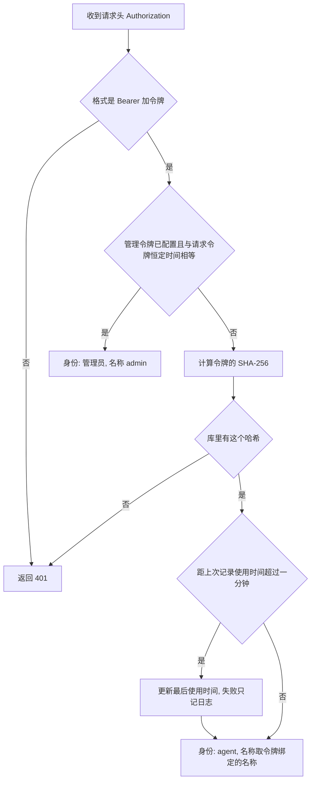
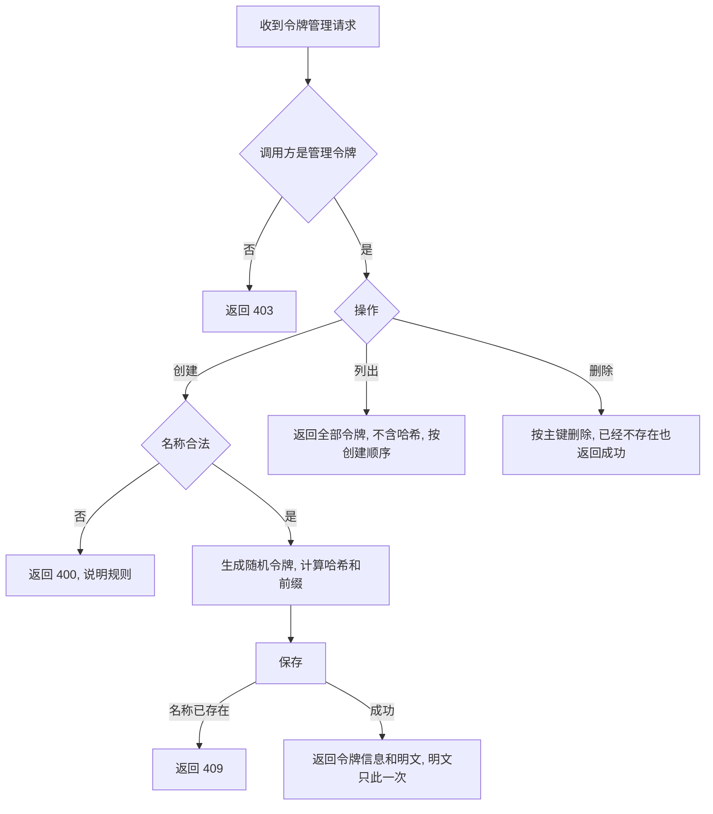

# 访问令牌与身份（access 包 token.go / core.go）

## 需求目标

网页上的人和各台电脑上的 agent 都要访问同一个看板服务。人用管理令牌登录网页；每个 agent 用自己的令牌，
令牌决定它在看板里叫什么名字：评论作者、事件操作者、领取者都用这个名字，服务端也按这个名字给它单独记读取进度。
所以令牌必须能区分每一个 agent，能被单独作废，数据库泄露时不能直接拿到可用的令牌。
本项目面向个人和小团队自托管，不做账号和密码，Bearer 令牌就够用。

| 编号 | 问题场景 | 不解决的后果 | 解决方案 | 状态 |
|------|----------|-------------|---------|------|
| 1 | 多个 agent 共用同一个令牌 | 事件里分不清是谁做的，读取进度互相覆盖，领取也无法区分持有者 | 每个 agent 一个令牌，令牌绑定名称，名称就是操作者名称，并且全局唯一 | 实施 |
| 2 | 某台电脑丢了，或令牌泄露 | 没办法单独停用，只能全部换掉 | 人可以在网页上删除某个 agent 的令牌，立即失效；管理令牌写在配置文件里，换掉重启即可 | 实施 |
| 3 | 数据库文件被拷走 | 里面存的令牌明文可以直接拿来用 | 库里只存令牌的 SHA-256 哈希和前缀；明文只在创建时返回一次，之后无法找回。令牌是 40 位随机串，不需要加盐的慢哈希 | 实施 |
| 4 | 逐字符试探令牌的时序攻击 | 慢慢猜出管理令牌 | 管理令牌用恒定时间比较；agent 令牌先哈希再按哈希查库，不比较明文 | 实施 |
| 5 | agent 起名叫 admin，或者名字里带控制字符、冒号 | 冒充人，或者破坏事件里的操作者字段，冒号还会和自动化规则的操作者混淆 | 名称只允许小写字母、数字、点、下划线、连字符，以字母或数字开头，1 到 64 个字符；admin 和 system 保留 | 实施 |
| 6 | 每次请求都更新最后使用时间 | 写放大，SQLite 只有一个连接，会拖慢真正的业务请求 | 距上次记录不足一分钟不再写；写失败只记日志，不影响请求 | 实施 |
| 7 | 管理令牌为空 | 空令牌恰好匹配空的请求头，等于不设防 | 启动时为空会自动生成并写回配置；认证时空令牌一律拒绝，不参与比较 | 实施 |
| 8 | agent 用自己的令牌去管理令牌 | agent 给自己再发令牌，或者删掉别人的 | 创建、列出、删除令牌只允许管理令牌，权限判断放在 Core 里，接口层不重复实现 | 实施 |
| 9 | 请求头格式五花八门 | 合法请求被拒，或者畸形请求被放行 | 只认 `Authorization: Bearer 令牌`，Bearer 不区分大小写，令牌前后的空白忽略，其他格式一律 401 | 实施 |

## 令牌

| 项 | 规则 |
|----|------|
| 格式 | `slate_` 加 40 位随机字母数字，一共 46 个字符；前缀便于在日志和泄露扫描里认出来 |
| 存储 | SHA-256 的十六进制串；另存令牌前 12 个字符作为展示用的前缀 |
| 名称 | 小写字母、数字、点、下划线、连字符，首字符是字母或数字，1 到 64 个字符，全局唯一，保留 admin 和 system |
| 最后使用时间 | 认证成功时记录，距上次记录不足一分钟不更新 |
| 管理令牌 | 配置文件 Auth.AdminToken，对应的身份是人，名称固定为 admin |

## 认证

## 创建、列出、删除令牌

说明：删除令牌后，持有它的 agent 下一次请求就会得到 401；它已经留在看板里的评论、事件、读取进度不受影响，
同名的新令牌可以接着用这份读取进度，所以换令牌不会让 agent 重新收到一遍历史事件。
agent 正持有的卡片租约也保持原样，到期后自然释放。

## 身份在各层之间的传递

| 层 | 做什么 |
|----|--------|
| access.Core | 认证请求头，返回 Principal（是否管理员加名称）；令牌管理的权限判断 |
| API 层的认证中间件 | 调用 Authenticate，把 Principal 换成 kanban.Actor（管理员对应人，其余对应 agent）放进请求上下文；失败返回 401 |
| kanban.Core | 只信任传进来的 Actor，按它判断权限 |

access 包不引用 kanban 包，两个领域之间只通过接口层的这一步转换衔接。

## 代码对照

| 步骤 | 函数或类型 | 文件 |
|------|-----------|------|
| 令牌模型 | Token | internal/core/access/token.model.go |
| 存储接口 | Storer, TokenStorer | internal/core/access/core.go |
| 认证 | Core.Authenticate, parseBearer, hashToken | internal/core/access/core.go |
| 创建、列出、删除 | Core.CreateToken, ListTokens, DeleteToken, checkName | internal/core/access/token.go |
| 错误定义 | ErrTokenNameTaken, ErrAdminOnly 等 | internal/core/access/errors.go |
| 数据库实现 | accessdb.Token | internal/core/access/stores/accessdb/token.db.go |
