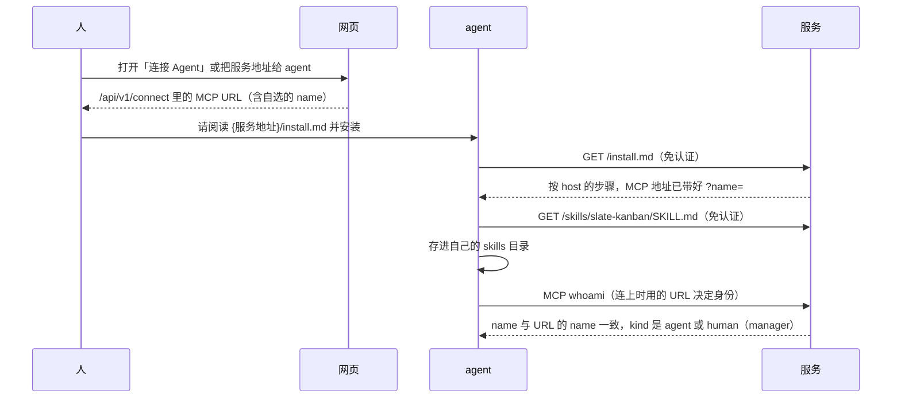
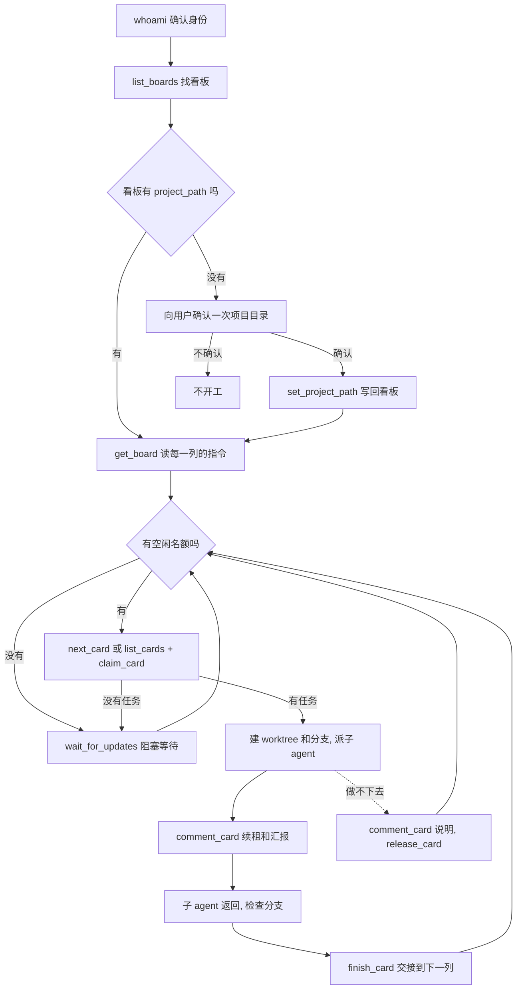

# Agent 接入：skill 与安装说明（skills、internal/web/api/connectapi、internal/web/mcpapi）

## 需求目标

agent 光有 MCP 工具还不够：它得知道怎么用——项目路径问不问、没活怎么等、来活了谁去做、在哪里改代码、做完交给谁。
这些流程写在一个 skill（`slate-kanban`）里；服务端负责让用户和 agent 都能一步装好 MCP 和这个 skill，并且 skill 永远和服务端是同一个版本。

| 编号 | 问题场景 | 不解决的后果 | 解决方案 | 状态 |
|------|----------|-------------|---------|------|
| 1 | agent 只有工具，不知道工作流程 | 领不该领的任务、直接在主分支上改、做完不交接 | 随服务发布 `slate-kanban` skill，写清：先确认看板和项目路径、守候、领取、worktree、子 agent、交接到审查、出错怎么办 | 实施 |
| 2 | 项目在本机的位置没人告诉 agent | agent 不知道去哪个目录建 worktree，或者每次都问用户 | 路径记在看板上（`project_path`），不在本地另存：看板上有就直接用，没有才问用户一次，再用 `set_project_path` 写回；agent 只能写还是空的，已有的只有人能改 | 实施 |
| 3 | 来活之后主 agent 自己干 | 上下文被代码细节占满，一次只能做一个，任务租约到期 | 主 agent 只做调度：领任务、派子 agent、续租、交接；每个任务一个子 agent、一个 worktree、一个分支；并发名额按名册算（研发和审查分开数，服务端把数字写进 `watch_prompt`），有几个空闲名额就一次领满、在同一次回复里同时派出，一个任务新开一个子 agent、不复用做过别的任务的。host 没有子 agent 能力时，主 agent 自己在 worktree 里做，一次一个 | 实施 |
| 4 | 不同 host 有的能长时间阻塞调用，有的不能 | 要么 agent 空转轮询，要么错过新活 | skill 给出选择：优先用 `wait_for_updates` 阻塞守候；工具调用超时短就缩短 `timeout_seconds`；host 不能保持会话就用它自己的定时功能周期性检查 | 实施 |
| 5 | 装 MCP 和 skill 要翻各 host 的文档 | 接入门槛高 | `/install.md`（免认证）写好 Claude Code、Cursor、Codex 的安装步骤，MCP URL 带 `?name=`（管理步骤带 `&role=manager`）；网页「连接 Agent」用免认证的 `/api/v1/connect` 取同一份结构化说明 | 实施 |
| 6 | skill 和服务端版本对不上 | skill 里提到的工具不存在或已改名，agent 去调用不存在的工具 | skill 内嵌在服务二进制里，由服务提供：`/skills/slate-kanban/SKILL.md` 和 MCP 资源 `slate://skills/slate-kanban`；测试保证 skill 提到的工具和错误名都真实存在，agent 视图的每个工具 skill 里都有 | 实施 |
| 7 | agent 连上 MCP 时还没装 skill | 不知道还有流程说明 | 连接时下发的 `instructions` 提示：没装就读取资源 `slate://skills/slate-kanban`，经用户同意后存成自己的 skill | 实施 |
| 8 | 免认证的地址被用来做文章 | 通过 Host 头注入内容，或被缓存污染 | 只返回静态内容和从请求里算出的服务地址；Host 和转发头严格校验，不合格返回 400；说明页不缓存；里面没有任何令牌 | 实施 |
| 9 | 多个 agent 同时连上来，不知道各自占哪个名额 | 同一个任务被重复领取，或同时做的任务超过人想要的并发 | 看板名册里每位工程师是一个名额：领取要带 `engineer_id`，服务端拒绝重复领取和忙碌的工程师；skill 把工程师的 `prompt` 当子 agent 角色设定的底稿 | 实施 |
| 10 | 装好后不知道怎么让 agent 长期挂着守候，只会复制一句安装提示词 | agent 做完就收工，没人再接新任务 | `/api/v1/connect` 增加 `watch_prompt`（长期守候，不收工、守候时不输出）、`loop_prompt`（单轮，配合 host 的 loop）、`watch_notes` 和每个 host 的 `watch` 片段（screen 开会话、恢复命令）；`/install.md` 第 4 节同源渲染；skill 第三节补长期运行纪律 | 实施 |

## 两条主线

### 安装



没有走安装页的 agent 也能自救：它连上 MCP 后，`instructions` 提示去读资源 `slate://skills/slate-kanban`，再经用户同意存成自己的 skill。

### 工作



## skill 的内容结构

`skills/slate-kanban/SKILL.md`，开头是 `name` 和 `description`（host 据此决定什么时候加载它），正文按顺序：

| 节 | 内容 | 对应需求 |
|----|------|---------|
| 先确认能用 | `whoami` 能返回 agent 身份才算装好；没装去读 `/install.md` | 5、6 |
| 找到看板和项目路径 | 按当前仓库匹配看板；路径为空问一次并写回；已有路径不再问；路径和当前目录不一致先问用户 | 2 |
| 守候和领取 | 阻塞循环；并发上限；单个用 `next_card`，多个用 `list_cards` 加 `claim_card`；按 host 能力选守候方式；重启后用 `claimed:` 找回自己持有的任务 | 3、4 |
| 派发 | 读全文和评论；建 worktree 和分支；子 agent 的约束和汇报要求；每 20 分钟评论续租；`finish_card` 交接；返工 | 3 |
| 做不下去 | 提问、释放、新任务记在非领取列、规划类字段不能改；服务端错误对照表 | 1 |
| 收尾 | 任务完成且分支已合并后清理 worktree 和分支 | 3 |

关键规则：各列允许 agent 做什么由列的 `instruction` 提示词约定；`next_card` 必须传入按提示词选择的 `column_id`，只从该列取任务；只有进行中派研发子 agent、只有审查派审查子 agent，任务完成只由审查决定，完成列 agent 不操作；不改人的规划类字段。
这些规则服务端本来就会强制（agent 做不到会得到对应的错误），skill 的作用是让 agent 一开始就不去尝试。

## 服务端提供的东西

| 路径 | 认证 | 内容 |
|------|------|------|
| `GET /install.md` | 无 | Markdown 安装说明：三种 host 的 MCP（带 `?name=`）与 skill 安装命令、验证方法 |
| `GET /skills/slate-kanban/SKILL.md` | 无 | skill 全文，文件和仓库里的 `skills/slate-kanban/SKILL.md` 是同一份（编译时内嵌） |
| `GET /api/v1/connect` | 无 | 同一份说明的 JSON 形式，网页「连接 Agent」用它渲染带复制按钮的代码块 |
| MCP 资源 `slate://skills/slate-kanban` | MCP 会话 | skill 全文，两个视图都有 |

免认证页面不返回敏感信息。MCP 身份在连接 URL 的查询参数里，不靠环境变量里的秘密。

### 服务地址怎么算

`/install.md` 和 `/api/v1/connect` 要把服务地址写进命令里。地址从请求里算，零配置，用户用什么地址打开页面，命令里就是什么地址：

| 部分 | 来源 | 校验 |
|------|------|------|
| 协议 | `X-Forwarded-Proto` 的第一个值，没有就看连接是否是 TLS | 只认 `http` 和 `https`，别的值忽略 |
| 主机 | `X-Forwarded-Host` 的第一个值，没有就用 `Host` | 只允许字母、数字、`-`、`.`、`_`，可以带 `:端口`，IPv6 用方括号；总长不超过 255；不合格返回 400 |

这些头都是调用者自己发的，响应只回给他自己，并且说明页带 `Cache-Control: no-store`，所以不会出现别人看到被污染内容的情况。
反向代理放在子路径下（例如 `/slate/`）的部署暂不支持，见"限制"。

### 结构化说明（`/api/v1/connect`）

```json
{
  "base_url": "https://kanban.example.com",
  "mcp_url": "https://kanban.example.com/mcp",
  "install_url": "https://kanban.example.com/install.md",
  "skill_url": "https://kanban.example.com/skills/slate-kanban/SKILL.md",
  "hosts": [
    {
      "id": "claude-code",
      "name": "Claude Code",
      "mcp":   [{"title": "添加 MCP 服务", "lang": "sh", "code": "claude mcp add ..."}],
      "skill": [{"title": "安装 skill",   "lang": "sh", "code": "mkdir -p ... && curl ..."}]
    }
  ]
}
```

### 三种 host 的安装方式

| host | MCP（工作视图） | MCP（管理视图，可选） | skill 目录 |
|------|----------------|----------------------|-----------|
| Claude Code | `claude mcp add ... slate '{地址}/mcp?name=你的agent名'` | 再加一条 `...&role=manager` 注册 `slate-manager` | `~/.claude/skills/slate-kanban/` |
| Cursor | `mcp.json` 里 `url` 指向 `{地址}/mcp?name=...`（无需 Authorization 头） | 另起一条 `role=manager` | `~/.cursor/skills/slate-kanban/` |
| Codex | `codex mcp add slate --url {地址}/mcp?name=...` | `--url ...&role=manager` | `~/.codex/skills/slate-kanban/` |

服务端 `bearerGate` 会在没有 Authorization 时自动补占位 `Bearer open`；客户端不必配置真实 Bearer。
不同 agent 实例应使用不同的 `name`，便于在看板事件和评论里区分来源。

## 资源和 instructions

- 资源 `slate://skills/slate-kanban`：固定地址的资源，`text/markdown`，内容是 skill 全文。两个视图都注册，因为人也可能想把它装给别的 agent。
- agent 的 `instructions` 最后一段改成：完整流程在 `slate-kanban` skill 里，装了就先读；没装就读取资源 `slate://skills/slate-kanban`，经用户同意后存成 skills 目录里的 `slate-kanban/SKILL.md`。
  `instructions` 总长仍然不超过 1500 字（已有测试限制）。

## 防止 skill 和服务端脱节

skill 是写给模型的文字，没有编译器帮忙，所以用测试守住几条：

1. frontmatter 里 `name` 是 `slate-kanban`，`description` 非空。
2. agent 视图的每个工具，skill 里都出现过（新增工具没写进 skill 会失败）。
3. skill 里出现的、长得像工具名的词，必须是 agent 视图里真实存在的工具（拼错、改名或提到管理视图的工具会失败）。
4. skill 里出现的 `ErrXxx` 错误名，必须在测试里登记的真实错误里（改名会让测试编译失败，提醒同步 skill）。
5. `/skills/slate-kanban/SKILL.md`、MCP 资源、编译进二进制的内容三者完全一致。
6. 安装说明里的 JSON 片段必须是合法 JSON，每个 host 都有 MCP 和 skill 两组步骤，命令里的地址和请求一致，MCP URL 含 `?name=` 且不含 Bearer 秘密。

## 验证记录

| 验证 | 做了什么 | 结果 |
|------|---------|------|
| 单元和路由测试 | skill 一致性（`skill_test.go`）；connectapi 地址与 Markdown；`/connect` 免认证、命令无秘密（`connect_test.go`、`guide_test.go`） | 通过 |
| 变异验证 | 在 skill、资源、说明、地址校验、渲染和路由上共造 35 处变异（一次性脚本，用完已清理） | 全部被测试发现；其中"代码围栏没有闭合"一处最初漏网：原来只数围栏个数，同时少了偶数个关闭围栏时发现不了，改成检查严格一开一关交替 |
| 真实进程：页面 | curl 检查免认证页面头、`/api/v1/connect` 免认证 JSON、非法 Host 400 | skill 与仓库一致 |
| 真实进程：host 命令 | 临时 HOME 执行安装命令 | MCP URL 带 `?name=`，无 SLATE_TOKEN；三种 host skill 安装可执行 |
| 真实进程：流程 | 一次性的冒烟测试（用完已清理）用脚本照着 skill 走完整流程：确认并写入项目路径、守候、用 `list_cards` 加 `claim_card` 领两个、按 skill 的命令建 worktree 和分支、子 agent 提交、交接到审查、人返工后再交接、释放做不下去的任务、人合并后清理；并触发错误对照表里的每个错误 | 通过：skill 里的 git 命令、查询写法和每个错误名，都和服务端真实行为一致 |
| 真实 host：Claude Code 2.1.286 | 临时 HOME 里照 `/install.md` 的命令装用户级 MCP 和 skill，中间放一个记录请求的代理，再用 `claude -p` 开真实会话 | 通过：会话里看得到用户级 MCP 和 skill，`Skill` 工具能加载；`whoami`、`list_boards`、`get_board`、`next_card`、`finish_card` 走通，任务进审查；`wait_for_updates` 阻塞和被事件唤醒都正常；带口令的 `--header` 写法有效 |
| 真实 host：Codex 0.168.0 | 同上，用 `codex mcp add` 和 `codex exec` | 通过：skill 从 `~/.codex/skills` 被发现；`whoami`、读取 skill 资源、`list_cards`、`claim_card`、`finish_card` 走通，任务进审查；`--bearer-token-env-var` 带口令有效（每个请求都带了头）；`wait_for_updates` 等满 50 秒正常返回，没有触发 Codex 默认的 60 秒工具超时 |
| 真实 host：Cursor 命令行客户端（Cursor 3.30.14 自带，版本 2026.11.13） | 隔离的 HOME 里放 `~/.cursor/mcp.json`（四个临时服务）和一份项目级 `.cursor/mcp.json`，中间放记录请求的代理，运行 `agent mcp list`、`agent mcp list-tools slate`、`agent mcp enable` | 通过，但只到 MCP 连接这一层：`~/.cursor/mcp.json` 里的服务直接显示 `ready`；`list-tools` 看到工作视图的 16 个工具；带口令的 `Authorization` 头有效，`${env:SLATE_PASSCODE}` 写法也有效；漏带口令显示 `Error: Connection failed`；项目级 `.cursor/mcp.json` 先显示 `not loaded (needs approval)`，`agent mcp enable` 之后才连上。每个连接只调用 `initialize`、`tools/list`、`resources/list` |
| 没有验证的 | Cursor：命令行没有登录（`agent status` 显示 Not logged in），所以没有带大模型的会话：`~/.cursor/skills` 能不能被发现、模型会不会照着 skill 做、工具超时多久都没验证；图形界面里改 `mcp.json` 是否要重启、怎么启用，只对照了官方文档（在 IDE 里临时放过一份项目级 `mcp.json`，约 55 秒内没有出现连接）。大模型会不会真的照着 skill 做，也只在 Claude Code 和 Codex 上看过 | 见"限制" |

## 真实 host 里发现的差异

| 差异 | 现象 | 处理 |
|------|------|------|
| 授权发现探测 | Claude Code 和 Codex 在收到 401 或执行 `mcp list` 时、Cursor 命令行在收到 401 时，会请求 `/.well-known/oauth-*`、`/.well-known/openid-configuration` 和 `/mcp/.well-known/*`。旧版本这些地址被网页回退成 `200 text/html`，Claude Code 因此报 `SyntaxError dialing …` | 这些地址改成 404（`internal/web/spa/reserved.go`，有测试） |
| 漏带口令 | Claude Code 显示 `✘ Failed to connect`，后面的文字不固定（修复探测之后是 `HTTP 405 dialing …`：它接着去 `POST /register` 做动态注册，被网页的「方法不允许」挡回）；Cursor 命令行显示 `Error: Connection failed`，同样先探测 `/.well-known/*` 再 `POST /register`；Codex 不报错，只是 slate 的工具不出现，日志里有 `AuthRequired` | 写进 `/install.md` 的常见问题；不为迎合某个 host 的 OAuth 流程去改服务端 |
| 资源订阅 | 三个 host 都没有调用 `resources/subscribe`；Claude Code 连 `resources/read` 也没调，Codex 读过一次 skill 资源，Cursor 命令行只在连接时调一次 `resources/list` | skill 本来就把通知当提示、以 `wait_for_updates` 为主，不改 |
| 工具超时 | Codex 默认 60 秒；`timeout_seconds` 为 50 的 `wait_for_updates` 在 Claude Code 和 Codex 里都正常返回 | skill 写明 50 是上限，不要超过 |
| 批准方式 | Cursor 命令行里，`~/.cursor/mcp.json` 的服务直接可用；项目级 `.cursor/mcp.json` 要先批准（`agent mcp enable <名字>`）。文档里写的“每个连接都要用户批准”在命令行里只适用于后者；图形界面没有验证 | 写进 `/install.md` 的验证步骤 |
| 提示文字 | `claude mcp add` 成功时打印的地址省略了 `?name=…`（配置里是完整的）；`codex mcp list` 不连服务，Auth 一栏显示 `Unsupported` 是正常的 | 写进 `/install.md` 的验证步骤和常见问题 |
| 工具列表大小 | Codex 里 `tools/list` 的响应：工作视图约 14.9 kB，管理视图约 24.9 kB | 只记录；日常用工作视图已经够小 |

## 限制与没做的事

- 只覆盖 Claude Code、Cursor、Codex 三种 host，其他 host（以及它们的配置格式）不在内；Claude Code 和 Codex 已在真实会话里走通，Cursor 只验证到 MCP 连接这一层（命令行客户端），带大模型的会话和 skill 目录没有验证；host 改版后以其官方文档为准。
- 反向代理放在子路径下的部署暂不支持：地址里没有路径前缀。
- skill 只有中文一份：它是写给 agent 读的操作手册，不是界面文案。网页界面的五种语言是另一件事。
- skill 不会自动更新：服务升级后，用户重新执行安装说明里的下载命令即可。
- 并发上限、20 分钟续租、worktree 的命名是 skill 里的建议，不是服务端的强制规则；服务端强制的只有权限、租约和列的约束。
- 没有 MCP Prompts：host 对它的支持参差不齐，流程说明放在 skill 和 `instructions` 里。
- 说明页只支持 GET，不处理 HEAD 请求（用 `curl -I` 探测会得到 404，用 `curl` 直接取即可）。

## 代码对照

| 步骤 | 函数 | 文件 |
|------|------|------|
| skill 全文（编译时内嵌） | SlateKanban | skills/embed.go、skills/slate-kanban/SKILL.md |
| 生成结构化说明 | buildGuide | internal/web/api/connectapi/guide.go |
| 渲染 Markdown 安装说明 | renderMarkdown | internal/web/api/connectapi/markdown.go |
| 从请求算服务地址并校验 | baseURL | internal/web/api/connectapi/base.go |
| 路由与处理函数 | Register、RegisterPublic | internal/web/api/connectapi/api.go |
| MCP 资源 | registerResources、readSkill | internal/web/mcpapi/resource.go |
| 连接时的提示 | agentInstructions | internal/web/mcpapi/instructions.go |
| 装配 | connectapi.New、setupRouter | internal/web/api/provider.go、internal/web/api/api.go |
