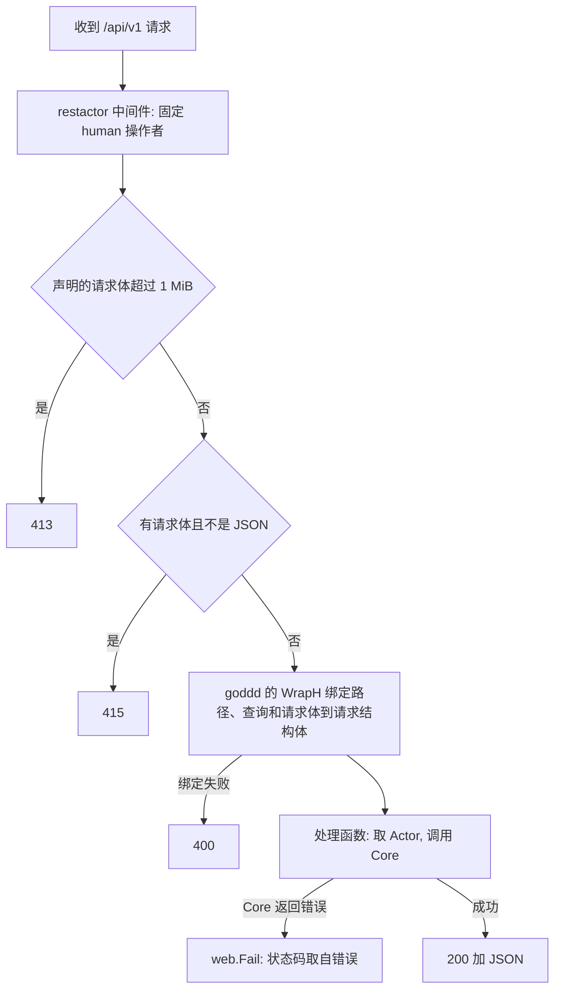
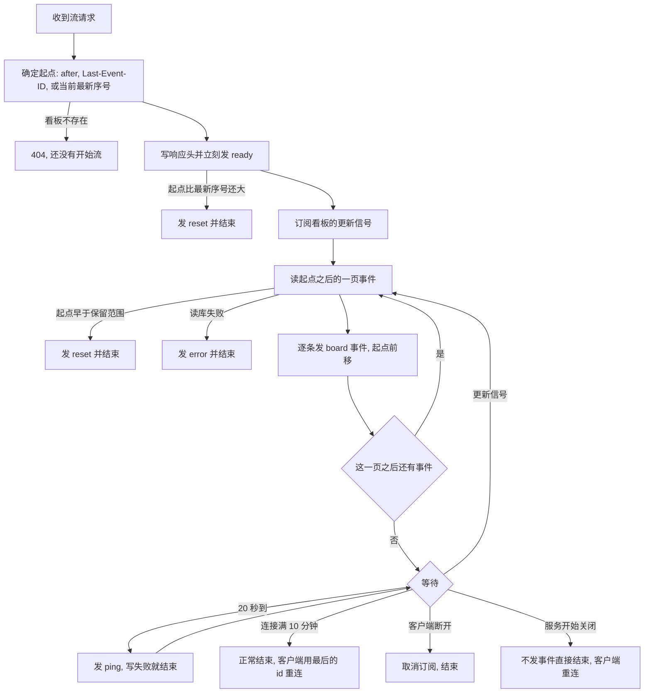

# REST 接口与实时流（internal/web/api）

## 需求目标

网页、各种脚本、不支持 MCP 的 agent 都要通过 HTTP 读写同一个看板；网页还要在别人改了看板时马上看到变化。
REST 层是看板领域（kanban）对外的第一个适配器，后面的 MCP 是第二个；默认免登录，操作者固定为人（`human`）。可选的访问口令只负责「进门」，不是账号体系，见 `security.passcode.go.md`。
两个适配器必须表现一致，所以 REST 层只做四件事：解析请求、取出调用者身份、调用 Core、返回结果。
权限判断、字段校验、业务规则一律留在 Core 里，REST 层不写任何业务判断。

| 编号 | 问题场景 | 不解决的后果 | 解决方案 | 状态 |
|------|----------|-------------|---------|------|
| 1 | 网页、MCP、脚本各写一套业务判断 | 同一个操作在不同入口结果不同，权限漏洞藏在某个入口里 | 处理函数只做"解析、取身份、调 Core、返回"，权限和校验全在 Core；两个入口共用同一套 Core | 实施 |
| 2 | 路径里的卡片编号被请求体或查询参数里的同名字段覆盖 | URL 指向卡片 1，实际改的是卡片 7，审计和权限都错位 | 路径参数字段统一标 `uri:"x" json:"-" form:"-"`，只能从 URL 取值；有测试专门验证覆盖不了 | 实施 |
| 3 | 用 EventSource 连实时流 | EventSource 不能自定义请求头，启用口令后带不了 Bearer | 网页用原生 EventSource；默认免登录、REST 固定人身份；启用口令后网页靠同源的会话 cookie 通过，EventSource 会自动带上它，不需要自定义请求头 | 实施 |
| 5 | 超大的请求体 | 一次请求吃光内存 | `/api/v1` 下请求体上限 1 MiB，声明的长度超过就直接返回 413；没声明长度的用读取上限兜底；唯一的例外是图片上传路由，它收 multipart 表单、上限 6 MiB（图片 5 MiB 加表单余量），跨站写请求由 Origin 检查拦住 | 实施 |
| 6 | curl 或脚本忘了写 Content-Type，请求体被当成表单悄悄忽略 | 创建出空卡片，或者收到莫名其妙的校验错误，排查很久 | 有请求体但不是 JSON，一律返回 415，说明要用 application/json | 实施 |
| 7 | 网页断线重连 | 断线期间别人做的修改看不到 | 流支持从某个事件序号续传：网页先取快照拿到 seq，再用 `after=seq` 连流；服务端先订阅再读库，读库和等待之间的新事件不会漏 | 实施 |
| 8 | 续传的起点比保留的最早事件还早 | 中间的事件已经被清理，补不齐，网页的数据会悄悄不一致 | 流发一条 reset 事件然后结束，网页收到后重新取快照再连 | 实施 |
| 9 | 流连接永远不断 | 半开的连接一直占着资源 | 每 20 秒发一次心跳，写失败就知道对方走了；单次连接最长 10 分钟，到点服务端主动结束，客户端带着最后的序号重连 | 实施 |
| 10 | 某个客户端读得很慢 | 拖慢服务或者堆积内存 | 每个连接一个协程顺序写，不做缓冲；慢只影响它自己 | 实施 |
| 11 | 看板被删时还有流连着 | 客户端一直没有反应 | 删除会唤醒等待者；流醒来重新读库得到"看板不存在"，发一条 error 事件然后结束 | 实施 |
| 12 | agent 用 REST 阻塞等待，被反向代理的 60 秒超时切断 | agent 反复断线重连 | 等待默认 30 秒、最长 50 秒（Core 已限制），超时返回空结果而不是错误 | 实施 |
| 13 | 各接口的错误格式不一样 | 客户端要写很多分支才能提示用户 | 统一用 goddd 的 `web.Fail`：`{reason, msg, trace_id}`，状态码取自 Core 返回的错误；Core 的错误必须原样返回，不能再包一层 | 实施 |
| 14 | 网页和接口不同源 | 要开跨域，扩大攻击面 | 网页由同一个服务提供，不开跨域；开发时用 Vite 的代理转发 `/api` | 实施 |
| 15 | 关闭服务时，挂着的实时流和阻塞等待让 Shutdown 一直等到超时 | 每次重启都卡 5 秒还留下一条错误日志；开着网页的人按 Ctrl-C 也会这样 | 关闭前先取消"关闭中"信号，长连接用 `lifecycle.Bind` 得到的上下文，收到信号后自己结束：实时流直接结束（客户端带最后的 id 重连），阻塞等待返回 503；普通请求不受影响。实测挂着一条流和一条等待时，退出耗时从 5.07 秒降到 0.11 秒 | 实施 |
| 16 | 导出整板撑爆内存或拖垮数据库 | 个人看板规模以外的滥用 | 导出一次性读出全部卡片和评论，不分页；适合个人/小团队规模，与快照同级 | 实施 |

## 路由

基础路径 `/api/v1`，请求和响应都是 JSON，字段名用下划线。成功时直接返回资源本身（goddd 的约定，状态码固定 200，创建也是 200），
失败时返回 `{reason, msg, trace_id}` 和对应状态码。除了 `/health`（框架自带，不在 `/api/v1` 下，免认证），
默认全部免认证：REST 中间件固定操作者为 `human`；全局 `securityMiddleware` 做 Host/Origin/安全头。已删除 `/me`、`/agent-tokens` 与令牌认证。
配置了访问口令后，`/api/`（`/api/v1/auth/*` 除外）、`/mcp`、`/app/` 都要先通过口令：`Authorization: Bearer <口令>` 或网页登录后的会话 cookie，未通过返回 401。

"谁能调用"一列只是说明，真正的判断在 Core 里。

| 方法和路径 | Core 方法 | 谁能调用 | 请求 | 返回 |
|-----------|-----------|----------|------|------|
| GET /version | 框架自带 | 全部 | — | `{version, remark}` |
| GET /auth/status | 见 `security.passcode.go.md` | 全部（本身不要求口令） | — | `{required, authenticated}` |
| POST /auth/login | 同上 | 全部（本身不要求口令） | `{passcode}` | `{authenticated}`，成功时写会话 cookie；口令不对 401，猜得太频繁 429 |
| POST /auth/logout | 同上 | 全部（本身不要求口令） | — | `{}`，并清掉会话 cookie |
| GET /boards | ListBoards | 全部 | — | 看板数组 |
| POST /boards | CreateBoard | 人 | CreateBoardInput | BoardDetail |
| GET /boards/:board_id | GetBoard | 全部 | — | BoardDetail（含列和规则） |
| PATCH /boards/:board_id | UpdateBoard | 人；agent 只能在项目路径为空时写项目路径 | UpdateBoardInput | Board |
| DELETE /boards/:board_id | DeleteBoard | 人 | — | `{}` |
| GET /boards/:board_id/snapshot | BoardSnapshot | 全部 | — | Snapshot（看板、列、规则、全部卡片、seq） |
| GET /boards/:board_id/export | ExportBoard | 全部 | 查询 format=json\|md，默认 json | JSON 信封或 Markdown 附件（见 kanban.board.go.md） |
| GET /boards/:board_id/events | ListEvents | 全部 | 查询 after、limit | EventPage |
| GET /boards/:board_id/activity | ListActivity | 全部 | 查询 before、limit、types（逗号分隔的事件类型）、actor_kind、actor、card_id（只看某张卡片的事件） | ActivityPage：events 从新到旧，has_more，latest，actors（见 kanban.event.go.md「读取路径：活动流」） |
| GET /boards/:board_id/stream | 见"实时流" | 全部 | 查询 after 或头 Last-Event-ID | text/event-stream |
| POST /boards/:board_id/updates/pull | PullUpdates | agent | PullInput | Updates |
| POST /boards/:board_id/updates/wait | WaitUpdates | agent | PullInput 加 timeout_seconds | Updates |
| POST /boards/:board_id/columns | CreateColumn | 人 | CreateColumnInput | Column |
| PUT /boards/:board_id/columns/order | ReorderColumns | 人 | `{ids: [...]}` | 列数组 |
| PATCH /boards/:board_id/columns/:column_id | UpdateColumn | 人 | UpdateColumnInput | Column |
| DELETE /boards/:board_id/columns/:column_id | DeleteColumn | 人 | 查询 move_to（卡片要搬去的列） | `{}` |
| GET /boards/:board_id/cards | ListCards | 全部 | 查询 query、limit | CardList |
| POST /boards/:board_id/cards | CreateCard | 人和 agent（agent 不能填规划类字段） | CreateCardInput | Card |
| POST /boards/:board_id/cards/next | NextCard | agent | NextCardInput | `{card: CardDetail 或 null}`，没有可领的卡片时是 null |
| POST /boards/:board_id/rules | CreateRule | 人 | CreateRuleInput | Rule |
| PATCH /rules/:rule_id | UpdateRule | 人 | UpdateRuleInput | Rule |
| DELETE /rules/:rule_id | DeleteRule | 人 | — | `{}` |
| GET /cards/:card_id | GetCardDetail | 全部 | — | CardDetail |
| PATCH /cards/:card_id | UpdateCard | 人；agent 只能改自己持有的卡片 | UpdateCardInput | Card |
| DELETE /cards/:card_id | DeleteCard | 人 | — | `{}` |
| POST /cards/:card_id/move | MoveCard | 人；agent 只能移自己持有的卡片 | MoveCardInput | Card |
| POST /cards/:card_id/claim | ClaimCard | agent | ClaimCardInput | CardDetail |
| POST /cards/:card_id/release | ReleaseCard | agent 释放自己的；人可以收回任何一张 | — | `{}` |
| POST /cards/:card_id/finish | FinishCard | 人；agent 只能完成自己持有的卡片 | FinishCardInput | CardDetail |
| POST /cards/:card_id/comments | AddComment | 人和 agent | `{body}` | Comment |
| DELETE /comments/:comment_id | DeleteComment | 人 | — | `{}` |
| POST /boards/:board_id/attachments | SaveAttachment | 人和 agent | multipart 表单，字段 `file`（图片） | `{token, url, content_type, size}`；见「图片附件」 |
| GET /attachments/:token | GetAttachment | 全部 | — | 图片字节（不是 JSON） |
没有对应路由的 Core 方法：`ListRules`（看板详情里已经带了规则）、`GetCard`（卡片详情接口已经覆盖）、
`Observe`（留给 MCP 做更新通知）、`Subscribe` 和 `LatestSeq`（实时流内部使用）。

## 一次请求怎么走

全局 `securityMiddleware` 在路由组外校验 Host/Origin；`/api/v1` 不再做令牌认证。

## 请求怎么绑定

goddd 的 `web.WrapH` 先把路径参数按 `uri` 标签填进请求结构体，再按方法处理其余部分：
GET 和不带请求体的 DELETE 读查询参数（`form` 标签），POST、PUT、PATCH 读 JSON 请求体，没有请求体就不绑定。

- 请求结构体把路径参数和 Core 的入参类型内嵌在一起，例如修改卡片：`{CardID int64; kanban.UpdateCardInput}`。
  Core 的入参类型只有 `json` 标签，所以 GET 和 DELETE 的查询参数要单独写带 `form` 标签的结构体，再转成 Core 的入参。
- 路径字段统一写成 `uri:"card_id" json:"-" form:"-"`。如果不加 `json:"-"`，请求体里的 `{"id": 7}` 会覆盖路径里的编号；
  不加 `form:"-"`，查询参数 `?CardID=7` 同样能覆盖。
- 修改类接口都是 PATCH，只更新请求里出现的字段：Core 入参用的是指针字段，没有出现的字段是 nil，表示不改。
- 校验不写在 REST 层：长度、格式、权限都由 Core 返回 400 或 403。REST 层只负责"格式能不能解析"。

## 身份

REST 的 `restactor.Middleware` 把固定操作者 `human`（名称 `human`）写进请求上下文，全部看板接口都当作人在用网页操作。
agent 通过 MCP 接入，身份由 `GET/POST /mcp?name=...&role=worker|manager` 决定，见 mcp.server.go.md。

处理函数一律用 `c.Request.Context()` 传给 Core：客户端断开时，阻塞等待和流会跟着取消。

## 导出

`GET /boards/:board_id/export?format=json|md`，默认 `json`。Core 的 `ExportBoard` 一次读出看板、列、规则、全部卡片（含 `CardView` 派生字段）和每张卡的评论，以及导出前的最新事件序号 `seq`；评论用 `ListByBoard` 批量加载，避免 N+1。权限与 `BoardSnapshot` 相同，看板不存在返回 404；`format` 不是 `json` 或 `md` 返回 400（`ErrInvalidInput`）。

| 格式 | Content-Type | 正文 |
|------|--------------|------|
| json | `application/json; charset=utf-8` | 信封：`format: slate-board-export`、`version: 1`、`exported_at`（RFC3339）、`seq`、`board`、`columns`、`rules`、`cards[]`（每项带 `comments`） |
| md | `text/markdown; charset=utf-8` | 在 `kanbanapi` 用 `renderBoardMarkdown` 渲染，按列分组、列内顺序与看板一致 |

两种格式都带 `Content-Disposition: attachment; filename="<slug 小写>-YYYYMMDD.json|md"`；文件名只保留 slug 的合法字符，防止响应头注入。整板不分页，规模按个人看板设计。

## 图片附件

粘贴进 Markdown 的图片存在数据库表 `attachments`（`Data` 字段是图片字节），不依赖文件目录，随数据库一起备份。

- 上传 `POST /boards/:board_id/attachments`：表单字段 `file`。`guard.go` 对这条路由放开「只收 JSON」和 1 MiB 上限（`uploadRoute`、`uploadBodyLimit`），请求体限制在 5 MB + 1 MB 后才解析。类型由 `http.DetectContentType` 按内容判断，只收 PNG、JPEG、GIF、WebP；**不收 SVG**（SVG 能带脚本）。超过 5 MB 返回 413 `ErrAttachmentTooLarge`，类型不对或字段缺失返回 400 `ErrInvalidInput`，看板不存在 404。
- 读取 `GET /attachments/:token`：`token` 是随机的 32 位小写十六进制，格式不对直接 404。响应头带 `X-Content-Type-Options: nosniff`、`Content-Security-Policy: default-src 'none'; sandbox`、`Content-Disposition: inline`，内容不变所以 `Cache-Control: private, max-age=31536000, immutable`。
- Markdown 里写 ``，网页只渲染这种本服务的附件图片，外部图片地址当文字显示，不会去加载。
- 删除看板时图片一起删除；删除卡片不删（图片可能被别处引用）。整板导出的 JSON/Markdown 只保留图片地址，不内嵌图片字节。
- 没有访问口令时和其他接口一样免登录；设了口令后图片地址也要带会话 cookie（`` 同源请求会自动带上）。

## 实时流

`GET /boards/:board_id/stream`，响应是 `text/event-stream`。续传位置的优先级：查询参数 `after` → 请求头 `Last-Event-ID` → 不指定（从当前最新开始）。

| 事件名 | 什么时候发 | data | 客户端怎么处理 |
|--------|-----------|------|----------------|
| ready | 连上后的第一条 | `{"latest": 当前最新序号}` | 标记已连接 |
| board | 每一条新事件 | 事件的 JSON，id 行是事件序号 | 刷新相关数据，记下 id |
| reset | 续传起点比保留的最早事件还早（中间的被清理了），或者比服务端最新序号还大（服务端数据回退过，比如从备份恢复） | `{"latest": 序号}`，发完就结束 | 丢掉本地数据，重新取快照，再用快照的 seq 连流 |
| error | 流开始之后读库失败，比如看板被删了 | `{reason, msg}`，发完就结束 | 停止重连，提示用户 |
| 注释行 `: ping` | 每 20 秒一次 | 无 | 忽略，只是为了保活和发现断线 |

要点：

- 先订阅信号再读库。读库和等待之间提交的事件，信号会留在订阅里，醒来后再读一次就能拿到。
- 起点的确定要在写响应头之前完成，这样看板不存在时还能返回正常的 404，而不是一条已经开始的流。
- 流里的事件是完整未过滤的（人和 agent 看到的一样）；agent 自己用 pull 和 wait，它们才有游标和过滤。
- 不用框架自带的 `web.SSE`：它没有心跳注释行，生产者和连接是两个协程，连接断了以后生产者可能卡在写满的通道上泄漏；
  写超时也只在开头设一次。这里一个协程顺序读写，逻辑更简单。
- 每次写之后立即 Flush：gin 的响应写入器自带 Flush，调试模式下日志中间件包的那一层也会透传，有测试覆盖。响应头里加 `X-Accel-Buffering: no`，防止 nginx 缓冲。
- 服务开始关闭时流直接结束，不发 error，因为这不是错误；客户端带着最后收到的 id 重连，新进程起来后就接得上。

## 关闭服务时的长连接

实时流和阻塞等待可以挂很久。`http.Server.Shutdown` 要等所有请求结束，如果不通知它们，每次关闭都要等满 5 秒的超时，还会留下一条 `context deadline exceeded` 错误日志。

做法放在 `internal/lifecycle`：

| 步骤 | 谁做 | 做什么 |
|------|------|--------|
| 1 | `app.Run` | 创建 closing 上下文，用 `lifecycle.Wrap` 给整个处理器包一层，每个请求的上下文里都带上它 |
| 2 | 长连接的处理函数 | 用 `lifecycle.Bind(请求上下文)` 得到一个"请求结束或服务关闭都会取消"的上下文，用它做等待 |
| 3 | `app.Run` | 收到退出信号后先取消 closing，再调用 `Shutdown`；长连接马上结束，普通请求照常处理完 |
| 4 | 阻塞等待的处理函数 | 等待被取消但请求本身还好好的（`lifecycle.Interrupted`），说明是服务在关闭，返回 `lifecycle.ErrShuttingDown`（503），客户端稍后重试 |

不直接取消所有请求的上下文：那样会把正在写库的普通请求也打断。MCP 的阻塞等待以后用同样的三个函数。

## 接线

| 位置 | 做什么 |
|------|--------|
| internal/web/api/provider.go | `NewKanbanCore` 建表并创建 `kanban.Core`；`NewMCP` 创建 MCP 适配器；`ProviderSet` 装配 `kanbanapi`、`connectapi`、版本接口；`NewHTTPHandler` 挂全局安全中间件和 SPA |
| internal/web/api/api.go | `setupRouter`：全局 `securityMiddleware`、健康检查与指标（免认证）；`/mcp` 交给 MCP 处理器；`/api/v1` 固定 `restactor.Middleware`、请求体上限、`requireJSON`，再挂看板接口、`/connect`、版本 |
| internal/app/app.go | `lifecycle.Wrap` 包处理器；退出时先取消 closing 再 `Shutdown` |
| 依赖注入 | `make wire` 生成 `internal/app/wire_gen.go`，不手改 |

## 代码对照

| 步骤 | 函数或类型 | 文件 |
|------|-----------|------|
| Host/Origin、安全头 | securityMiddleware, checkHost, checkOrigin, canonicalHostPort | internal/web/api/security.go |
| 请求体上限、JSON 检查 | limitBody, requireJSON | internal/web/api/guard.go |
| REST 固定人身份 | restactor.Middleware, restactor.From | internal/web/restactor/actor.go |
| 看板、列、规则 | boardRoutes 等 | internal/web/api/kanbanapi/board.go, column.go, rule.go |
| 卡片、评论 | cardRoutes | internal/web/api/kanbanapi/card.go |
| 领取、完成 | claimRoutes | internal/web/api/kanbanapi/claim.go |
| 快照、事件、拉取、等待 | snapshot、listEvents、pullUpdates、waitUpdates | internal/web/api/kanbanapi/event.go |
| 导出 | export, exportAttachmentName, renderBoardMarkdown | internal/web/api/kanbanapi/export.go, export_md.go |
| 实时流 | stream 及 streamSession | internal/web/api/kanbanapi/stream.go |
| 路由注册 | Register, route | internal/web/api/kanbanapi/api.go |
| 整板导出（Core） | ExportBoard, ListByBoard | internal/core/kanban/export.go, comment.go |
| 关闭时长连接 | Wrap, Bind, Interrupted, ErrShuttingDown | internal/lifecycle/lifecycle.go |
| 装配 | NewKanbanCore, NewMCP, NewHTTPHandler, setupRouter | internal/web/api/provider.go, api.go |
| 退出 | Run | internal/app/app.go |
| 路由与安全测试 | TestHealthIsOpen, TestAPINoAuthHuman, TestGuardsMounted, TestStreamThroughRouter, TestSecurityHostAndOrigin, TestConnectNoTokenString | internal/web/api/router_test.go |
| 导出 API 测试 | TestBoardExportJSON, TestBoardExportMarkdown, TestRenderBoardMarkdownGolden | internal/web/api/kanbanapi/board_export_test.go, export_md_test.go |
| Core 导出测试 | TestExportBoardComplete 等 | internal/core/kanban/board_export_test.go |
