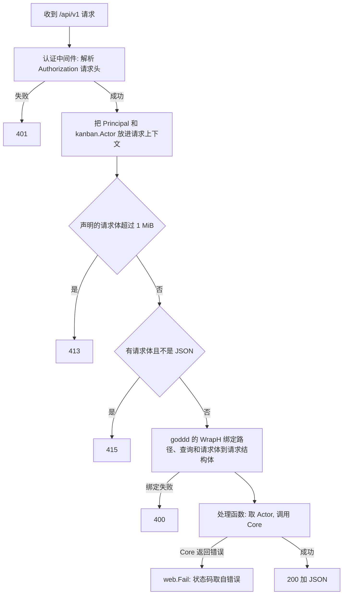
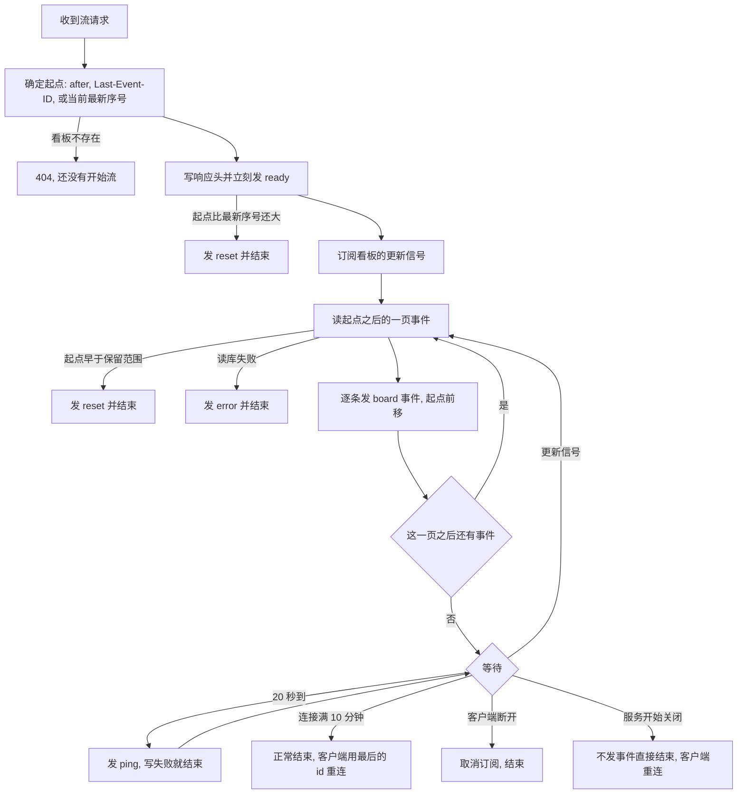

# REST 接口与实时流（internal/web/api）

## 需求目标

网页、各种脚本、不支持 MCP 的 agent 都要通过 HTTP 读写同一个看板；网页还要在别人改了看板时马上看到变化。
REST 层是看板领域（kanban）对外的第一个适配器，后面的 MCP 是第二个；v1 免登录，操作者固定为人（`human`）。
两个适配器必须表现一致，所以 REST 层只做四件事：解析请求、取出调用者身份、调用 Core、返回结果。
权限判断、字段校验、业务规则一律留在 Core 里，REST 层不写任何业务判断。

| 编号 | 问题场景 | 不解决的后果 | 解决方案 | 状态 |
|------|----------|-------------|---------|------|
| 1 | 网页、MCP、脚本各写一套业务判断 | 同一个操作在不同入口结果不同，权限漏洞藏在某个入口里 | 处理函数只做"解析、取身份、调 Core、返回"，权限和校验全在 Core；两个入口共用同一套 Core | 实施 |
| 2 | 路径里的卡片编号被请求体或查询参数里的同名字段覆盖 | URL 指向卡片 1，实际改的是卡片 7，审计和权限都错位 | 路径参数字段统一标 `uri:"x" json:"-" form:"-"`，只能从 URL 取值；有测试专门验证覆盖不了 | 实施 |
| 3 | 用 EventSource 连实时流，令牌只能放进 URL | 令牌出现在访问日志、浏览器历史、代理日志里 | 实时流和其他接口一样只认 Authorization 请求头；网页用 fetch 读流，不使用 EventSource，不支持 URL 里带令牌 | 实施 |
| 4 | 调试日志会记录响应体，创建令牌的响应里有令牌明文 | 明文令牌写进日志文件，等于泄露 | 令牌管理路径不记录请求体和响应体 | 实施 |
| 5 | 超大的请求体 | 一次请求吃光内存 | `/api/v1` 下请求体上限 1 MiB，声明的长度超过就直接返回 413；没声明长度的用读取上限兜底 | 实施 |
| 6 | curl 或脚本忘了写 Content-Type，请求体被当成表单悄悄忽略 | 创建出空卡片，或者收到莫名其妙的校验错误，排查很久 | 有请求体但不是 JSON，一律返回 415，说明要用 application/json | 实施 |
| 7 | 网页断线重连 | 断线期间别人做的修改看不到 | 流支持从某个事件序号续传：网页先取快照拿到 seq，再用 `after=seq` 连流；服务端先订阅再读库，读库和等待之间的新事件不会漏 | 实施 |
| 8 | 续传的起点比保留的最早事件还早 | 中间的事件已经被清理，补不齐，网页的数据会悄悄不一致 | 流发一条 reset 事件然后结束，网页收到后重新取快照再连 | 实施 |
| 9 | 流连接永远不断 | 令牌被删除后还能一直读；半开的连接一直占着资源 | 每 20 秒发一次心跳，写失败就知道对方走了；单次连接最长 10 分钟，到点服务端主动结束，客户端带着最后的序号重连，顺便重新验证令牌 | 实施 |
| 10 | 某个客户端读得很慢 | 拖慢服务或者堆积内存 | 每个连接一个协程顺序写，不做缓冲；慢只影响它自己 | 实施 |
| 11 | 看板被删时还有流连着 | 客户端一直没有反应 | 删除会唤醒等待者；流醒来重新读库得到"看板不存在"，发一条 error 事件然后结束 | 实施 |
| 12 | agent 用 REST 阻塞等待，被反向代理的 60 秒超时切断 | agent 反复断线重连 | 等待默认 30 秒、最长 50 秒（Core 已限制），超时返回空结果而不是错误 | 实施 |
| 13 | 各接口的错误格式不一样 | 客户端要写很多分支才能提示用户 | 统一用 goddd 的 `web.Fail`：`{reason, msg, trace_id}`，状态码取自 Core 返回的错误；Core 的错误必须原样返回，不能再包一层 | 实施 |
| 14 | 网页和接口不同源 | 要开跨域，扩大攻击面 | 网页由同一个服务提供，不开跨域；开发时用 Vite 的代理转发 `/api` | 实施 |
| 15 | 关闭服务时，挂着的实时流和阻塞等待让 Shutdown 一直等到超时 | 每次重启都卡 5 秒还留下一条错误日志；开着网页的人按 Ctrl-C 也会这样 | 关闭前先取消"关闭中"信号，长连接用 `lifecycle.Bind` 得到的上下文，收到信号后自己结束：实时流直接结束（客户端带最后的 id 重连），阻塞等待返回 503；普通请求不受影响。实测挂着一条流和一条等待时，退出耗时从 5.07 秒降到 0.11 秒 | 实施 |
| 16 | 没有令牌的人能试探请求检查的结果，或者读到调用统计 | 通过 413、415 判断接口的行为；统计里暴露各接口的调用情况 | 认证排在请求体上限和 JSON 检查之前；`/app/metrics/api` 也要令牌，只有 `/health` 免认证 | 实施 |

## 路由

基础路径 `/api/v1`，请求和响应都是 JSON，字段名用下划线。成功时直接返回资源本身（goddd 的约定，状态码固定 200，创建也是 200），
失败时返回 `{reason, msg, trace_id}` 和对应状态码。除了 `/health`（框架自带，不在 `/api/v1` 下，免认证），
v1 全部免认证；全局 `securityMiddleware` 做 Host/Origin/安全头（见 identity.open.go.md）。已删除 `/me`、`/agent-tokens`。

"谁能调用"一列只是说明，真正的判断在 Core 里。

| 方法和路径 | Core 方法 | 谁能调用 | 请求 | 返回 |
|-----------|-----------|----------|------|------|
| GET /me | — | 全部 | — | `{name, kind}`，kind 是 human 或 agent |
| GET /version | 框架自带 | 全部 | — | `{version, remark}` |
| GET /boards | ListBoards | 全部 | — | 看板数组 |
| POST /boards | CreateBoard | 人 | CreateBoardInput | BoardDetail |
| GET /boards/:board_id | GetBoard | 全部 | — | BoardDetail（含列和规则） |
| PATCH /boards/:board_id | UpdateBoard | 人；agent 只能在项目路径为空时写项目路径 | UpdateBoardInput | Board |
| DELETE /boards/:board_id | DeleteBoard | 人 | — | `{}` |
| GET /boards/:board_id/snapshot | BoardSnapshot | 全部 | — | Snapshot（看板、列、规则、全部卡片、seq） |
| GET /boards/:board_id/events | ListEvents | 全部 | 查询 after、limit | EventPage |
| GET /boards/:board_id/stream | 见"实时流" | 全部 | 查询 after 或头 Last-Event-ID | text/event-stream |
| POST /boards/:board_id/updates/pull | PullUpdates | agent | PullInput | Updates |
| POST /boards/:board_id/updates/wait | WaitUpdates | agent | PullInput 加 timeout_seconds | Updates |
| POST /boards/:board_id/columns | CreateColumn | 人 | CreateColumnInput | Column |
| PUT /boards/:board_id/columns/order | ReorderColumns | 人 | `{ids: [...]}` | 列数组 |
| PATCH /boards/:board_id/columns/:column_id | UpdateColumn | 人 | UpdateColumnInput | Column |
| DELETE /boards/:board_id/columns/:column_id | DeleteColumn | 人 | 查询 move_to（卡片要搬去的列） | `{}` |
| GET /boards/:board_id/cards | ListCards | 全部 | 查询 query、limit | CardList |
| POST /boards/:board_id/cards | CreateCard | 人和 agent（agent 不能填规划类字段） | CreateCardInput | Card |
| POST /boards/:board_id/cards/next | NextCard | agent | NextCardInput | `{card: CardDetail 或 null}`，没有可领的卡片时是 null |
| POST /boards/:board_id/rules | CreateRule | 人 | CreateRuleInput | Rule |
| PATCH /rules/:rule_id | UpdateRule | 人 | UpdateRuleInput | Rule |
| DELETE /rules/:rule_id | DeleteRule | 人 | — | `{}` |
| GET /cards/:card_id | GetCardDetail | 全部 | — | CardDetail |
| PATCH /cards/:card_id | UpdateCard | 人；agent 只能改自己持有的卡片 | UpdateCardInput | Card |
| DELETE /cards/:card_id | DeleteCard | 人 | — | `{}` |
| POST /cards/:card_id/move | MoveCard | 人；agent 只能移自己持有的卡片 | MoveCardInput | Card |
| POST /cards/:card_id/claim | ClaimCard | agent | ClaimCardInput | CardDetail |
| POST /cards/:card_id/release | ReleaseCard | agent 释放自己的；人可以收回任何一张 | — | `{}` |
| POST /cards/:card_id/finish | FinishCard | 人；agent 只能完成自己持有的卡片 | FinishCardInput | CardDetail |
| POST /cards/:card_id/comments | AddComment | 人和 agent | `{body}` | Comment |
| DELETE /comments/:comment_id | DeleteComment | 人 | — | `{}` |
| GET /agent-tokens | ListTokens | 管理令牌 | — | 令牌数组（没有哈希） |
| POST /agent-tokens | CreateToken | 管理令牌 | `{name}` | 令牌信息加明文，明文只此一次 |
| DELETE /agent-tokens/:token_id | DeleteToken | 管理令牌 | — | `{}` |

没有对应路由的 Core 方法：`ListRules`（看板详情里已经带了规则）、`GetCard`（卡片详情接口已经覆盖）、
`Observe`（留给 MCP 做更新通知）、`Subscribe` 和 `LatestSeq`（实时流内部使用）。

## 一次请求怎么走

认证排在最前面，没有令牌的人看不到 413、415 这些检查结果。

## 请求怎么绑定

goddd 的 `web.WrapH` 先把路径参数按 `uri` 标签填进请求结构体，再按方法处理其余部分：
GET 和不带请求体的 DELETE 读查询参数（`form` 标签），POST、PUT、PATCH 读 JSON 请求体，没有请求体就不绑定。

- 请求结构体把路径参数和 Core 的入参类型内嵌在一起，例如修改卡片：`{CardID int64; kanban.UpdateCardInput}`。
  Core 的入参类型只有 `json` 标签，所以 GET 和 DELETE 的查询参数要单独写带 `form` 标签的结构体，再转成 Core 的入参。
- 路径字段统一写成 `uri:"card_id" json:"-" form:"-"`。如果不加 `json:"-"`，请求体里的 `{"id": 7}` 会覆盖路径里的编号；
  不加 `form:"-"`，查询参数 `?CardID=7` 同样能覆盖。
- 修改类接口都是 PATCH，只更新请求里出现的字段：Core 入参用的是指针字段，没有出现的字段是 nil，表示不改。
- 校验不写在 REST 层：长度、格式、权限都由 Core 返回 400 或 403。REST 层只负责"格式能不能解析"。

## 身份

认证中间件（accessapi.Middleware）读取 `Authorization` 请求头，调用 `access.Core.Authenticate`，成功后把两样东西放进请求上下文：

| 放什么 | 谁用 |
|--------|------|
| access.Principal（是否管理员加名称） | 令牌管理接口，原样传给 access.Core 判断是不是管理令牌 |
| kanban.Actor（管理员对应 human，名称 admin；其余对应 agent，名称取令牌绑定的名称） | 看板相关的全部接口，传给 kanban.Core |

处理函数一律用 `c.Request.Context()` 传给 Core：这样客户端断开连接时，阻塞等待和流会跟着取消；
gin 的 `*gin.Context` 本身不会去读请求上下文里的值。MCP 适配器会复用同一个中间件和取身份的方法。

`GET /me` 返回当前身份，网页登录时用它验证管理令牌，并据此决定显示哪些管理功能。

## 实时流

`GET /boards/:board_id/stream`，响应是 `text/event-stream`。续传位置的优先级：查询参数 `after` → 请求头 `Last-Event-ID` → 不指定（从当前最新开始）。

| 事件名 | 什么时候发 | data | 客户端怎么处理 |
|--------|-----------|------|----------------|
| ready | 连上后的第一条 | `{"latest": 当前最新序号}` | 标记已连接 |
| board | 每一条新事件 | 事件的 JSON，id 行是事件序号 | 刷新相关数据，记下 id |
| reset | 续传起点比保留的最早事件还早（中间的被清理了），或者比服务端最新序号还大（服务端数据回退过，比如从备份恢复） | `{"latest": 序号}`，发完就结束 | 丢掉本地数据，重新取快照，再用快照的 seq 连流 |
| error | 流开始之后读库失败，比如看板被删了 | `{reason, msg}`，发完就结束 | 停止重连，提示用户 |
| 注释行 `: ping` | 每 20 秒一次 | 无 | 忽略，只是为了保活和发现断线 |

要点：

- 先订阅信号再读库。读库和等待之间提交的事件，信号会留在订阅里，醒来后再读一次就能拿到。
- 起点的确定要在写响应头之前完成，这样看板不存在时还能返回正常的 404，而不是一条已经开始的流。
- 流里的事件是完整未过滤的（人和 agent 看到的一样）；agent 自己用 pull 和 wait，它们才有游标和过滤。
- 不用框架自带的 `web.SSE`：它没有心跳注释行，生产者和连接是两个协程，连接断了以后生产者可能卡在写满的通道上泄漏；
  写超时也只在开头设一次。这里一个协程顺序读写，逻辑更简单。
- 每次写之后立即 Flush：gin 的响应写入器自带 Flush，调试模式下日志中间件包的那一层也会透传，有测试覆盖。响应头里加 `X-Accel-Buffering: no`，防止 nginx 缓冲。
- 服务开始关闭时流直接结束，不发 error，因为这不是错误；客户端带着最后收到的 id 重连，新进程起来后就接得上。

## 关闭服务时的长连接

实时流和阻塞等待可以挂很久。`http.Server.Shutdown` 要等所有请求结束，如果不通知它们，每次关闭都要等满 5 秒的超时，还会留下一条 `context deadline exceeded` 错误日志。

做法放在 `internal/lifecycle`：

| 步骤 | 谁做 | 做什么 |
|------|------|--------|
| 1 | `app.Run` | 创建 closing 上下文，用 `lifecycle.Wrap` 给整个处理器包一层，每个请求的上下文里都带上它 |
| 2 | 长连接的处理函数 | 用 `lifecycle.Bind(请求上下文)` 得到一个"请求结束或服务关闭都会取消"的上下文，用它做等待 |
| 3 | `app.Run` | 收到退出信号后先取消 closing，再调用 `Shutdown`；长连接马上结束，普通请求照常处理完 |
| 4 | 阻塞等待的处理函数 | 等待被取消但请求本身还好好的（`lifecycle.Interrupted`），说明是服务在关闭，返回 `lifecycle.ErrShuttingDown`（503），客户端稍后重试 |

不直接取消所有请求的上下文：那样会把正在写库的普通请求也打断。MCP 的阻塞等待以后用同样的三个函数。

## 接线

| 位置 | 做什么 |
|------|--------|
| internal/web/api/provider.go | 新增两个构造函数：`NewKanbanCore(db)` 建表并创建 kanban.Core，`NewAccessCore(db, conf)` 建表并创建 access.Core（管理令牌取自配置）；把 accessapi.New、kanbanapi.New 加进 ProviderSet；Usecase 增加 Kanban 和 Access 两个字段 |
| internal/web/api/api.go | `/api/v1` 路由组：认证中间件、请求体上限、JSON 检查，再挂 accessapi、kanbanapi 和版本接口；`/app/metrics/api` 加认证中间件；日志的"记录请求体"对令牌管理路径关闭；去掉没人签发 JWT 的 `auth`（配置里的 JwtSecret 字段保留，不再使用） |
| internal/app/app.go | 用 `lifecycle.Wrap` 包一层处理器；收到退出信号后先取消 closing 再 `Shutdown` |
| 重新生成依赖注入 | `make wire`，不手改 `wire_gen.go` |

## 代码对照

| 步骤 | 函数或类型 | 文件 |
|------|-----------|------|
| 请求体上限、JSON 检查 | limitBody, requireJSON | internal/web/api/guard.go |
| 认证中间件、取身份 | accessapi.Middleware, ActorFrom, PrincipalFrom | internal/web/api/accessapi/middleware.go |
| 身份和令牌接口 | accessapi.API, me, createToken, listTokens, deleteToken | internal/web/api/accessapi/api.go, token.go |
| 看板、列、规则接口 | kanbanapi.API 的 board、column、rule 处理函数 | internal/web/api/kanbanapi/board.go, column.go, rule.go |
| 卡片、评论接口 | card、comment 处理函数 | internal/web/api/kanbanapi/card.go |
| 领取、释放、完成、取下一张 | claim 处理函数 | internal/web/api/kanbanapi/claim.go |
| 快照、事件、拉取、等待 | snapshot、listEvents、pullUpdates、waitUpdates | internal/web/api/kanbanapi/event.go |
| 实时流 | stream, streamCursor, streamSession 的 run、sendPage、wait | internal/web/api/kanbanapi/stream.go |
| 路由表和取身份的通用包装 | Register, route | internal/web/api/kanbanapi/api.go |
| 关闭时通知长连接 | Wrap, Bind, Interrupted, ErrShuttingDown | internal/lifecycle/lifecycle.go |
| 依赖装配 | NewKanbanCore, NewAccessCore, ProviderSet | internal/web/api/provider.go |
| 路由挂载 | setupRouter | internal/web/api/api.go |
| 退出流程 | Run | internal/app/app.go |
| 完整路由的测试 | TestAPIRequiresToken, TestAgentLifecycle, TestGuardsMounted, TestTokenPathsNotLogged, TestStreamThroughRouter | internal/web/api/router_test.go |
