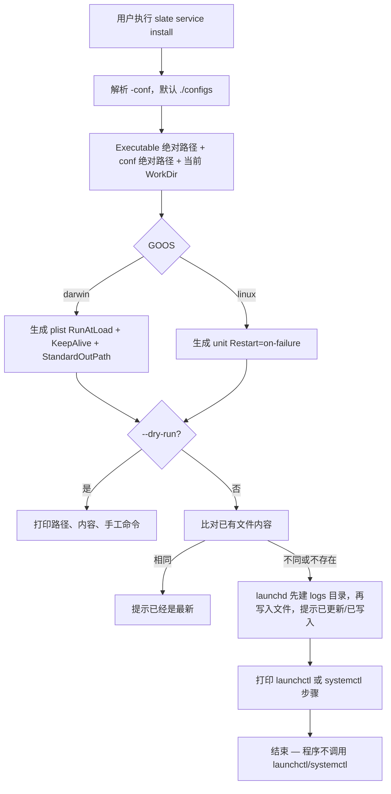

# 系统服务安装（internal/svcinstall）

## 需求目标

提供 `slate service` 子命令：生成 macOS launchd 用户级 LaunchAgent 或 Linux 用户级 systemd 单元，
写入当前用户目录下的标准位置，并打印用户须在本机手工执行的 `launchctl` / `systemctl` 步骤。
不替用户加载或启停服务，避免未经同意改动系统状态。

相对路径（配置目录、SQLite、日志）以**进程启动时的工作目录**为基准（见 `main.go`、`internal/data/provider.go`、`internal/app/app.go`），
因此服务文件里的 `WorkingDirectory` 必须是执行 `slate service install` 时所在的目录，`-conf` 必须为绝对路径。

| 编号 | 问题场景 | 不解决的后果 | 解决方案 | 状态 |
|------|----------|-------------|---------|------|
| 1 | 用户希望 Slate 登录后自动拉起 | 每次开机或关终端都要手工 `./slate` | `slate service install` 写 LaunchAgent / user unit，并打印 bootstrap / enable 命令 | 实施 |
| 2 | 可执行文件、配置、工作目录路径含空格或 XML 特殊字符 | 服务文件损坏，launchd/systemd 拒载 | plist 做 XML 转义；systemd 的 `ExecStart` 参数里有空格、引号、反斜杠、`%`、`$` 时整体加双引号并转义（`%` 写成 `%%`，`$` 写成 `$$`），`WorkingDirectory` 只转义 `%`、空格原样保留（systemd 把等号后面整段当路径，加引号反而成了路径的一部分）；打印给用户粘贴的命令里，含空格等字符的路径用单引号包住 | 实施 |
| 3 | 程序自动执行 launchctl/systemctl | 用户不知系统被改了什么，安全与可预期性差 | **只写文件 + 打印命令**；文档与输出明确说明 | 实施 |
| 4 | macOS LaunchAgent vs「通电即起」 | 用户以为未登录也会跑服务 | 文档说明：用户级 LaunchAgent 在**登录图形会话后**启动 | 实施 |
| 5 | Linux 用户 unit 默认随会话退出 | 无人登录时服务不起 | 提示 `loginctl enable-linger <用户名>` | 实施 |
| 6 | 需要 root / 系统级服务 | 多用户机器权限复杂 | **仅用户级**：`~/Library/LaunchAgents/`、`~/.config/systemd/user/`，不需 root | 实施 |
| 7 | 重复 install 或配置未变 | 无意义覆写、时间戳抖动 | 内容相同则跳过并提示「已经是最新」 | 实施 |
| 8 | 在非 macOS/Linux 上开发 | 无法预览另一种平台的文件 | `print --platform launchd\|systemd` 任意系统可预览 | 实施 |
| 9 | launchd 打开日志文件时不会替我们建目录 | `logs/` 不存在时服务一启动就失败 | 真正安装时先建好 `<WorkDir>/logs`；`--dry-run` 不建 | 实施 |
| 10 | `-conf` 里混进换行等控制字符 | 服务文件被写坏，甚至多出一行不该有的配置 | 校验 `-conf`：不能为空或全空白、最长 4096 字节、不能含控制字符，不合法时不写任何文件 | 实施 |
| 11 | `--dry-run` 的输出让人以为已经写了文件 | 用户误判系统状态 | dry-run 的输出写明「没有写任何文件 / 没有删除任何文件」，只列会写的路径、内容和之后要手工执行的命令 | 实施 |

## 命令与子命令

```text
slate service print [--platform launchd|systemd] [-conf 目录]
slate service install [-conf 目录] [--dry-run]
slate service uninstall [--dry-run]
```

- **print**：只 stdout 输出，不写盘。未指定 `--platform` 时按 `GOOS` 选择（darwin→launchd，linux→systemd）。
- **install**：创建目标目录并写入服务文件；`--dry-run` 打印路径、全文与后续命令。
- **uninstall**：`os.Remove` 删除本包写入的那份文件；不存在视为成功。

### 常量

| 平台 | 标识 / 文件名 | 写入路径 |
|------|---------------|----------|
| launchd | Label / plist：`dev.slate.kanban` / `dev.slate.kanban.plist` | `~/Library/LaunchAgents/` |
| systemd | 单元：`slate.service` | `~/.config/systemd/user/` |

可执行路径：`os.Executable()` + `EvalSymlinks` + `Abs`。日志（仅 launchd）：`<WorkDir>/logs/slate-service.stdout.log` 与 `stderr.log`，`logs/` 在安装时创建。launchd 的 plist 同时设置 `RunAtLoad`（加载或登录时立刻启动）和 `KeepAlive`（退出后自动拉起）。

没有验证到的部分：本机没有真的执行 `launchctl` / `systemctl`，加载、开机自启、崩溃重启的实际效果没有在真机上验收；systemd 的引号规则（`ExecStart` 加引号、`WorkingDirectory` 不加）依据 systemd 文档写成，没有在真实 systemd 上跑过。

## 流程



## 目录规划

```text
internal/svcinstall/
├── constants.go    Label、文件名、日志名
├── paths.go        目标路径、平台检测与白名单
├── env.go          可注入 Home/Work/Executable（测试用）
├── generate.go     plist / unit 文本生成与转义
├── install.go      写入、幂等、后续命令文案
├── cli.go          子命令解析与分发
├── generate_test.go
└── cli_test.go
main.go             os.Args[1]==service 时转 RunFromMain，不改原 flag 启动路径
```

## 验证计划

| 测试名 | 覆盖点 |
|--------|--------|
| `TestLaunchdContentNormalPath` | 普通路径 plist 字段完整 |
| `TestSystemdContentNormalPath` | 普通路径 unit 字段完整 |
| `TestLaunchdContentSpecialChars` | `&`、`<`、引号经 XML 解析后能原样还原成原路径 |
| `TestSystemdContentSpecialChars` | 空格、引号、反斜杠、`%`、`$` 在 `ExecStart` 和 `WorkingDirectory` 里的写法 |
| `TestShellQuote` | 打印给用户的命令里路径能安全粘贴 |
| `TestPrintWritesNoFiles` | print 不落盘 |
| `TestInstallDryRunWritesNoFiles` | dry-run 不落盘、不建日志目录、不说「已写入」 |
| `TestUninstallDryRunKeepsFile` | uninstall 的 dry-run 不删文件、不说「已删除」 |
| `TestInstallCreatesLogsDirForLaunchd` | 真正安装时建好日志目录 |
| `TestInstallFollowUpQuotesPathsWithSpaces` | 工作目录含空格时打印的 tail 命令带单引号 |
| `TestConfArgValidation` | `-conf` 为空、全空白、过长、含换行或控制字符都报错且不写文件 |
| `TestUnsupportedSystem` | 不支持的系统上 install、uninstall、print 报错，指定平台后 print 可用 |
| `TestInstallWritesCorrectContent` | 写入内容与生成一致 |
| `TestInstallIdempotentLatest` | 再次 install 已是最新 |
| `TestInstallUpdatesWhenContentChanges` | 可执行路径变化时已更新 |
| `TestUninstallRemovesFile` | 删除已写文件 |
| `TestUninstallWhenNotExists` | 无文件仍成功 |
| `TestUnknownPlatform` | --platform 白名单 |
| `TestIllegalArgs` | 未知参数 |
| `TestSystemdInstallLinux` | GOOS=linux 路径与 linger 提示 |

手工（`HOME` 指向临时目录，不碰真实 LaunchAgents）：

```sh
go build -o /tmp/slate-svc/slate .
/tmp/slate-svc/slate service print --platform launchd
HOME=/tmp/slate-svc/home /tmp/slate-svc/slate service install
plutil -lint "$HOME/Library/LaunchAgents/dev.slate.kanban.plist"
```

静态检查：`go vet ./internal/... ./pkg/... .`；`go test -race -count=1 ./internal/svcinstall/...`。手工验证时记得只对单条命令设置 `HOME=...`，不要 `export`，否则同一个终端里的 `go build` 会把缓存写进那个临时目录。