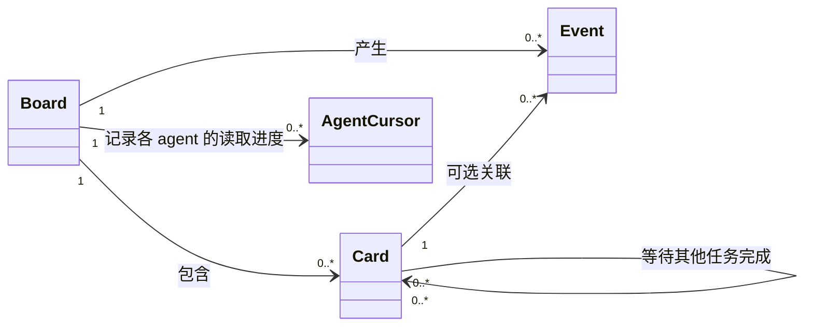
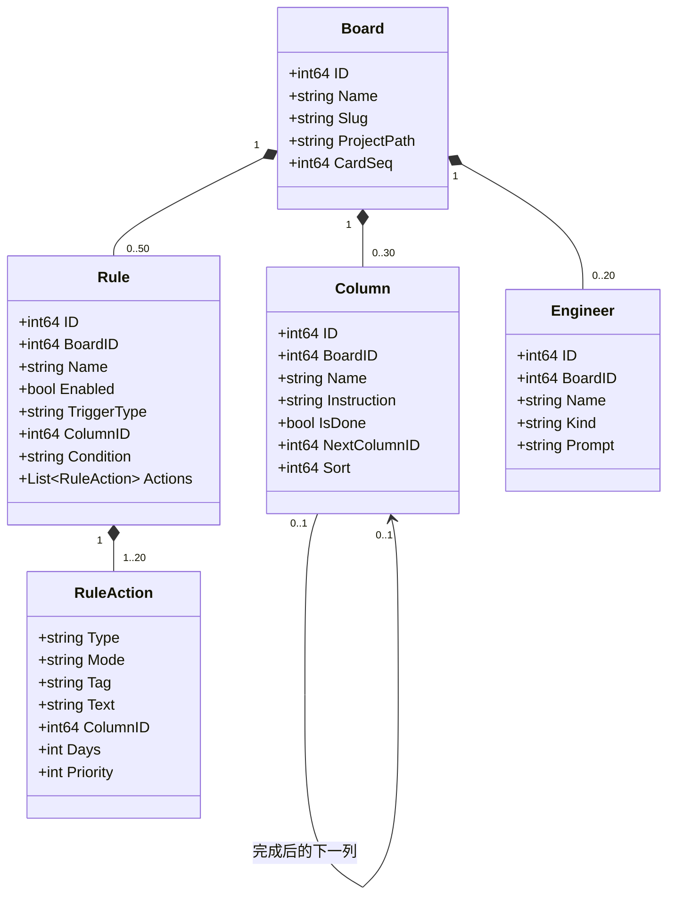
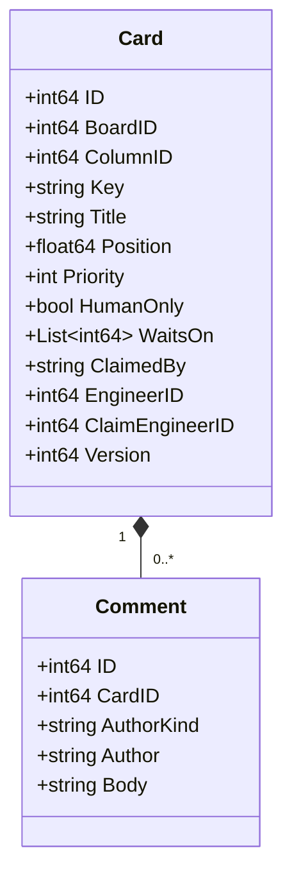
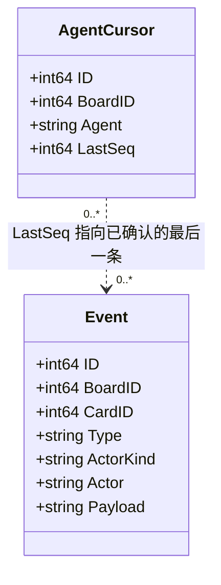

# 看板领域类图

本文件只放类图。L0 是全局上下文，只画聚合根和独立实体，不含字段；L1 每个聚合根一节，只列关键字段。
各功能的流程图在同目录的 `kanban.*.md` 里。

## L0 全局上下文

聚合根有四个：看板（Board）、任务（Card）、事件（Event）、Agent 游标（AgentCursor）。
列（Column）、自动化规则（Rule）和工程师（Engineer）依附于看板，评论（Comment）依附于任务，所以不在 L0 出现。

## L1 看板聚合

看板是根，列和自动化规则只能通过看板访问。看板上的 CardSeq 记录最后一个已分配的任务编号，
创建任务时在事务里加一，保证同一看板内编号不重复。

## L1 任务聚合

任务是根，评论依附于任务。任务靠 BoardID 和 ColumnID 引用看板与列，不持有它们的对象。
Version 是乐观锁，每次写入加一，调用方带着旧 Version 更新时发现不一致就返回冲突。

## L1 事件与游标

事件只追加不修改，ID 就是全局递增的序号 seq。游标按（看板，agent 名）保存，只增不减。

