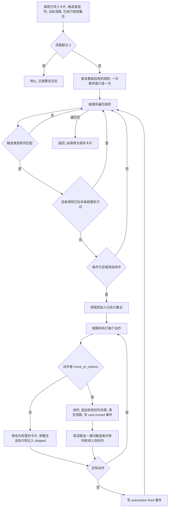
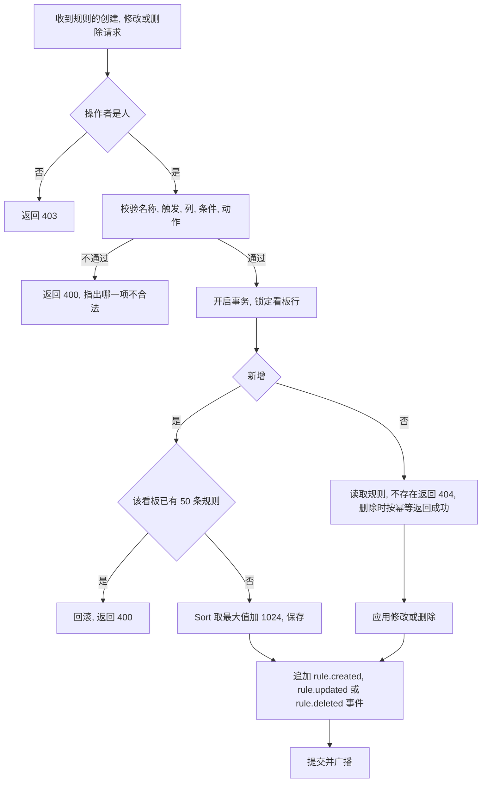
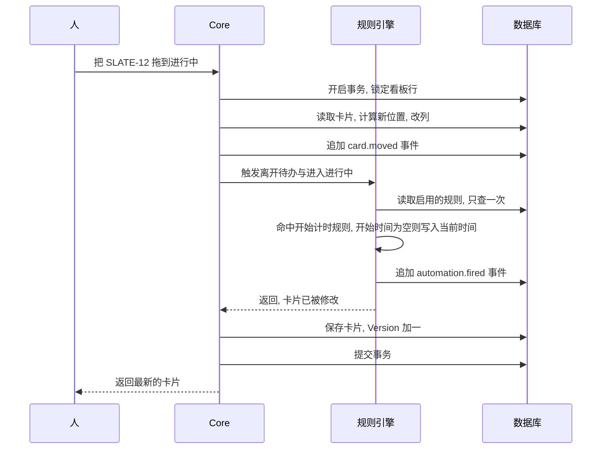

# 自动化规则（kanban 包 rule.go / rule_engine.go）

## 需求目标

Trello 里最受欢迎的能力之一是：卡片移到某一列时，系统自动替你做一些事。本项目也需要，
最典型的两个：卡片进入进行中，自动写开始时间；进入完成，自动写结束时间。
除此之外，用户还会有自己的习惯，比如进入审查时自动加标签，或者完成时自动评论。
所以做成可配置的规则：当什么事发生（触发）、满足什么条件（筛选语法）、做哪些事（动作）。
规则只能由人管理，在触发它的同一个事务里执行，执行结果会写进活动记录，让用户看得见系统为什么改了卡片。

| 编号 | 问题场景 | 不解决的后果 | 解决方案 | 状态 |
|------|----------|-------------|---------|------|
| 1 | 用户希望开始时间、完成时间自动记录 | 靠人手填，经常漏，统计不准 | 触发是卡片进入或离开某列，动作是写时间；起步模板自带三条默认规则 | 实施 |
| 2 | 用户有各自的流程习惯，例如进入审查自动加标签 | 写死的逻辑满足不了，只能手工重复操作 | 规则由用户配置：触发（创建、进入列、离开列）、条件（沿用卡片筛选语法）、动作（十二种） | 实施 |
| 3 | 规则之间互相触发，例如进入 A 就移到 B，进入 B 又移回 A | 请求卡死，数据库被无限写入 | 链式深度最多 3 层；同一条规则在同一条链里最多执行一次 | 实施 |
| 4 | 规则引用的列被删除 | 执行时找不到列而出错 | 删除列时停用引用它的规则，见看板设计 | 实施 |
| 5 | 规则配置写错，保存后才发现永远不触发 | 用户花大量时间排查 | 保存时校验触发类型、列归属、条件语法和每个动作的参数；执行时写 automation.fired 事件，活动页可见 | 实施 |
| 6 | 某个动作无法执行（例如标签已满 10 个） | 要么让用户的拖动失败，体验差；要么悄悄吞掉，没人知道 | 动作按能做就做的语义执行，参数问题导致无法执行的动作跳过，并在 automation.fired 的 skipped 里列出；只有数据库错误才回滚整个操作 | 实施 |
| 7 | 自动化改了卡片，但看不出是谁改的 | 用户不明白卡片为什么自己变了 | 自动化产生的事件与评论，操作者类型是 system，名字是 automation 加冒号加规则名 | 实施 |
| 8 | 人手动清除了开始时间，下次进入进行中又被覆盖 | 人的修正被自动覆盖 | 写时间的动作默认模式为 if_empty，只在为空时写入；选择 always 才覆盖 | 实施 |
| 9 | 规则数量和动作数量没有上限 | 每次变更都要遍历大量规则，拖慢请求 | 每个看板最多 50 条规则，每条规则最多 20 个动作；一次请求里规则列表只查询一次 | 实施 |
| 10 | agent 修改规则 | 人设计的自动化被 AI 改乱 | 规则的增删改只允许人，agent 只能读 | 实施 |
| 11 | agent 完成交接或人拖动时，规则是否生效 | 结果取决于谁操作，行为不一致 | 创建、移动、完成交接三个入口走同一个规则引擎，不区分操作者 | 实施 |
| 12 | 因删除列而被迁移的卡片 | 规则大量触发，产生意料之外的写入 | 结构调整不触发规则，见看板设计 | 实施 |

## 规则的组成

| 部分 | 取值 | 说明 |
|------|------|------|
| 名称 | 1 到 100 个字符 | 出现在活动记录里 |
| 启用 | 是或否 | 停用的规则不执行 |
| 触发 | card_created、card_entered、card_left | 创建卡片；卡片进入某列；卡片离开某列 |
| 列 | 0 或某列的 id | 对 card_entered 与 card_left 表示哪一列；0 表示任意列；对 card_created 表示创建在哪一列，0 表示任意 |
| 条件 | 筛选语法，可为空，最多 500 个字符 | 用触发之后的卡片状态匹配，不满足就不执行 |
| 动作 | 1 到 20 个，按顺序执行 | 见下表 |

创建卡片会同时触发 card_created 和进入初始列的 card_entered。

## 动作

| 类型 | 参数 | 效果 |
|------|------|------|
| set_started_at | mode：if_empty（默认）或 always | 开始时间设为当前时间 |
| set_finished_at | mode：if_empty（默认）或 always | 完成时间设为当前时间 |
| clear_started_at | 无 | 清空开始时间 |
| clear_finished_at | 无 | 清空完成时间 |
| set_due | days：1 到 365 | 到期时间设为当前时间加 days 乘 24 小时 |
| clear_due | 无 | 清空到期时间 |
| set_priority | priority：0 到 3 | 设置优先级 |
| add_tag | tag：1 到 30 个字符 | 加标签；已有则跳过；已满 10 个则跳过并记录 |
| remove_tag | tag | 移除标签；没有则跳过 |
| set_human_only | flag：是或否 | 设置是否只能由人处理 |
| add_comment | text：1 到 2000 个字符 | 以 system 身份写一条评论 |
| move_to_column | column_id：同一看板的列 | 把卡片移到目标列末尾，清空领取，并继续触发规则 |

## 执行流程

引擎在三个地方被调用：创建卡片、移动卡片、完成交接。调用时卡片的新状态已经在内存里，但还没保存；
引擎修改内存里的卡片，最后由调用方保存一次，所以一次操作里不管有多少条规则命中，卡片只写一次、版本只加一次。

说明：

- 条件匹配用的是触发之后的卡片状态，所以可以写成：进入审查，并且带有 backend 标签，才执行。
- 同一次调用里，一条规则只要执行过一次，就加入集合，递归里不会再执行它，保证不会出现 A 到 B 再到 A 的无限循环。
- move_to_column 递归产生的 card.moved 事件，操作者是 system，名字为 automation 加冒号加规则名。
- add_comment 需要卡片已经有 id；创建卡片时先保存再执行规则，所以评论能写入。
- 保存规则时的静态校验：触发类型在白名单内；列属于该看板；条件能被筛选解析器解析；每个动作的类型在白名单内，参数范围正确；move_to_column 的目标列存在。

## 规则的管理

## 一个例子：拖进进行中

## 代码对照

| 步骤 | 函数 | 文件 |
|------|------|------|
| 规则存储接口 | RuleStorer | internal/core/kanban/rule.go |
| 规则的增删改查 | Core.ListRules, CreateRule, UpdateRule, DeleteRule | internal/core/kanban/rule.go |
| 规则校验 | validateRule, validateAction | internal/core/kanban/rule.go |
| 引擎入口 | unit.runRules | internal/core/kanban/rule_engine.go |
| 单个动作的执行 | applyAction | internal/core/kanban/rule_engine.go |
| 动作类型与触发类型常量 | ActionSetStartedAt 等, TriggerCardEntered 等 | internal/core/kanban/rule.go |
| 模板里的默认规则 | defaultRules | internal/core/kanban/board_template.go |
