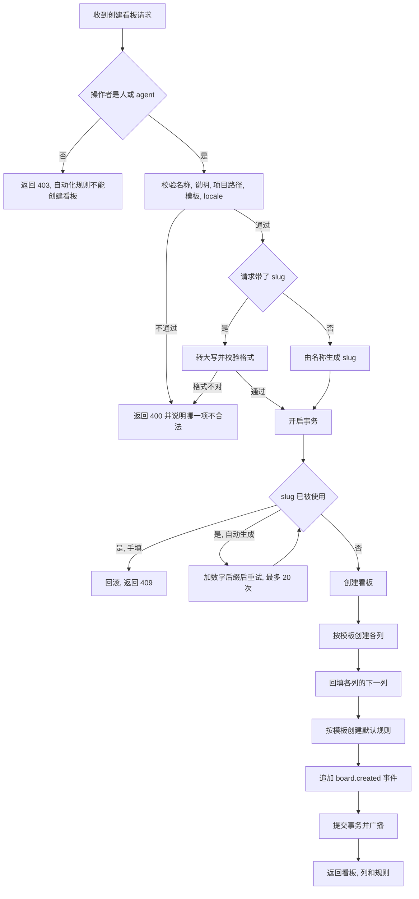
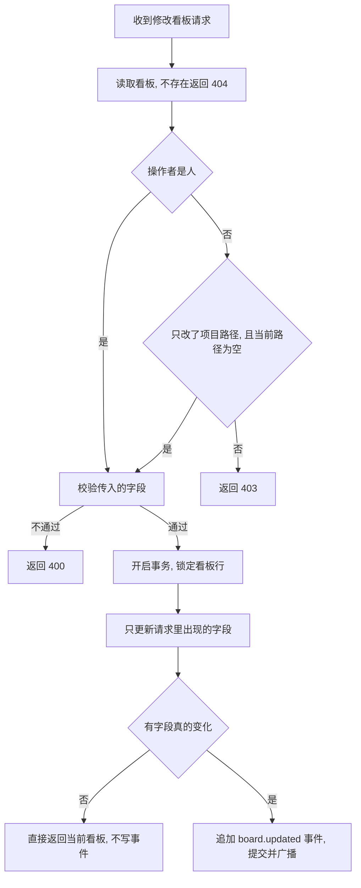
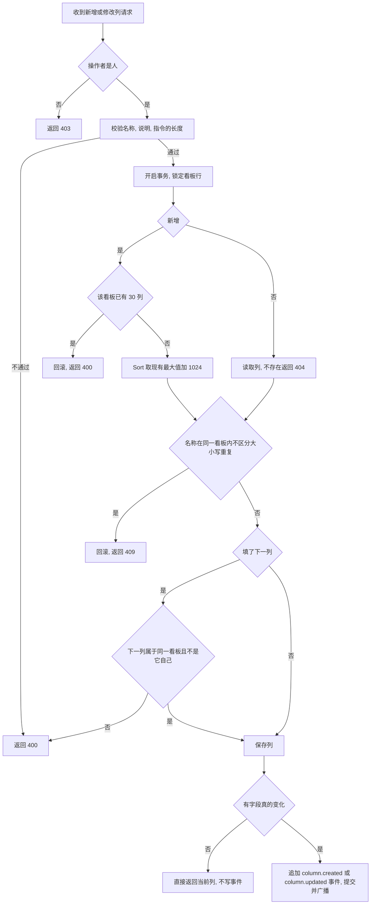
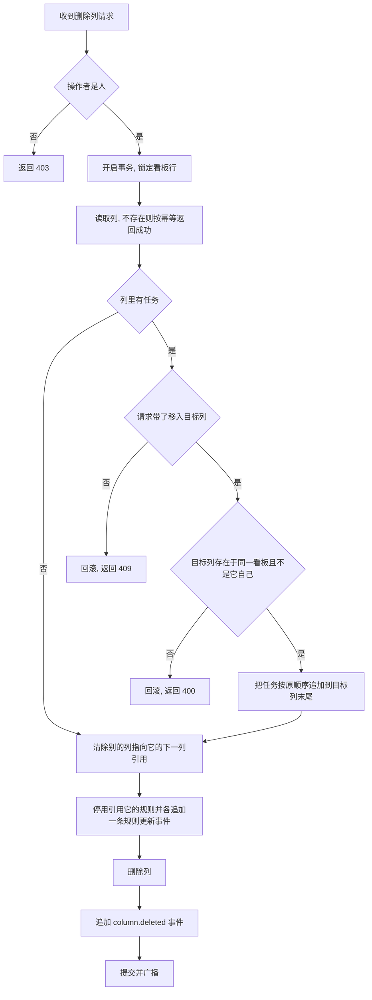
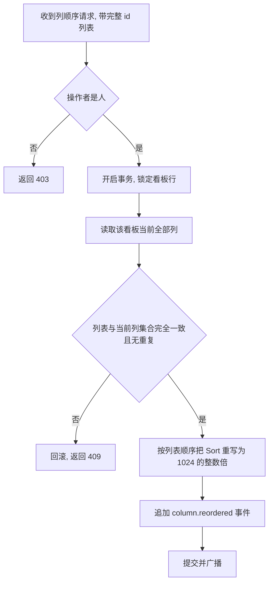
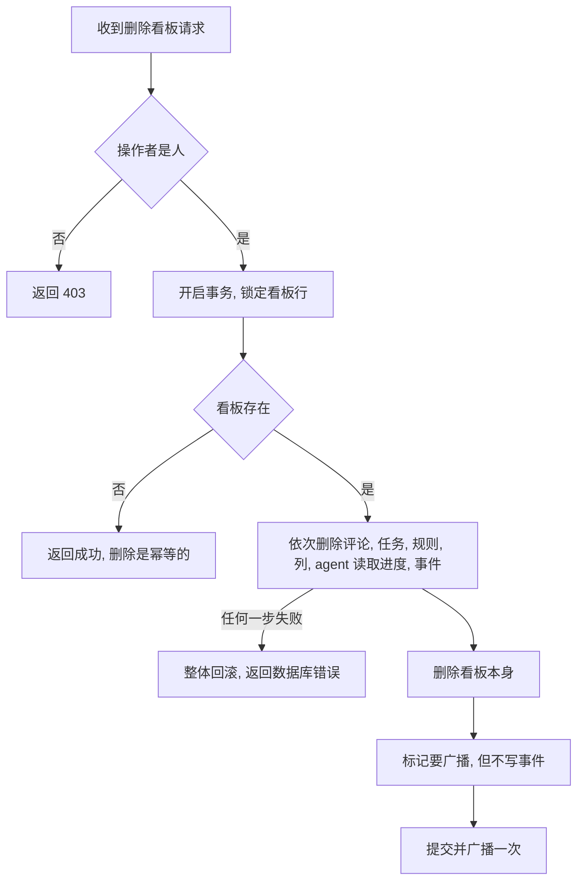
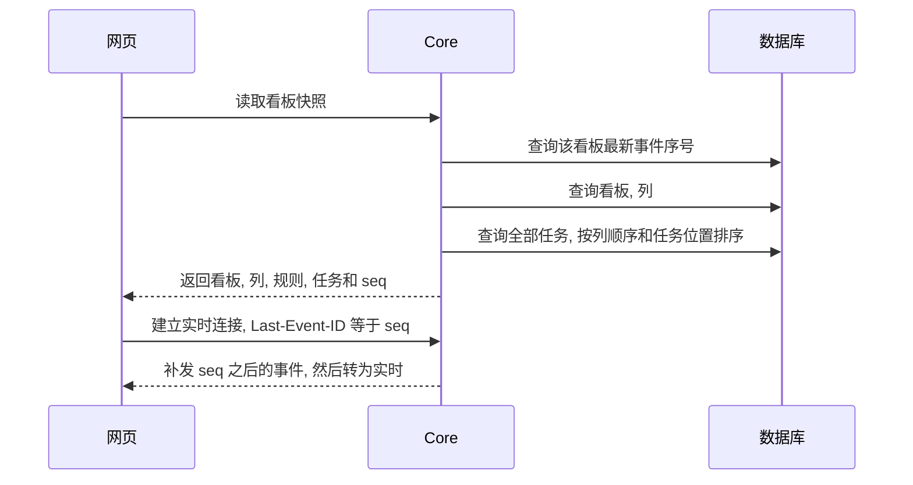

# 看板与列（kanban 包 board.go / column.go / board_template.go / snapshot.go）

## 需求目标

不同项目的流程不一样：有的只要三列，有的要五列加评审。如果状态写死，用户没法按自己的习惯用；
但状态完全自由，AI 又不知道一个任务做完以后该去哪一列、哪些列里的任务该由它来做。
所以列由用户自己创建、改名、排序和删除，每一列带两段说明：给人看的说明，和给 agent 看的指令，
再加完成标记（IsDone），以及完成后默认去哪一列（NextColumnID）。是否由 agent 处理只由列提示词约定。
新建看板时按模板和界面语言生成一套起步的列，用户之后可以随意改。

| 编号 | 问题场景 | 不解决的后果 | 解决方案 | 状态 |
|------|----------|-------------|---------|------|
| 1 | 不同项目需要不同数量、不同名字的列 | 固定状态会让用户削足适履，或者放弃使用 | 列完全由用户创建、改名、排序、删除；模板只提供起步的初始值 | 实施 |
| 2 | agent 不知道一列代表什么阶段，也不知道做完该移去哪里 | agent 乱移任务或者停在原地不动 | 每列有 Description 给人看，Instruction 给 agent 看，NextColumnID 指明完成后的默认去向 | 实施 |
| 3 | 各列该由谁处理、能做什么 | agent 误动收件箱、待办或完成中的任务 | 每列都有提示词（Instruction）写明 agent 在这个状态下能做什么，服务端不按列拦截；next_card 必须传入 agent 按提示词选择的 column_id，只在所选列内取任务 | 实施 |
| 4 | 新建看板后一片空白，用户不知道怎么开始 | 用户要自己逐列创建，还得想每列该怎么写给 AI 的指令 | 提供 dev、simple、empty 三种模板，列名和指令按界面语言生成，并同时创建默认的自动化规则 | 实施 |
| 5 | 看板标识要短、好记，并且不重复 | 任务编号冲突，agent 引用错任务 | slug 由 2 到 10 位大写字母和数字组成，全局唯一；不填时按名称生成，冲突自动加数字；手填冲突返回 409 | 实施 |
| 6 | 创建看板后又改 slug | 已发出的任务编号全部失效，agent 记忆里的编号指向不存在的任务 | slug 创建后不可修改 | 实施 |
| 7 | 删除一个还有任务的列 | 任务凭空消失，没有人知道去了哪里 | 列里有任务时必须指定移入哪一列，否则返回 409；任务按原有顺序追加到目标列末尾 | 实施 |
| 8 | 被删除的列还被其他列当作下一列，或被自动化规则引用 | 任务完成时无处可去，规则执行时找不到列 | 删除时清除别的列对它的下一列引用；引用它的规则自动停用并记录事件，用户可以在规则页修正 | 实施 |
| 9 | 两个人同时调整列顺序 | 顺序错乱，甚至丢列 | 请求必须带完整的列 id 列表，和当前列集合不完全一致就返回 409；校验和重排在锁定看板行的事务里完成 | 实施 |
| 10 | agent 想新增、删除列或规则，或者删除看板 | 流程被 AI 改乱，人的设计被破坏 | 看板、列、规则的增删改只允许人操作；agent 唯一的例外是在项目路径为空时写入项目路径 | 实施 |
| 11 | 项目路径是某台电脑上的路径，多台电脑的路径不同 | 一个 agent 改写了路径，另一台电脑上的 agent 找不到目录 | 服务端只存一个主路径，agent 只能在它为空时写入；每台电脑自己的路径由 skill 保存在本机，见 skill 设计文档 | 实施 |
| 12 | 同一看板里两列同名 | 筛选和 agent 引用列名时有歧义 | 同一看板内列名不区分大小写唯一，重复返回 409 | 实施 |
| 13 | 单个看板列数没有上限 | 页面和 agent 的上下文被塞满 | 单个看板最多 30 列 | 实施 |
| 14 | 网页先加载整板，再建立实时连接，两者之间有空隙 | 空隙里的变化丢失，页面停留在旧状态 | 整板快照里带上读取数据之前的最新事件序号，网页从这个序号之后开始接收实时事件 | 实施 |
| 15 | 删除看板 | 任务、评论、事件、游标、规则留下孤儿数据 | 在一个事务里按依赖顺序删除全部关联数据，最后广播一次唤醒等待者 | 实施 |

## 数据与限制

| 项 | 规则 |
|----|------|
| 看板名称 | 必填，去掉首尾空白后 1 到 100 个字符 |
| slug | 2 到 10 位，首字符是大写字母，其余是大写字母或数字；全局唯一；创建后不可改 |
| 看板说明 | 最多 2000 个字符 |
| 项目路径 | 最多 512 个字符；非空时必须是绝对路径（以斜线开头，或盘符加冒号加斜线或反斜线，或双反斜线开头）；不允许出现空字符 |
| 列名 | 必填，1 到 60 个字符，同一看板内不区分大小写唯一 |
| agent 指令 | 最多 4000 个字符 |
| 每个看板的列数 | 最多 30 |
| 列间距 | Sort 以 1024 为间距，重排时整体重写 |
| 标签库 | 每个看板最多 60 个标签；文字 0 到 30 个字符、单行，非空文字不区分大小写唯一；颜色是 `色相-深浅`，色相 10 种（green、yellow、orange、red、purple、blue、sky、lime、pink、gray），深浅 1 到 3，空字符串表示无颜色 |

## 起步模板

模板 dev 是为开发工作准备的五列流程，simple 是三列，empty 不建任何列。列名和指令按创建请求里的 locale 生成，支持 zh-CN、zh-TW、en、ja、ko，不认识的 locale 一律按 en 处理。

| 模板 | 列（按顺序） | IsDone | 下一列 |
|------|-------------|--------|--------|
| dev | 收件箱 | 否 | 待办 |
| dev | 待办 | 否 | 进行中 |
| dev | 进行中 | 否 | 审查 |
| dev | 审查 | 否 | 完成 |
| dev | 完成 | 是 | 无 |
| simple | 待办 | 否 | 进行中 |
| simple | 进行中 | 否 | 完成 |
| simple | 完成 | 是 | 无 |

dev 与 simple 同时创建三条默认的自动化规则，规则的细节见 kanban.automation.go.md：

| 规则 | 触发 | 动作 |
|------|------|------|
| 开始计时 | 任务进入进行中 | 开始时间为空时写入当前时间 |
| 完成计时 | 任务进入完成 | 完成时间为空时写入当前时间 |
| 重新打开 | 任务离开完成 | 清空完成时间 |

## 创建看板

自动生成 slug 的办法：取名称里的 ASCII 字母和数字，转大写，最多取 6 位；结果不足 2 位或不是以字母开头（比如纯中文名）时，用 BOARD；
如果被占用，在末尾追加 2、3、4……，必要时截短前面的部分，保证总长度不超过 10 位。

## 修改看板

## 标签库

标签库是独立的 `tags` 表（`id`、`board_id`、`text`、`color`、`sort`），每个看板一份；任务上存标签 id 数组（`Card.TagIDs`，列 `tag_ids`，去重，最多 10 个）。标签 = 颜色 + 文字，两者都能改；文字可以是空字符串（表示只有颜色），颜色空字符串表示无颜色。

- 创建看板时按模板复制 6 个标签到新看板：颜色固定为浅色的绿、黄、橙、红、紫、蓝；`empty` 模板的文字留空，`dev`/`simple` 模板的文字固定写中文（需求、文档、移动端、Bug、服务端、前端，常量 `seedTagTexts`），不随看板语言变化。网页发现标签文字和这六个中文完全相等时，按界面语言显示译文（译文表 `label.seed.*`，编辑页显示译文、没改动就原样存回中文）；改过文字的标签不再翻译。
- `Board.Tags` 是读取时附带的标签库（不入 boards 表）；`UpdateBoardInput.Tags` 传完整的新标签库（整体替换），只有人能改，agent 带 `tags` 会被拒绝。按 id 对照旧库：没带 id 或 id 不认识的当新标签；旧库里有、新库里没有的被删除，并从所有任务的 `tag_ids` 里去掉（任务版本号加一）。顺序以传入顺序为准。
- 改文字或颜色只改标签这一行，任务不用动，所以不会改任务版本号。
- 非空文字不区分大小写唯一，空文字可以有多个；颜色必须在色板里；最多 60 个；文字 0 到 30 个字符、单行。违反都返回 400，整个请求不生效。
- 任务的创建和更新可以传 `tag_ids`（按 id）或 `tags`（按文字，两者不能同时传）。按文字传时，库里没有的文字会自动建成无颜色标签；库已满或任务已满 10 个则返回 400。
- 标签库的变化写成单独的 `board.labels_updated` 事件（载荷 `fields` 固定 `["tags"]`），网页读活动流时把它排除。
- 删除看板时一并删除该看板的全部标签。
- 旧数据迁移：服务启动时 `AutoMigrate` 把旧的 `boards.labels` 和 `cards.tags` 两列搬进 `tags` 表和 `cards.tag_ids`（按看板在事务里做，可重复执行），旧列清空但保留在表里。
- 已知限制：自动化规则的 `add_tag`/`remove_tag` 和筛选条件仍按文字匹配，文字被改掉后规则会新建一个同旧文字的标签；文字为空的标签没法按文字筛选。

说明：判断 agent 能否写项目路径要在锁定看板行之后再读一次当前值，防止两个 agent 同时写入时后者覆盖前者。

## 新增与修改列

说明：修改时只更新请求里出现的字段；下一列填 0 表示清除。新增列时下一列只能指向已有的列，所以起步模板里的各列要先全部创建，再回填下一列。

## 删除列

说明：

- 因删除列而被迁移的任务不会触发自动化规则，因为这是结构调整，不是用户在流程里推进任务；事件里只记录移动的个数，不为每个任务单独写 card.moved。
- 被迁移任务的领取和移动任务一致：人删列时领取原样保留（不写 card.released）；agent 操作时清掉并写 card.released（why 为 moved）。每个被迁移的任务版本加一。
- 列已经不存在时直接返回成功；移入目标列不存在、不属于该看板或就是要删的列本身，返回 400。
- 引用这一列的规则指触发所在的列是它，或者某个 move_to_column 动作的目标列是它；已经停用的规则不用动，想重新启用时保存前的校验会指出列不存在。

## 调整列顺序

## 删除看板

说明：事件随看板一起删除，所以只广播、不写事件；正在等待这个看板的 agent 和网页被唤醒后重新查询，得到"看板不存在"。

入口：只有网页用的 REST `DELETE /boards/:board_id`，网页要求人在模态框里输入项目名称确认；MCP 两个视图都没有删除项目的工具（`mcpapi.TestNoBoardDeletionTool` 守住），agent 和管理视图都只能创建、修改项目。
删除顺序按依赖从子到父，每类数据一条删除语句，所以不管任务多少，语句数是固定的。

## 整板快照

网页首次加载和断线恢复时使用。先读最新事件序号，再读数据，所以快照里的数据一定不比这个序号旧；
网页拿这个序号去接收实时事件，重复收到的事件只会触发一次多余的刷新，不会漏。

## 整板导出

网页工具栏的「导出」一次性拉出看板、列、规则、全部任务（含列名、完成、等待、领取等派生字段）、每个任务的评论，以及导出时刻的最新事件序号。
不分页，规模按个人看板设计（几千个任务以内）。人和 agent 都能读，权限与整板快照相同；看板不存在返回 404。

| 格式 | 说明 |
|------|------|
| JSON（默认） | 顶层信封：`format: slate-board-export`、`version: 1`、`exported_at`（RFC3339）、`seq`、`board`、`columns`、`rules`、`cards[]`（每项含 `comments`） |
| Markdown | 在 REST 层渲染：`# 看板名（SLUG）`，按列 `##`，任务 `### KEY 标题`，元信息行、描述、评论引用块；任务顺序与看板一致 |

评论在 Core 里按看板批量读取，避免 N+1。REST 响应带 `Content-Disposition` 附件名和对应 `Content-Type`。

| 步骤 | 函数 | 文件 |
|------|------|------|
| 导出数据 | Core.ExportBoard | internal/core/kanban/export.go |
| 评论批量读 | CommentStorer.ListByBoard | internal/core/kanban/comment.go |
| JSON/Markdown 与路由 | API.export, renderBoardMarkdown | internal/web/api/kanbanapi/export.go, export_md.go |

## 权限小结

| 操作 | 人 | agent |
|------|----|-------|
| 创建、删除看板 | 允许 | 拒绝 |
| 修改看板名称、说明 | 允许 | 拒绝 |
| 写入项目路径 | 允许 | 仅当路径为空时允许 |
| 列的增删改与排序 | 允许 | 拒绝 |
| 读取看板、列、快照、导出 | 允许 | 允许 |

## 代码对照

| 步骤 | 函数 | 文件 |
|------|------|------|
| 看板存储接口与锁行 | BoardStorer, BoardStorer.Lock | internal/core/kanban/board.go |
| 创建、修改、删除、列表、详情 | Core.CreateBoard, createBoardOnce, UpdateBoard, DeleteBoard, ListBoards, GetBoard | internal/core/kanban/board.go |
| agent 能否写项目路径 | checkBoardPatchAllowed | internal/core/kanban/board.go |
| 删除看板的事务内步骤 | unit.deleteBoard | internal/core/kanban/board.go |
| slug 生成与校验 | generateSlug, validateSlug, maxSlugAttempts | internal/core/kanban/board.param.go |
| 项目路径校验 | validateProjectPath | internal/core/kanban/board.param.go |
| 起步模板的列与文案 | normalizeLocale, textsFor, unit.seedColumns | internal/core/kanban/board_template.go |
| 起步模板的规则 | defaultRules, unit.seedRules | internal/core/kanban/board_template.go |
| 列的增删改与排序 | Core.CreateColumn, UpdateColumn, DeleteColumn, ReorderColumns | internal/core/kanban/column.go |
| 删除列的事务内步骤 | unit.deleteColumn, evacuateColumn, disableRulesUsing, ruleUsesColumn | internal/core/kanban/column.go |
| 整板快照 | Core.BoardSnapshot | internal/core/kanban/snapshot.go |
| 整板导出 | Core.ExportBoard | internal/core/kanban/export.go |
| 入参结构 | CreateBoardInput, UpdateBoardInput, CreateColumnInput, UpdateColumnInput | internal/core/kanban/board.param.go, column.param.go |
| 错误定义 | ErrBoardNotFound, ErrColumnNotEmpty 等 | internal/core/kanban/errors.go |

## 工程师名册

工程师是 agent 的并发名额，独立的 `board_engineers` 表（`id`、`board_id`、`name`、`kind`、`prompt`、`avatar`、`sort`），每个看板一份；`kind` 是 `dev`（全栈）、`frontend`（前端）、`backend`（后端）、`ui`（UI）或 `review`（测试）：前四种都做研发，只是专长不同（`stageOf` 把它们归为研发阶段），`review` 做审查；agent 按列提示词选择工程师，服务端不从列推断类型。

- 创建看板时按模板和语言播种：`dev` 模板 2 位全栈 + 1 位测试，`simple` 模板 2 位全栈，`empty` 不播种。名称固定用英文名（Atlas、Orion、Sentinel），提示词固定写中文，都不随界面语言翻译（常量 `seedEngineerTexts`）。
- `Board.Engineers` 是读取时附带的名册；`UpdateBoardInput.Engineers` 传完整的新名册（整体替换，同标签库），只有人能改，agent 带 `engineers` 会被拒绝。名称 1–30 字单行、不分大小写不重名，提示词 1–2000 字，最多 20 位（`maxBoardEngineers`）。
- 解聘：名册里有、新名册里没有的被删除，并清掉所有任务的 `EngineerID` 和 `ClaimEngineerID`（任务版本号加一）。
- 任务的 `EngineerID` 是绑定的全栈工程师（0 表示未绑定），只有人能改（规划类字段），必须是本看板的研发类工程师（不是 `review`）；领取规则见 `kanban.claim.go.md`。
- `avatar` 是头像的随机种子（字母、数字、下划线、连字符，最多 32 位，`avatarSeedPattern`）：招募时留空由服务端生成（`newAvatarSeed`），修改时留空沿用原来的，显式传入才换（算名册变化，写 `board.updated`）。网页按种子画头像，种子为空的旧数据用 `e<编号>`。
- 删除看板时一并删名册（步骤「工程师」）。
- 旧数据迁移：新表由 `AutoMigrate` 建；已有看板的名册由一次性脚本补（不在服务代码里）。
