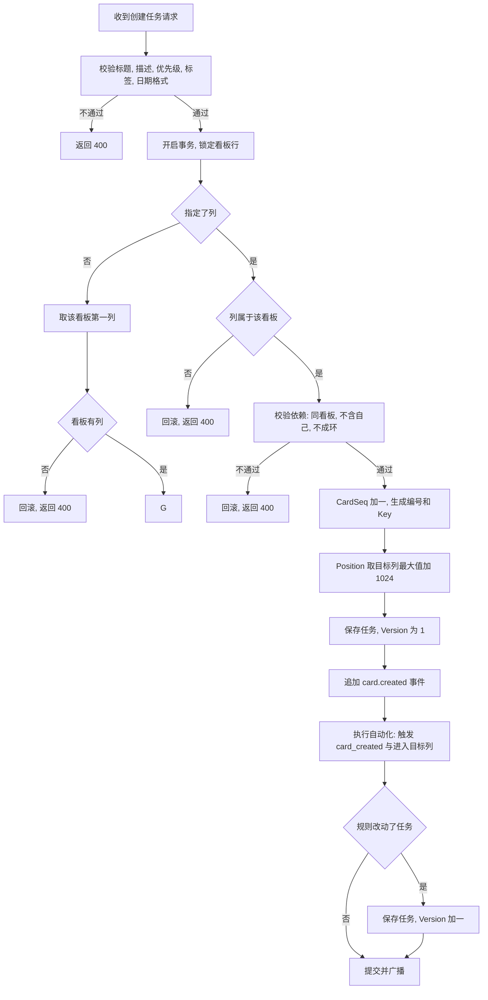
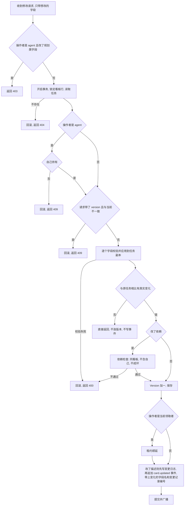
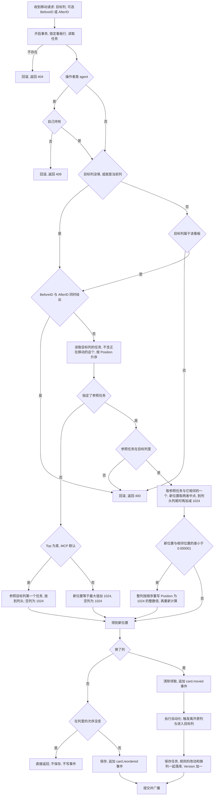
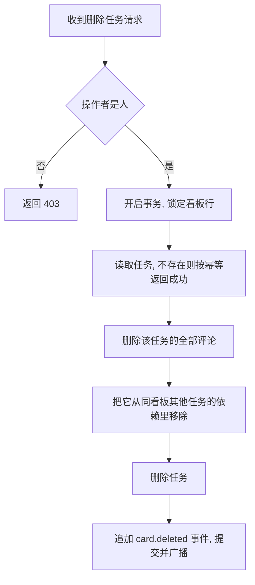

# 任务与评论（kanban 包 card.go / card_position.go / card_filter.go / comment.go）

## 需求目标

任务是看板的核心。人和 agent 都会读写它，所以要解决几件事：编号在看板内唯一又好记，方便 agent 在对话里引用；
拖动排序时多人同时操作不能互相覆盖；两个人同时编辑同一个任务不能静默丢改动；
agent 只能碰它该碰的任务和字段，人的规划不能被 AI 改乱；任务之间要能表达先后依赖；
网页搜索框和 agent 的列表工具要用同一套筛选语法。

| 编号 | 问题场景 | 不解决的后果 | 解决方案 | 状态 |
|------|----------|-------------|---------|------|
| 1 | 两个人同时创建任务 | 编号重复，agent 引用 SLATE-12 时指向两个不同的任务 | 创建在锁定看板行的事务里完成，看板上的 CardSeq 加一后作为编号，编号永不回收，任务 Key 等于 slug 加横线加编号，全局唯一 | 实施 |
| 2 | 拖动任务到两个任务之间 | 如果用整数下标，每次拖动要重写整列，并发拖动互相覆盖 | Position 用浮点数，插入时取两个相邻位置的中点；相邻差小于 0.000001 时整列重排为 1024 的整数倍 | 实施 |
| 3 | 两个人同时编辑同一个任务 | 后保存的人静默覆盖先保存的人 | 任务带 Version，每次真实修改加一；更新时带了 version 而与当前不一致，返回 409，提示刷新 | 实施 |
| 4 | agent 擅自改优先级、依赖、到期时间等人设定的字段 | 人的规划被 AI 改动，且难以察觉 | 按权限表限制：agent 只能改自己持有的任务，并且只能改标题、说明、标签、分支、链接 | 实施 |
| 5 | agent 在不该动的列里创建或移动任务 | 绕开了由人决定做什么的约定 | 不在服务端按列拦截，各列允许 agent 做什么由列的提示词（Instruction）约定；agent 不指定列时进入第一列；正被别的 agent 持有的任务不能移动 | 实施 |
| 6 | 一个任务必须等另一个任务完成才能开始 | agent 先做了依赖未完成的任务，返工 | 任务有 WaitsOn 列表；依赖任务不在完成列里就算等待中；取下一个任务时跳过等待中的任务 | 实施 |
| 7 | 增加依赖时形成环（A 等 B，B 等 A） | 两个任务永远等待，都不会被领取 | 保存依赖前沿依赖链检查是否回到自己，成环返回 400 | 实施 |
| 8 | 被依赖的任务被删除 | 依赖悬空，等待它的任务永远显示等待中 | 删除任务的事务里，把它从同看板其他任务的依赖里移除 | 实施 |
| 9 | 有些任务必须由人来做 | agent 误领，做出不该由 AI 做的改动 | 任务有 HumanOnly 标记，agent 不能领取，取下一个任务时跳过；只有人能改这个标记 | 实施 |
| 10 | 用户和 agent 都要按条件找任务 | 两套筛选逻辑，结果不一致 | 一套筛选语法，网页搜索框和 MCP 的列表工具共用同一个解析器与匹配函数 | 实施 |
| 11 | 筛选语法写错 | 静默返回空列表，用户以为没有任务 | 解析失败返回 400，并指出是哪个词有问题 | 实施 |
| 12 | agent 需要回复人留下的评论 | 如果评论受任务所在列限制，agent 没法在待办或评审中的任务下答复 | 评论任何人对任何任务都能写；写评论的 agent 恰好是当前领取者时，顺带续租 | 实施 |
| 13 | 评论、描述、标题没有长度上限 | 数据库和 agent 上下文被撑爆 | 标题 200、描述 20000、评论 20000、标签最多 10 个每个最多 30 字符、依赖最多 20 个 | 实施 |
| 14 | 更新请求里的值与现有值相同 | 仍然写事件和涨版本，唤醒 agent 空转 | 没有真实变化时不涨版本、不写事件、直接返回 | 实施 |
| 15 | 在同一列里只是调整顺序 | 与换列用同一种事件，agent 被无意义地唤醒 | 同列调整顺序写 card.reordered，换列写 card.moved；agent 拉取时忽略 card.reordered | 实施 |
| 16 | 创建或移动时指定了别的看板的列 | 任务挂到错误的看板，数据错乱 | 校验列属于该任务所在看板；创建时不指定列则进入该看板第一列，看板没有列返回 400 | 实施 |
| 17 | 误删任务 | 评论、依赖关系残留 | 删除在一个事务里完成：删评论、清依赖、删任务，并只允许人操作 | 实施 |
| 18 | 移动一个被 agent 领取的任务离开进行中 | agent 自己换列后任务已经在评审列，却还显示被 agent 占用；人拖一下卡片，agent 手里还在做的活又不能被悄悄收走 | agent 换列（交接）时清除领取并写 card.released；人换列不动领取，只写 card.moved，领取由 agent 自己放开、租约到期或人明确收回才结束 | 实施 |

## 字段与限制

| 字段 | 规则 |
|------|------|
| Key | slug 加横线加编号，例如 SLATE-12，创建时生成，不可改 |
| 标题 | 必填，1 到 200 个字符 |
| 描述 | 最多 20000 个字符 |
| 优先级 | 0 到 3，0 表示未设置，1 低，2 中，3 高 |
| 标签 | 任务存标签 id（`tag_ids`），最多 10 个，去重，必须属于本看板；按文字传 `tags` 时每个 1 到 30 个字符，不区分大小写去重，库里没有会自动建标签；两种写法不能同时传 |
| 依赖 | 最多 20 个任务 id，必须是同一看板的其他任务 |
| 分支 | 最多 200 个字符 |
| 链接 | 最多 500 个字符，非空时必须以 http:// 或 https:// 开头 |
| 到期、开始、完成时间 | 请求里用 RFC3339 格式的字符串，空字符串表示清除 |
| 评论 | 1 到 20000 个字符 |
| 一次列表返回的任务数 | 默认 200，最大 500 |

## 权限

| 操作 | 人 | agent |
|------|----|-------|
| 创建任务 | 允许 | 允许 |
| 修改标题、说明、标签、分支、链接 | 允许 | 仅限自己持有的任务 |
| 修改优先级、HumanOnly、依赖、到期、开始、完成时间 | 允许 | 拒绝 |
| 移动任务 | 允许 | 允许，但别的 agent 正持有的任务不能动 |
| 删除任务 | 允许 | 拒绝 |
| 写评论 | 允许 | 允许 |
| 删除评论 | 允许 | 拒绝 |
| 读取任务与评论 | 允许 | 允许 |

自己持有的含义：任务的 ClaimedBy 等于该 agent 的名字。租约过期但还没有被别的 agent 接手时仍然算持有，
这样耗时很长的任务不会因为忘了续租而白做；一旦别的 agent 接手，原持有者的写入返回 409。
agent 对从没领取过的任务写入同样返回 409，提示先领取。agent 改规划类字段（优先级、依赖、时间、仅限人处理）返回 403，
这一项在读取任务之前就判断。领取的完整规则见 kanban.claim.go.md。

## 创建任务

## 修改任务

## 移动任务与位置计算

说明：同一列里的"次序没变"指新位置排在它前面的任务数量和原来一样；这种情况只可能是用户点了一下没有真的移动，所以什么都不做。
换列和完成交接（见领取设计）共用同一个收尾 commitMove，所以规则对谁的操作都一样生效。

## 删除任务与评论

写评论：校验正文长度，开启事务，锁定看板行，任务不存在返回 404；保存评论；
写评论的是 agent 且自己持有这个任务时，租约顺延；追加 comment.added 事件，Payload 里的 snippet 只取正文前 200 个字符；提交并广播。
删除评论只允许人，追加 comment.deleted 事件，评论不存在按幂等返回成功。

## 依赖检查

依赖保存前执行：

1. 去重，数量不超过 20。
2. 每个 id 必须是同一看板的任务，且不能是任务自己。
3. 沿依赖链做深度优先搜索：从新依赖出发，经过每个任务自己的依赖继续向下走；如果能走回当前任务，说明成环，返回 400。
4. 搜索使用一次查询取出该看板所有带依赖的任务，在内存里完成，复杂度为任务数量的线性级。

等待中的判断：任务的任何一个依赖对应的任务存在，并且所在的列不是完成列，就是等待中。

## 筛选语法

用空格分隔多个词，所有词都满足才算命中。双引号包起来的内容算一个词。词前加减号表示取反。

| 写法 | 含义 |
|------|------|
| 普通文字 | 标题、描述、Key、标签里包含该文字，不区分大小写 |
| tag:xxx | 带有该标签 |
| col:xxx 或 column:xxx | 所在列的名称等于 xxx，不区分大小写；也可以写列 id |
| key:xxx | Key 等于 xxx，不区分大小写 |
| title:xxx | 标题里包含 xxx，不区分大小写 |
| desc:xxx | 描述里包含 xxx，不区分大小写 |
| priority:high、priority:3、priority:>=2 | 优先级等于，或者用比较符；high、medium、low、none 对应 3、2、1、0 |
| claimed:xxx | 当前被名为 xxx 的 agent 领取且租约有效 |
| is:done | 位于完成列 |
| is:open | 不在完成列 |
| is:human | HumanOnly |
| is:claimed | 被领取且租约有效 |
| is:free | 没被领取，或租约已过期 |
| is:waiting | 有未完成的依赖 |
| is:overdue | 有到期时间，已过期，且不在完成列 |
| is:started、is:finished | 开始、完成时间不为空 |
| has:xxx 与 no:xxx | xxx 取 due、branch、url、tags、desc、deps 之一，表示有或没有 |
| 多选一：tag:bug\|ui、col:待办\|进行中、priority:high\|medium、claimed:a\|b、is:free\|waiting 等 | 取值之间用竖线隔开，命中任意一个就算命中；前缀 tag、col、column、key、priority、claimed、is、has、no 支持，title、desc 和日期类不支持（竖线按原样处理）；竖线前后都要有内容；词前加减号表示一个都不能命中；标签或列名本身带竖线时，用 col:列 id 或普通文字搜索 |
| due:、created:、updated: 加比较符加日期 | 比较符为 <、<=、>、>=、=，不写比较符就是等于；日期写 2026-11-17 或 today；按服务器所在时区的自然日比较，所以 due:today 命中今天任意时刻到期的任务 |

出错的情况：未知的前缀、值不合法、引号没有闭合，都返回 400 并写出出错的词，例如：筛选词 is:foo 无法识别，可选值为 done、open、human、claimed、free、waiting、overdue、started、finished。

## 代码对照

| 步骤 | 函数 | 文件 |
|------|------|------|
| 任务存储接口与查询 | CardStorer | internal/core/kanban/card.go |
| 创建、修改 | Core.CreateCard, UpdateCard, unit.updateCard | internal/core/kanban/card.go |
| 移动 | Core.MoveCard, unit.moveCard, resolveMove, relocateCard, reorderCard, commitMove | internal/core/kanban/card_move.go |
| 删除 | Core.DeleteCard, unit.deleteCard, dropDependency | internal/core/kanban/card_delete.go |
| 详情、列表 | Core.GetCard, GetCardDetail, ListCards | internal/core/kanban/card.go, card_detail.go, card_list.go |
| 编号与 Key | unit.assignNumberAndPosition | internal/core/kanban/card.go |
| 位置计算与整列重排 | computePosition, unit.placeCard, appendPosition, renumberColumn | internal/core/kanban/card_position.go |
| 依赖校验与等待判断 | normalizeWaitsOn, validateWaitsOn, reachesTarget, unfinishedDeps, unit.checkWaitsOn | internal/core/kanban/card_deps.go, card.go |
| 视图与看板索引 | CardView, boardIndex, newBoardIndex | internal/core/kanban/card_view.go |
| 筛选解析与匹配 | parseFilter, filter.match, splitTerms, buildTerm | internal/core/kanban/card_filter.go |
| 筛选词的具体写法 | buildIs, buildHas, buildNo, buildPriority, buildDate 等 | internal/core/kanban/card_filter_terms.go |
| 评论 | Core.AddComment, unit.addComment, DeleteComment | internal/core/kanban/comment.go |
| 权限判断 | requireHuman, requireWriter, checkCardWritable, UpdateCardInput.touchesPlanning | internal/core/kanban/validate.go, card.go, card.param.go |
| 入参结构 | CreateCardInput, UpdateCardInput, MoveCardInput | internal/core/kanban/card.param.go |
