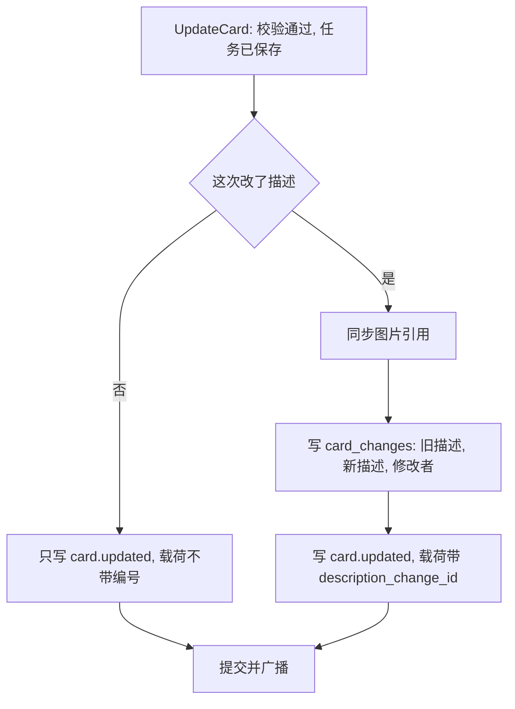

# 任务描述变更日志（card_changes）

## 需求目标

活动流里原来只写「我 修改了描述」，连改两次就是两行一模一样的字，看不出改了什么。
现在每次改描述都在日志表里记一条「修改前、修改后」的完整内容；活动流和任务的「评论和活动」在这句话后面加一个带下划线的「查看变更」，点开后像 VS Code 的 git diff 那样左右对比两个版本。

| 编号 | 问题场景 | 不解决的后果 | 解决方案 | 状态 |
|------|----------|-------------|---------|------|
| 1 | 活动里只有「修改了描述」 | 看不出改了什么，连改两次的两行没法区分 | `card.updated` 的载荷里带 `description_change_id`，指向日志表的一条记录 | 实施 |
| 2 | 事件表只留最近 1 万条，且载荷不放长文本 | 事件被清理后历史版本就没了；长文本塞进载荷会让事件表膨胀 | 单独建 `card_changes` 表存前后全文，生命周期跟任务走，不跟事件走 | 实施 |
| 3 | 记录和事件不一致 | 事件指向不存在的记录，或者有记录却没有事件 | 记录在改任务的同一个事务里先写，事件载荷再带上它的编号；事务回滚时两者一起撤销 | 实施 |
| 4 | 没有真正改动也写记录 | 日志里全是重复内容 | 沿用 `UpdateCardInput.apply` 的「值没变不算修改」，描述没变就不写记录、不写事件 | 实施 |
| 5 | 拿别的任务的记录编号来读 | 读到不属于这个任务的内容 | `GetCardChange(cardID, changeID)` 同时校验归属，不属于就按不存在处理（404） | 实施 |
| 6 | 删除任务或看板后留下孤儿记录 | 数据残留，删除不彻底 | `deleteCard`、`deleteBoard` 一并删除；删除后活动流里旧事件的「查看变更」读取返回 404，网页对已删除任务的事件不显示链接 | 实施 |
| 7 | 创建任务时的初始描述 | 第一次修改没法对比 | 不单独记「创建」，第一次修改的记录里 `old_value` 就是初始描述 | 实施 |
| 8 | 日志无限增长 | 同一个任务被反复改写会占空间 | 描述最长 2 万字，每条记录最多约两份；目前不设条数上限，真有需要再加按任务保留最近 N 条的清理 | 暂不处理 |

## 数据

表 `card_changes`，模型 `kanban.CardChange`（`internal/core/kanban/card_change.model.go`），只增不改：

| 字段 | 含义 |
|------|------|
| id | 记录编号，也是事件载荷里的 `description_change_id` |
| board_id、card_id | 所属看板和任务，各有索引，用于读取校验和随任务、看板删除 |
| field | 被修改的字段名，目前只会是 `description` |
| old_value、new_value | 修改前、修改后的完整内容 |
| actor_kind、actor | 修改者类型和名称（人、agent、规则） |
| created_at | 修改时间 |

所有列 NOT NULL，符合 `TestNoNullableColumns`。目前只记描述：它是长文本，一句「修改了描述」说明不了什么；标题、分支这类短字段在事件里已经够用。`field` 列让以后记别的长文本字段时不用改表。

## 写入路径

代码在 `internal/core/kanban/card.go` 的 `finishCardUpdate` 和 `card_change.go` 的 `recordDescriptionChange`。任何一步失败整个事务回滚。

## 读取路径

`GET /api/v1/cards/:card_id/changes/:change_id` → `Core.GetCardChange`：人和 agent 都能读；记录不存在或不属于这个任务返回 404 `ErrCardChangeNotFound`。接口描述见 `docs/api/card.go.yaml`。

网页：活动抽屉（`ActivityItem`）和任务详情的「评论和活动」（`CardTimeline`）在 `card.updated` 带 `description_change_id` 时，把句子写成「修改了描述，查看变更」，「查看变更」带下划线；点击后懒加载对比弹窗，请求上面的接口，用 `features/diff/DiffView` 左右对比（左旧右新，行号，新增绿色、删除红色）。设计见 `web.activity.md`。

## 测试

| 层 | 文件 | 覆盖 |
|----|------|------|
| 存储 | `stores/kanbandb/card_change.db_test.go` | 存取、主键递增、两万字多行中文和 emoji 原样往返、按任务和按看板删除只影响自己；SQLite 与 PostgreSQL 各跑一遍 |
| 领域 | `card_change_test.go` | 记录内容和修改者、连改两次互不覆盖、清空和补写、没改描述不写记录、同时改别的字段、agent 修改、事件写失败时回滚、按任务归属校验、删任务和删看板清理 |
| REST | `kanbanapi/card_change_test.go` | 改描述 → 事件带编号 → 读回前后两版；别的任务、不存在的编号、非数字编号、任务删除后的返回 |
