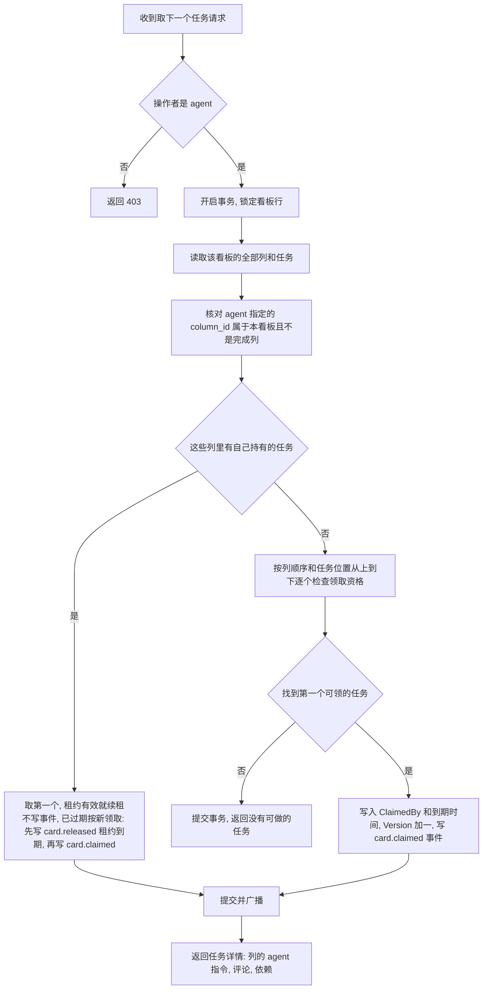
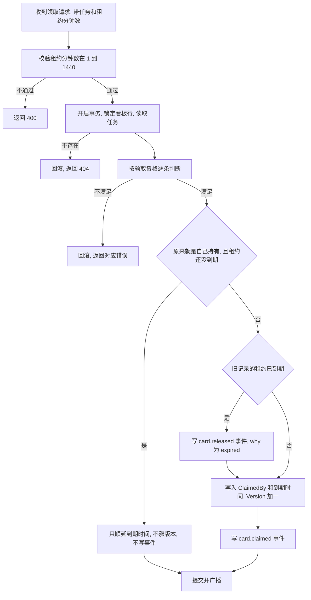
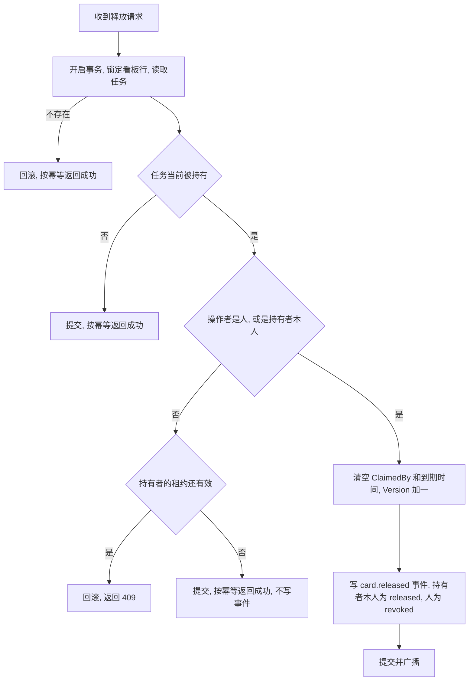
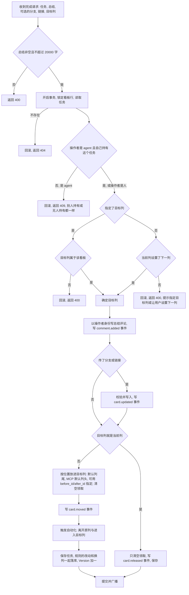
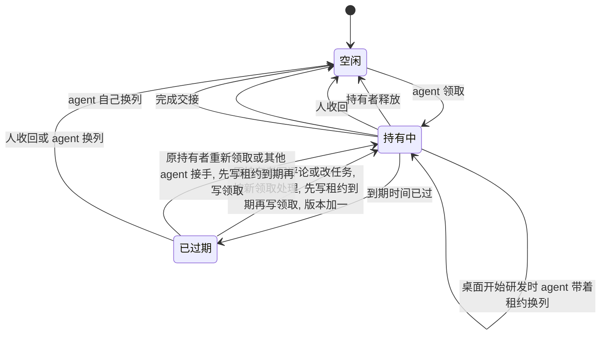

# 领取、租约与完成交接（kanban 包 claim.go）

## 需求目标

agent 取下一个任务时，必须传入按提示词选择的 column_id，只从该列取；其他列的任务可以用列表找出来再领取，各列允许 agent 做什么由列的提示词（Instruction）约定，服务端不按列拦截。多个 agent 可能同时在等活，
所以需要一个原子的取活动作，保证同一个任务不会被两个 agent 同时拿走；agent 可能崩溃或断网，
所以占用必须带过期时间；agent 做完以后要有明确的交接：留下总结、记录分支和链接、把任务移到下一列、释放占用。
这些都由 Core 里的四个方法完成：NextCard、ClaimCard、ReleaseCard、FinishCard。

| 编号 | 问题场景 | 不解决的后果 | 解决方案 | 状态 |
|------|----------|-------------|---------|------|
| 1 | 两个 agent 同时请求下一个任务 | 领到同一个，重复劳动，互相覆盖改动 | 取任务在锁定看板行的事务里完成，领取写入 ClaimedBy 和到期时间；后到的请求会看到这个任务已被领取，自动取下一个 | 实施 |
| 2 | agent 领了任务之后崩溃或断网 | 任务永远被占着，没有人再做 | 领取带租约，默认 30 分钟，最短 1 分钟，最长 24 小时；到期视为空闲，别的 agent 可以接手 | 实施 |
| 3 | agent 重启后不记得自己手上有哪个任务 | 又领一个新任务，旧任务悬在那里直到租约过期 | 取下一个任务时，先返回自己持有的任务并续租，没有才去找新的 | 实施 |
| 4 | 耗时长的任务超过了租约 | 任务被别人抢走，重复劳动 | 持有者每次写评论、改任务、再次领取都会顺延租约；skill 约定定期续租 | 实施 |
| 5 | agent 想领不该领的任务 | agent 误动需要人来做的任务、依赖未完成的任务或别人正在做的任务 | 领取要求同时满足：任务不是 HumanOnly、任务不在等待中、任务没有被别人持有；卡在哪一列不限，由列的提示词约定 | 实施 |
| 6 | agent 做完活没有统一的交接方式 | 人不知道成果在哪，任务还留在进行中被反复领取 | FinishCard 在一个事务里完成：写总结评论、记录分支和链接、移到目标列、释放领取、触发自动化 | 实施 |
| 7 | 做完以后该去哪一列不明确 | agent 乱选目标列，可能绕过人的评审 | 默认使用当前列的下一列；没有设置下一列返回 400 并提示；agent 显式指定目标列时只校验目标列属于该看板 | 实施 |
| 8 | 人想把正在被 agent 做的任务收回来 | 没有办法打断 | 人可以随时释放任何任务的领取，事件里 why 为 revoked；原持有者下一次写入收到 409，知道自己已经不持有 | 实施 |
| 9 | 租约过期后，原持有者回来继续，但任务已被另一个 agent 接手 | 两个 agent 同时改同一个任务 | 以 ClaimedBy 为准：已被别人接手，原持有者的写入返回 409 | 实施 |
| 10 | 租约过期后无人接手，原持有者回来完成 | 因为忘了续租而白做 | 仍然算持有，允许继续；回来写评论、改任务时按新的领取处理，租约从现在起重新算，并补记到期和新的领取（问题 15） | 实施 |
| 11 | 过期领取需要后台任务来清理 | 多一个后台任务，多一个故障点 | 不需要后台任务：所有判断都拿当前时间和到期时间比较，过期即视为空闲；释放事件只在状态真的变化时才写；到期本身没有时刻可写，等下一次新领取盖掉过期记录时再补记（问题 15） | 实施 |
| 12 | 人调用领取 | 领取是 agent 的概念，人领取会让界面和事件语义混乱 | 领取只给 agent 使用；人调用领取返回 403，人通过拖动任务分配工作 | 实施 |
| 13 | 桌面派发领取待办任务后把它移到进行中 | agent 换列会清除领取，只好再领一次：同一次派发出现两条领取事件，中间任务还有一小段没有持有者 | MoveCard 入参带 KeepClaimForEngineerID 时，持有者本人（同名 agent、同一位工程师、租约有效）换列保留租约，也不写 card.released；条件不符返回 409。目前只有桌面开始研发时使用，REST 和 MCP 不开放 | 实施 |
| 14 | 桌面的心跳续租和重复派发 | 心跳每次续租都写一条 card.claimed，活动里刷出一串假的领取；两台桌面的同名工程师还会互相续租、重复做同一个任务 | 持有者在有效期内再次领取只顺延到期时间，不涨版本、不写事件；桌面派发的领取遇到有效租约一律返回 409；心跳用 RenewOnly，只续自己有效的租约，过期或已被收回返回 409，不会重新领取 | 实施 |
| 15 | 租约断了之后又被领取（原持有者重启重领、回来继续写入，或别的 agent 接手） | 活动里只多一条新的领取，看不出上一次领取是断了而不是被续上；续租的重复记录又会把活动刷满 | 续租没断就不记录（问题 14）；到期的旧租约被新领取盖掉时，先写 card.released（why 为 expired，内容含 agent 和 expired_at），再写新的 card.claimed。事件记在发起新领取的人名下：别的 agent 接手时原持有者能收到「租约到期」，原持有者自己重领时是他自己的事件，不会推给他。原持有者在租约到期后回来写评论、改任务（问题 10）同样按新领取处理：先写到期，再写新的领取，然后才是评论或修改本身，版本加一；租约有效期内的写入只顺延到期时间，不写事件 | 实施 |

## 领取资格

一个任务对某个 agent 来说是否可领，按下面的顺序判断，任何一条不满足就停止，并返回对应的错误：

| 顺序 | 条件 | 不满足时的错误 |
|------|------|----------------|
| 1 | 操作者是 agent | 403，人不需要领取 |
| 2 | 任务不是 HumanOnly | 403，提示这个任务只能由人处理 |
| 3 | 任务没有未完成的依赖 | 409，提示它在等待哪些任务 |
| 4 | 任务没有被别的 agent 持有，或别人的租约已经过期，或持有者就是自己 | 409，提示被谁持有以及到期时间 |

## 工程师名额

看板有工程师时，领取多一道名额检查（代码在 `engineer_claim.go`、`claim_acquire.go`）：

- 工程师角色由 agent 按列提示词显式选择 engineer_id；未指定时默认分配研发类工程师，服务端不从列推断角色。
- 选人顺序：入参 `engineer_id`（必须是该类型且空闲）→ 任务绑定的工程师（仅研发阶段）→ 随机一位同类型的空闲工程师。
- 一位工程师同一时刻只能持有一个有效的任务；忙返回 `ErrEngineerBusy`，同类都忙返回 `ErrNoIdleEngineer`，任务绑定了别的工程师返回 `ErrEngineerBound`（都是 409）。任务被别的 agent 持有时仍是 `ErrCardClaimed`，所以多个 agent 同时领同一个任务，先到的成功、后到的被拒绝。
- 领到后写入任务的 `ClaimEngineerID`；研发领取时若任务没有绑定，同时写 `EngineerID`。清除领取（释放、完成、agent 换列、过期被抢）时一并清 `ClaimEngineerID`；人换列不清除领取，`ClaimEngineerID` 也保留；桌面开始研发时 agent 带着自己的有效租约换列（问题 13），领取和 `ClaimEngineerID` 同样保留。
- 续租：同名 agent 对自己持有的、租约还有效的任务重复领取，不传 `engineer_id` 就沿用 `ClaimEngineerID`，只顺延到期时间，不涨版本、不写事件。租约已过期时重新领取按新领取处理：涨版本，先写租约到期 `card.released`（why 为 expired），再写 `card.claimed`。过期的持有者回来写评论、改任务（`renewLease`）同样按新领取处理：两条事件排在评论或修改本身之前，`engineer_id` 沿用 `ClaimEngineerID`，`engineer_name` 留空（和普通 agent 的新领取一致，显示名由事件的 actor 决定）；评论只在这种情况下才涨版本，改任务本来就涨一次，不会多涨。
- `next_card` 跳过绑定给其他工程师的任务，没有空闲工程师时也跳过；没有工程师的看板（旧数据或空白模板）按原规则，不做名额检查。

## 取下一个任务

说明：顺序完全由人决定：列越靠左越先，同一列里越靠上越先；优先级只是展示，不参与排序。
找不到可领的任务时不是错误，返回空结果，由 agent 决定是等待还是结束。

## 指定领取与续租

## 释放

说明：别的 agent 想释放自己不持有的任务，对方的租约还有效就拒绝（409）；已经过期的领取在它看来本来就是空闲，什么都不做。

## 完成交接

说明：写总结评论、改分支和链接、换列、清空领取、触发自动化都在同一个事务里，任何一步失败整体回滚，
所以不会出现总结已经写了但任务还留在进行中的半成品。换了列时持有者的释放不再单独写 card.released 事件，因为 card.moved 已经表达了这件事；
留在原列时没有别的事件，才补一条 card.released。人也可以完成任何任务，这时同样清空领取。
换列的收尾和手动移动共用 commitMove，所以规则对谁的操作都一样生效。

## 领取状态

说明：已过期不是存储里的状态，没有任何后台任务去写它；它只是读取时用当前时间和到期时间比较出来的结果。
对读取方来说，已过期等同于空闲，只有原持有者继续操作时才会优先被识别为持有。

## 代码对照

| 步骤 | 函数 | 文件 |
|------|------|------|
| 取下一个任务 | Core.NextCard, unit.claimNext | internal/core/kanban/claim_acquire.go |
| 指定领取与续租 | Core.ClaimCard, unit.grantClaim | internal/core/kanban/claim_acquire.go |
| 释放 | Core.ReleaseCard, unit.releaseCard | internal/core/kanban/claim_release.go |
| 完成交接 | Core.FinishCard, unit.finishCard, finishTarget, recordLinks, handOver | internal/core/kanban/claim_finish.go |
| 领取资格 | checkClaimable, notPickupError | internal/core/kanban/claim.go |
| 桌面开始研发时带着租约换列 | unit.moveCard（MoveCardInput.KeepClaimForEngineerID） | internal/core/kanban/card_move.go, card.param.go |
| 有效租约、清除领取、补记租约到期、顺延租约（到期后重新开始时补记新的领取）、写领取事件 | claimActive, unit.clearClaim, unit.expireClaim, unit.renewLease, unit.emitClaimed | internal/core/kanban/claim.go |
| 持有者写评论时续租（先于评论保存） | unit.saveRenewedLease | internal/core/kanban/comment.go |
| 租约时长校验 | normalizeLease | internal/core/kanban/claim.go |
| 开启领取的列与看板索引 | boardIndex.pickupColumns, unit.boardIndex, unit.claimIndex | internal/core/kanban/claim.go, claim_acquire.go |
| 写入权限（持有者判断） | checkCardWritable | internal/core/kanban/card.go |
| 入参结构 | NextCardInput, ClaimCardInput, FinishCardInput | internal/core/kanban/claim.param.go |
