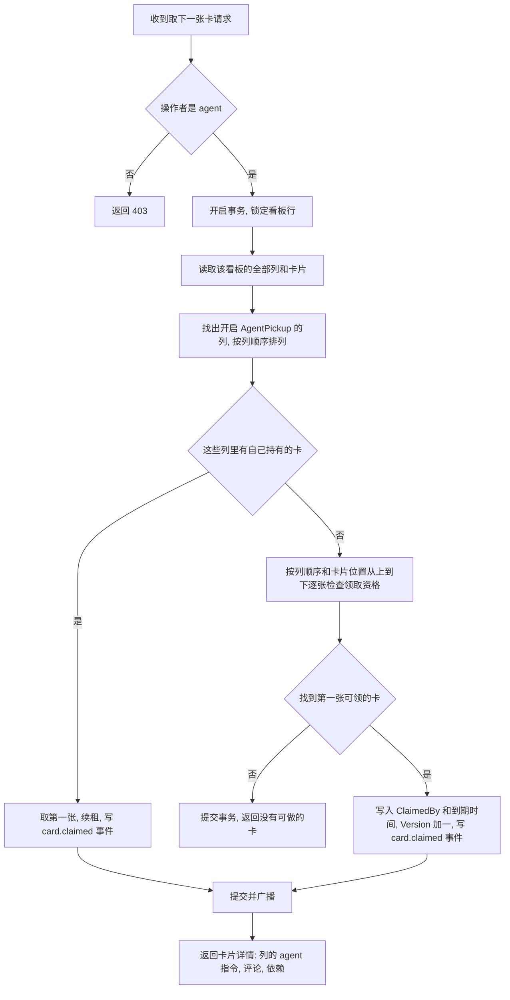
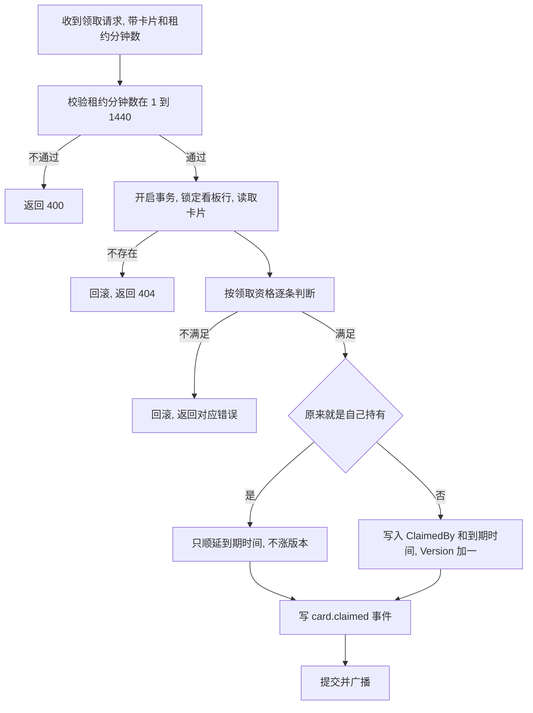
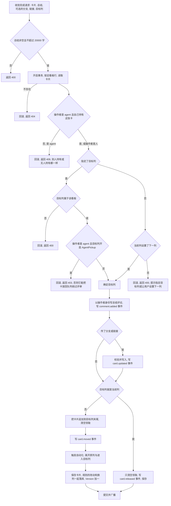
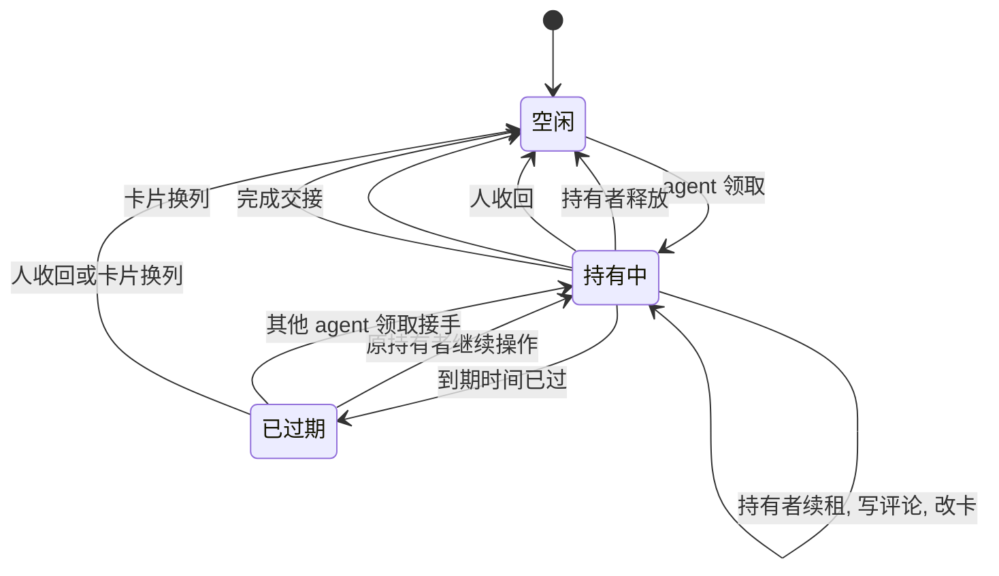

# 领取、租约与完成交接（kanban 包 claim.go）

## 需求目标

agent 要处理的活，只来自那些开启了 AgentPickup 的列（模板里是进行中）。多个 agent 可能同时在等活，
所以需要一个原子的取活动作，保证同一张卡不会被两个 agent 同时拿走；agent 可能崩溃或断网，
所以占用必须带过期时间；agent 做完以后要有明确的交接：留下总结、记录分支和链接、把卡移到下一列、释放占用。
这些都由 Core 里的四个方法完成：NextCard、ClaimCard、ReleaseCard、FinishCard。

| 编号 | 问题场景 | 不解决的后果 | 解决方案 | 状态 |
|------|----------|-------------|---------|------|
| 1 | 两个 agent 同时请求下一张卡 | 领到同一张，重复劳动，互相覆盖改动 | 取卡在锁定看板行的事务里完成，领取写入 ClaimedBy 和到期时间；后到的请求会看到这张卡已被领取，自动取下一张 | 实施 |
| 2 | agent 领了卡之后崩溃或断网 | 卡永远被占着，没有人再做 | 领取带租约，默认 30 分钟，最短 1 分钟，最长 24 小时；到期视为空闲，别的 agent 可以接手 | 实施 |
| 3 | agent 重启后不记得自己手上有哪张卡 | 又领一张新卡，旧卡悬在那里直到租约过期 | 取下一张卡时，先返回自己持有的卡并续租，没有才去找新的 | 实施 |
| 4 | 耗时长的任务超过了租约 | 卡被别人抢走，重复劳动 | 持有者每次写评论、改卡、再次领取都会顺延租约；skill 约定定期续租 | 实施 |
| 5 | agent 想领不该领的卡 | agent 误动想法池、评审中的卡，或需要人来做的卡，或依赖未完成的卡 | 领取要求同时满足：卡所在的列开启 AgentPickup、卡不是 HumanOnly、卡不在等待中、卡没有被别人持有 | 实施 |
| 6 | agent 做完活没有统一的交接方式 | 人不知道成果在哪，卡还留在进行中被反复领取 | FinishCard 在一个事务里完成：写总结评论、记录分支和链接、移到目标列、释放领取、触发自动化 | 实施 |
| 7 | 做完以后该去哪一列不明确 | agent 乱选目标列，可能绕过人的评审 | 默认使用当前列的下一列；没有设置下一列返回 400 并提示；agent 显式指定目标列时，不能是开启 AgentPickup 的列 | 实施 |
| 8 | 人想把正在被 agent 做的卡收回来 | 没有办法打断 | 人可以随时释放任何卡的领取，事件里 why 为 revoked；原持有者下一次写入收到 409，知道自己已经不持有 | 实施 |
| 9 | 租约过期后，原持有者回来继续，但卡已被另一个 agent 接手 | 两个 agent 同时改同一张卡 | 以 ClaimedBy 为准：已被别人接手，原持有者的写入返回 409 | 实施 |
| 10 | 租约过期后无人接手，原持有者回来完成 | 因为忘了续租而白做 | 仍然算持有，允许继续并自动续租 | 实施 |
| 11 | 过期领取需要后台任务来清理 | 多一个后台任务，多一个故障点 | 不需要后台任务：所有判断都拿当前时间和到期时间比较，过期即视为空闲；释放事件只在状态真的变化时才写 | 实施 |
| 12 | 人调用领取 | 领取是 agent 的概念，人领取会让界面和事件语义混乱 | 领取只给 agent 使用；人调用领取返回 403，人通过拖动卡片分配工作 | 实施 |

## 领取资格

一张卡对某个 agent 来说是否可领，按下面的顺序判断，任何一条不满足就停止，并返回对应的错误：

| 顺序 | 条件 | 不满足时的错误 |
|------|------|----------------|
| 1 | 操作者是 agent | 403，人不需要领取 |
| 2 | 卡片不是 HumanOnly | 403，提示这张卡只能由人处理 |
| 3 | 卡所在的列开启 AgentPickup | 403，提示这一列不允许 agent 处理，并说明哪些列允许 |
| 4 | 卡片没有未完成的依赖 | 409，提示它在等待哪些卡片 |
| 5 | 卡片没有被别的 agent 持有，或别人的租约已经过期，或持有者就是自己 | 409，提示被谁持有以及到期时间 |

## 取下一张卡

说明：顺序完全由人决定：列越靠左越先，同一列里越靠上越先；优先级只是展示，不参与排序。
找不到可领的卡时不是错误，返回空结果，由 agent 决定是等待还是结束。

## 指定领取与续租

## 释放

说明：别的 agent 想释放自己不持有的卡片，对方的租约还有效就拒绝（409）；已经过期的领取在它看来本来就是空闲，什么都不做。

## 完成交接

说明：写总结评论、改分支和链接、换列、清空领取、触发自动化都在同一个事务里，任何一步失败整体回滚，
所以不会出现总结已经写了但卡片还留在进行中的半成品。换了列时持有者的释放不再单独写 card.released 事件，因为 card.moved 已经表达了这件事；
留在原列时没有别的事件，才补一条 card.released。人也可以完成任何卡片，这时同样清空领取。
换列的收尾和手动移动共用 commitMove，所以规则对谁的操作都一样生效。

## 领取状态

说明：已过期不是存储里的状态，没有任何后台任务去写它；它只是读取时用当前时间和到期时间比较出来的结果。
对读取方来说，已过期等同于空闲，只有原持有者继续操作时才会优先被识别为持有。

## 代码对照

| 步骤 | 函数 | 文件 |
|------|------|------|
| 取下一张卡 | Core.NextCard, unit.claimNext | internal/core/kanban/claim_acquire.go |
| 指定领取与续租 | Core.ClaimCard, unit.grantClaim | internal/core/kanban/claim_acquire.go |
| 释放 | Core.ReleaseCard, unit.releaseCard | internal/core/kanban/claim_release.go |
| 完成交接 | Core.FinishCard, unit.finishCard, finishTarget, recordLinks, handOver | internal/core/kanban/claim_finish.go |
| 领取资格 | checkClaimable, notPickupError | internal/core/kanban/claim.go |
| 有效租约、清除领取、顺延租约 | claimActive, unit.clearClaim, unit.renewLease | internal/core/kanban/claim.go |
| 租约时长校验 | normalizeLease | internal/core/kanban/claim.go |
| 开启领取的列与看板索引 | boardIndex.pickupColumns, unit.boardIndex, unit.claimIndex | internal/core/kanban/claim.go, claim_acquire.go |
| 写入权限（持有者判断） | checkCardWritable | internal/core/kanban/card.go |
| 入参结构 | NextCardInput, ClaimCardInput, FinishCardInput | internal/core/kanban/claim.param.go |
