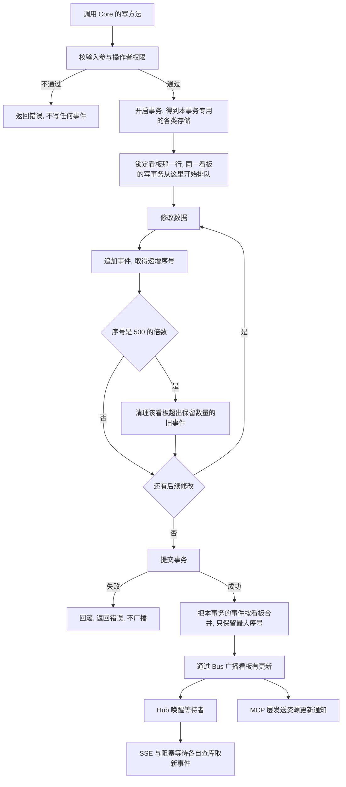
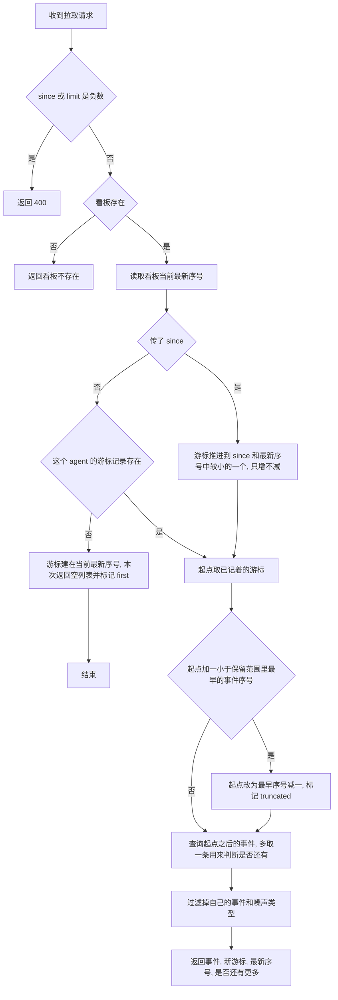
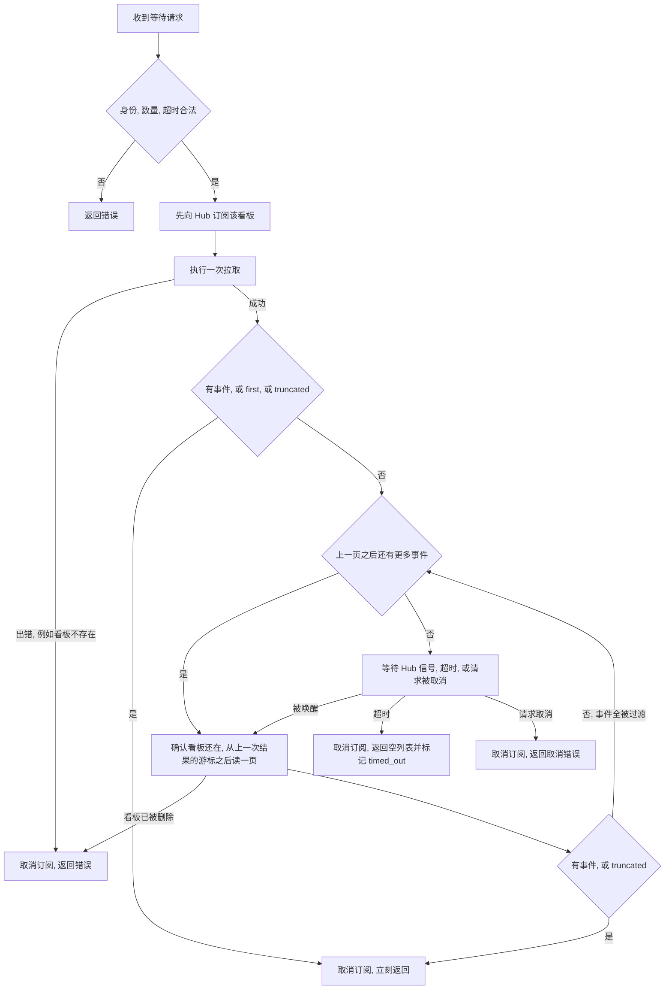
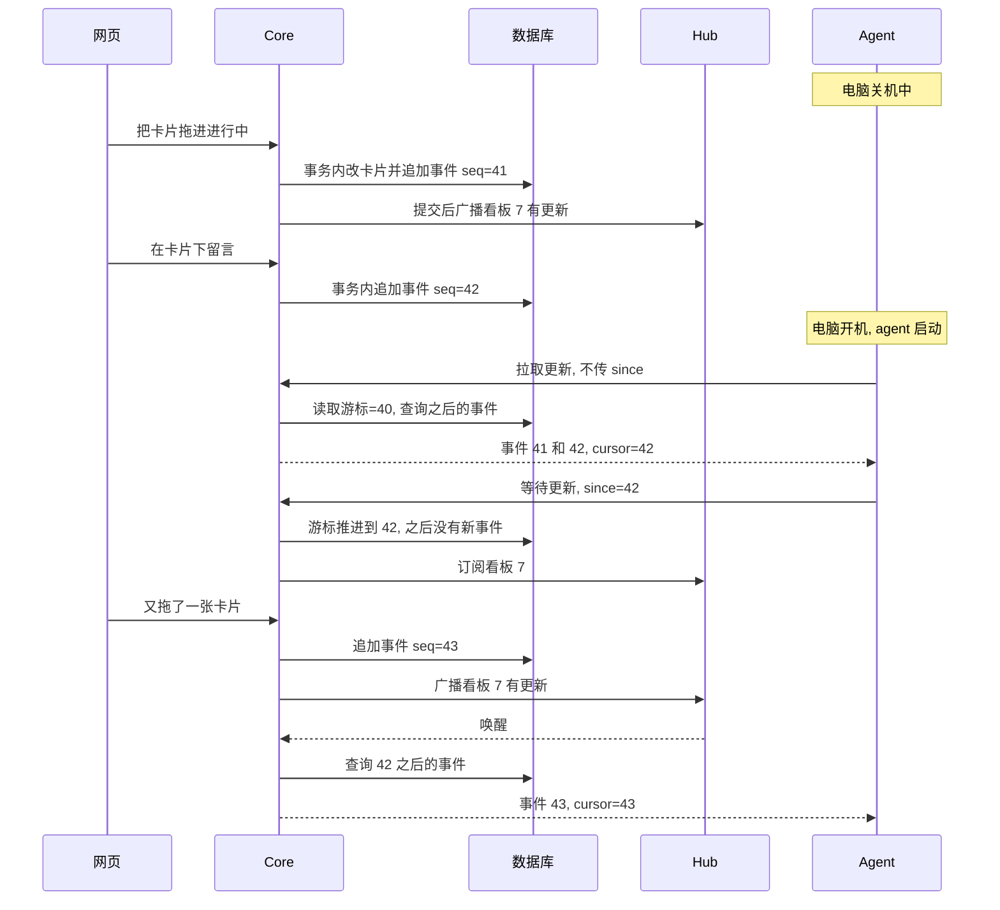

# 事件日志、游标与唤醒（kanban 包 event.go / unit.go / hub.go）

## 需求目标

看板会被两类人同时改：网页上的人，和各台电脑上的 agent。agent 不能一直盯着页面，所以服务端一旦有变化，
必须能主动叫醒它们；而 agent 所在的电脑可能关机、断网，上线后还要能把错过的变化补回来。
本设计用一张只追加的事件表做唯一的变化记录，用每个 agent 的游标记住它读到哪里，用内存里的 Hub 负责叫醒正在等待的人。
事件表是事实，叫醒只是提示，所以进程崩溃或通知丢失都不会让数据丢失。

| 编号 | 问题场景 | 不解决的后果 | 解决方案 | 状态 |
|------|----------|-------------|---------|------|
| 1 | 人在网页上把卡片拖进进行中，agent 正在等待 | agent 不知道有新活，卡片在进行中放着没人做 | 事务提交后通过 Bus 通知 Hub，Hub 立刻唤醒所有等待该看板的请求；同时 MCP 层发出资源更新通知，网页 SSE 也被唤醒 | 实施 |
| 2 | agent 的电脑关机，期间看板被改了几十次 | 上线后不知道错过了什么，会漏掉人留下的评论和新分配的卡片 | 每次变化写一条带递增序号的事件；服务端按看板加 agent 名保存游标；上线后从游标补拉 | 实施 |
| 3 | 事件已写入，但进程在广播之前崩溃 | 只会丢失一次唤醒，事件本身在库里，下一次拉取一定能拿到 | 先在事务里落库，提交后再广播；广播不携带任何只此一份的数据 | 实施 |
| 4 | agent 拿到一批事件后，处理到一半崩溃 | 如果拿到就算已读，这批事件永久丢失，人的评论没人回 | 只有下一次调用带上 since 才算确认上一批；不带 since 则从旧游标重新发送 | 实施 |
| 5 | 网页 SSE 断线后重连 | 断线期间的变化丢失，页面一直显示旧状态 | SSE 事件的 id 就是序号；重连带 Last-Event-ID，服务端先从库里补发，再切到实时 | 实施 |
| 6 | 两个 agent 共用同一个看板 | 一个 agent 确认进度，会把另一个 agent 的进度一起推进，对方漏事件 | 游标按（看板，agent 名）各存一份 | 实施 |
| 7 | agent 自己的操作（发评论、移动卡片）产生的事件又唤醒自己 | 空转，严重时两个 agent 互相触发形成死循环 | 拉取时过滤掉 actor 是自己的 agent 事件，但游标照常往前走 | 实施 |
| 8 | 事件表无限增长 | 数据库越来越大，查询变慢 | 每个看板只保留最近 10000 条；序号是 500 的倍数时顺带清理；游标落后于保留范围时返回 truncated，让 agent 重新读整块看板 | 实施 |
| 9 | 一个操作里连续改了多处（比如自动化规则连续执行多个动作） | 订阅者在事务中途被唤醒，读到半成品 | 事件在事务内写入，提交成功后一次性广播；订阅者被唤醒时数据一定已提交 | 实施 |
| 10 | 阻塞等待的请求一直占着数据库连接 | SQLite 只有一个连接，其他所有请求都被卡死 | 等待期间不开事务、不占连接，只在被唤醒或超时后做一次短查询 | 实施 |
| 11 | 看板被删除时还有人在等待 | 等待者要一直等到超时，且看不到看板已经没了 | 删除看板后再广播一次；等待者醒来重新查询，得到看板不存在的错误 | 实施 |
| 12 | 使用 PostgreSQL 时，两个事务同时写同一看板，序号小的事务反而后提交 | 读取方已经把游标推进到大序号，后提交的小序号事件对它永久不可见，agent 漏掉一次变化 | 每次写入的事务第一步先锁定看板那一行，同一看板的写事务因此串行，序号顺序等于提交顺序；创建看板时没有旧行可锁，也没有人持有它的游标，不需要锁 | 实施 |

## 事件类型

事件的 Payload 是一段 JSON，只放展示和判断需要的字段。网页根据 Type 和 Payload 在前端拼出各语言的活动文案，
所以服务端不在事件里存任何自然语言。

| Type | 触发时机 | Payload 字段 |
|------|----------|-------------|
| board.created | 创建看板 | name, slug |
| board.updated | 修改看板名称、说明或项目路径 | fields |
| column.created | 新增列 | column_id, name |
| column.updated | 修改列 | column_id, name, fields |
| column.deleted | 删除列 | column_id, name, moved_to_id, moved_cards |
| column.reordered | 调整列顺序 | ids |
| card.created | 创建卡片 | key, title, column_id, column |
| card.updated | 修改卡片字段 | key, title, fields |
| card.moved | 卡片换列 | key, title, from_id, from, to_id, to |
| card.reordered | 卡片在同一列内调整顺序 | key, column_id |
| card.deleted | 删除卡片 | key, title |
| card.claimed | agent 领取或续期 | key, title, agent, expires_at |
| card.released | 领取被释放或被收回 | key, title, agent, why；why 取 released（持有者主动释放）、revoked（人收回）、moved（卡片换列） |
| comment.added | 新增评论 | key, comment_id, author, author_kind, snippet |
| comment.deleted | 删除评论 | key, comment_id |
| rule.created / rule.updated / rule.deleted | 规则变更 | rule_id, name |
| automation.fired | 自动化规则执行 | key, rule_id, rule, actions, skipped |

## 写入路径：事务里落库，提交后广播

所有会改数据的 Core 方法都走同一个事务执行器，保证数据和事件同生共死。

说明：

- 锁定看板行用的是行锁。SQLite 只有一个连接，写事务本来就排队，行锁语句会被忽略；PostgreSQL 靠它保证同一看板的事件序号和提交顺序一致。
- 事务执行器中任何一步返回错误，整个事务回滚，已经追加的事件一并撤销，不会出现有事件没数据的情况。
- 广播处理函数返回的错误只记录日志，不影响本次请求的结果，因为数据已经提交。
- 看板被删除时，事件随看板一起删除，所以删除操作只广播不写事件。

## 读取路径：拉取更新

`PullUpdates` 的参数是看板、agent 名、since（可选）、limit（默认 100，最大 500）。只有 agent 能调用，人调用返回 403。

说明：

- 过滤有两类：actor 是自己的 agent 事件；以及对 agent 没有意义的噪声类型 card.reordered、column.reordered、automation.fired。网页的实时流不做任何过滤。
- 先分页再过滤：limit 限制的是读出来的原始事件数。一页事件全被过滤掉时，返回的事件为空，但游标照样前进、has_more 仍为真，调用方应该继续拉。
- 新游标等于本批扫描到的最后一个序号，包含被过滤掉的事件，这样自己的事件不会让下一次拉取原地踏步。
- 返回里的 cursor 不会自动保存。agent 下一次调用把它作为 since 传回来，才算确认；不传 since 就从服务端记着的游标重新读，所以结果丢了也不会漏。
- since 比服务端已有游标小的话忽略，游标永远不倒退；比最新序号大的部分按最新序号算，免得写错的大数字把以后的新事件都跳过去。
- 判断 truncated 用"起点加一小于最早保留的事件序号"。序号是所有看板共用的，同一看板里相邻事件的序号本来就可能不连续，只有起点比最早保留的事件序号还早一个以上，中间才可能缺了事件。
- 第一次见到某个 agent 时只记录当前位置，不回放历史。历史状态由读取整块看板获得，事件只负责告诉它之后发生了什么。
- 看板不存在时不会为它留下游标记录。

## 读取路径：阻塞等待

`WaitUpdates` 在拉取的基础上加了等待。timeout 默认 30 秒，最大 50 秒，因为多数 MCP 客户端和反向代理一分钟左右就会判定请求超时。

说明：

- 必须先订阅再拉取。如果反过来，在拉取结束到订阅开始的空隙里发生的更新，唤醒信号会丢，等待者要白等到超时。
- Hub 给每个订阅者的信号通道容量为 1，发送时不阻塞，多次更新合并成一次唤醒，唤醒后一次查库把所有新事件取回。
- agent 自己的操作也会唤醒自己，但事件被过滤掉了，所以醒来后读不到值得通知的事件，继续等。下一次从上一次结果的游标之后读，不重读已经过滤掉的事件。
- 一页事件全被过滤、后面还有更多事件时不等信号，直接读下一页，否则会白白等到超时。
- 超时不是错误，返回空事件并标记 timed_out，游标已经越过被过滤的事件；调用方把它作为 since 立刻再等一次。
- 等待本身不推进服务端游标，只有下一次调用带的 since 才确认。

## 读取路径：网页补发

`ListEvents(boardID, afterSeq, limit)` 给网页的实时流重连和活动列表用，人和 agent 都能读。它不做任何过滤，
limit 默认 200、最大 1000。起点早于保留范围时同样标记 truncated 并从保留范围的开头读起，
网页收到 truncated 就丢掉本地数据，重新读整板快照（见看板设计）。

## 时序：离线补拉与实时唤醒

## 代码对照

| 步骤 | 函数或类型 | 文件 |
|------|-----------|------|
| 事务执行器，开始时锁看板行 | Core.run, BoardStorer.Lock | internal/core/kanban/unit.go, board.go |
| 追加事件并按需清理 | unit.emit | internal/core/kanban/unit.go |
| 提交后广播 | Core.publish, Hub.publish | internal/core/kanban/unit.go, hub.go |
| 事件类型常量、事件与游标存储接口 | EventCardMoved 等, EventStorer, CursorStorer | internal/core/kanban/event.go |
| 读一页事件并判断 truncated | Core.readWindow | internal/core/kanban/event_read.go |
| 网页补发 | Core.ListEvents | internal/core/kanban/event_read.go |
| 数量整理 | normalizeLimit | internal/core/kanban/validate.go |
| 拉取、确认游标、过滤 | Core.PullUpdates, ackCursor, advanceCursor, scanUpdates, relevantToAgent, quietEventTypes | internal/core/kanban/event_pull.go |
| 阻塞等待 | Core.WaitUpdates, updateWaiter.wait, normalizeWaitTimeout | internal/core/kanban/event_wait.go |
| 整板快照 | Core.BoardSnapshot | internal/core/kanban/snapshot.go |
| 唤醒器与观察者 | Hub.Subscribe, Hub.Register, Core.Subscribe, Core.Observe | internal/core/kanban/hub.go, core.go |
| 事件模型与游标模型 | Event, AgentCursor | internal/core/kanban/event.model.go |
| 数据库实现 | kanbandb.Event, kanbandb.Cursor | internal/core/kanban/stores/kanbandb/event.db.go |
