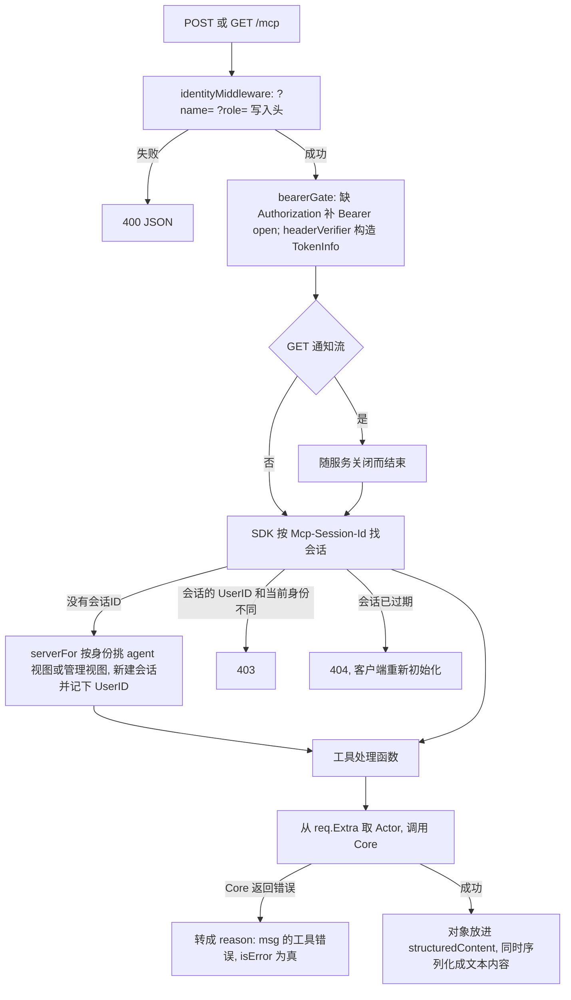
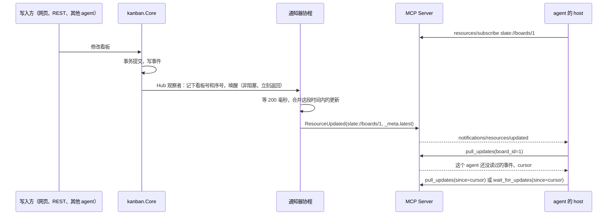

# MCP 服务（internal/web/mcpapi）

## 需求目标

agent 要通过 MCP 读写看板，并且在看板有变化时被通知；agent 可能不在线，上线后要能补齐离线期间的变化。
MCP 是看板领域（kanban）的第二个适配器，和 REST 一致：只做"取身份、调 Core、转换结果"，
权限判断和字段校验一律留在 Core 里，所以同一个操作无论从网页、REST 还是 MCP 进来，结果都一样。

| 编号 | 问题场景 | 不解决的后果 | 解决方案 | 状态 |
|------|----------|-------------|---------|------|
| 1 | MCP 工具里自己再写一套权限判断 | 同一个操作在不同入口结果不同，漏洞藏在某个入口里 | 工具只做"取身份、调 Core、转结果"，权限和校验全在 Core；工具视图只是减少干扰，不是安全边界 | 实施 |
| 2 | MCP 请求没有可靠的身份 | 不同入口的操作者混乱 | `identityMiddleware` 解析 `?name=` 与 `?role=worker|manager`，校验后写入 `X-Slate-Actor-*` 头；`bearerGate` 在无 Authorization 时补占位 `Bearer open`，SDK 用 `headerVerifier` 读头构造 TokenInfo 做会话绑定 | 实施 |
| 3 | agent 看到一堆自己用不了的管理工具 | 占掉上下文，还会反复尝试越权再被拒绝 | 两套工具视图：`role=worker`（默认 agent 名）16 个工作工具，`role=manager` 23 个管理工具；同名工具入参按身份裁剪 | 实施 |
| 4 | 一个工具返回整板卡片，每张描述最长 20000 字 | 一次响应几百 KB，把 agent 的上下文撑爆 | `list_cards` 和资源快照里的卡片只给摘要（没有描述和评论），要看全文用 `get_card`；`list_cards` 默认 50 张、最多 200 张；资源快照最多 200 张，并如实给出 `total` 和 `truncated`；创建、修改、移动卡片只返回精简字段，不把刚写进去的描述原样回传 | 实施 |
| 5 | 服务端有更新，agent 不知道 | 只能盲目轮询 | agent 订阅资源 `slate://boards/{board_id}`，看板每次提交更新，服务端异步发 `notifications/resources/updated`（带最新事件序号）；200 毫秒内的多次更新合并成一次通知；通知不阻塞写请求 | 实施 |
| 6 | agent 当时不在线，或者它的 host 不支持订阅通知 | 通知丢了就丢了更新 | 通知只是"有更新"的提示，不带数据也不保证送达；数据靠 `pull_updates`：进度按（看板，agent）存在服务端数据库里，离线多久都能补读；离线太久事件被清理时返回 `truncated`，agent 用 `list_cards` 重新了解现状 | 实施 |
| 7 | agent 想一直挂着等活 | 定时轮询浪费请求，而且 host 的循环功能很笨重 | `wait_for_updates` 阻塞到有值得处理的更新为止，最长 50 秒（低于常见代理和客户端的一分钟超时）；超时返回 `timed_out`，不是错误，agent 带着返回的 `cursor` 立刻再等 | 实施 |
| 8 | 关闭服务时，挂着的阻塞等待和通知流让 Shutdown 一直等到超时 | 每次重启卡 5 秒，还留下一条错误日志 | 和 REST 一样用 `lifecycle.Bind`：阻塞等待返回"服务正在关闭"，通知流直接结束；普通工具调用不受影响 | 实施 |
| 9 | 通知流（客户端用 GET 一直挂着的连接）永远不断 | 僵尸连接占资源 | 依赖正常 TCP/代理超时与服务关闭时 `lifecycle.Bind` 结束；身份在连接 URL 里，换 name 重连即换身份 | 实施 |
| 10 | 服务放在 nginx 后面，nginx 用 127.0.0.1 连过来，Host 头是域名 | SDK 默认 Host 校验误判 DNS 重绑定 | 关闭这项校验；MCP 身份在查询参数，不靠 Bearer 秘密 | 实施 |
| 11 | 内部错误的细节原样返回给 agent | 数据库错误文本进了模型的上下文，还可能被写进它的记录里 | 业务错误返回 `reason: msg`；不是业务错误的只记日志，返回通用文案；错误的 details 一律不返回 | 实施 |
| 12 | agent 不知道这个看板怎么用 | 领不该领的卡、把卡片拖进完成列、一直轮询 | 连接时下发简短的使用说明（instructions），每个工具的描述写清前置条件和后果；worktree、子 agent、项目路径这类更完整的流程放在 skill 里 | 实施 |
| 13 | 会话越攒越多 | 内存一直涨 | 会话空闲 6 小时自动关闭，客户端按协议重新初始化 | 实施 |
| 14 | 新版协议（2026-07-28 起的无状态协议）的客户端 | 部分新 host 可能只讲新协议 | 本版只提供有状态会话（2025 系列协议）。SDK 对新协议请求返回"不支持的协议版本"并列出支持的旧版本，遵循规范的客户端会自动降级；将来 host 不再支持旧协议时，再加一个无状态入口 | 限制 |

## 两套工具视图

`serverFor` 在会话创建时按身份挑一个 MCP Server，之后整个会话都用它。视图是为了让 agent 只看到自己能用的工具，
真正的权限仍由 Core 判断：agent 即使绕过视图直接调用别的 REST 接口，也会被 Core 拒绝。

| 工具 | agent 视图 | 管理视图 | Core 方法 | 说明 |
|------|:---------:|:-------:|-----------|------|
| whoami | 有 | 有 | — | 当前身份、视图、服务版本、订阅用的资源地址 |
| list_boards | 有 | 有 | ListBoards | 看板列表 |
| get_board | 有 | 有 | GetBoard | 看板、列（含列说明和给 agent 的指令）、规则 |
| list_cards | 有 | 有 | ListCards | 按筛选语法列出卡片摘要 |
| get_card | 有 | 有 | GetCardDetail | 卡片全文、评论、依赖、所在列的指令 |
| pull_updates | 有 | — | PullUpdates | 拉取没读过的更新，进度在服务端 |
| wait_for_updates | 有 | — | WaitUpdates | 阻塞等待更新，最长 50 秒 |
| next_card | 有 | — | NextCard | 从"agent 领取列"里领下一张该做的卡，没有时 `card` 为 null |
| claim_card | 有 | — | ClaimCard | 领取或续租指定的卡 |
| release_card | 有 | 有 | ReleaseCard | agent 释放自己的；人可以收回任何一张 |
| finish_card | 有 | 有 | FinishCard | 写总结并交接到下一列（通常是"审查"） |
| comment_card | 有 | 有 | AddComment | 写评论 |
| create_card | 有 | 有 | CreateCard | agent 版没有规划类字段 |
| update_card | 有 | 有 | UpdateCard | agent 版没有规划类字段，只能改自己持有的卡 |
| move_card | 有 | 有 | MoveCard | agent 只能移自己持有的卡，且不能放进"agent 领取列" |
| set_project_path | 有 | — | UpdateBoard | 项目路径为空时写入；已有值时返回 `ErrProjectPathLocked` |
| list_events | — | 有 | ListEvents | 看板的活动流水 |
| create_board、update_board | — | 有 | CreateBoard、UpdateBoard | 项目（看板）的创建和修改；有意不提供删除，删除项目只能由人在网页上输入项目名称确认后完成（`TestNoBoardDeletionTool` 守住这一条） |
| create_column、update_column、reorder_columns、delete_column | — | 有 | CreateColumn、UpdateColumn、ReorderColumns、DeleteColumn | 列管理 |
| create_rule、update_rule、delete_rule | — | 有 | CreateRule、UpdateRule、DeleteRule | 自动化规则管理 |
| delete_card、delete_comment | — | 有 | DeleteCard、DeleteComment | 删除 |

agent 视图 16 个，管理视图 23 个（`whoami`、`list_boards`、`get_board`、`list_cards`、`get_card`、`release_card`、`finish_card`、`comment_card`、
`create_card`、`update_card`、`move_card` 共 11 个共用，加上 12 个管理专用）。

没有对应工具的 Core 方法：`DeleteBoard`（有意不提供，只有网页用的 REST 接口能删除项目）、`BoardSnapshot`（作为资源提供，见"资源"）、`GetCard`（`get_card` 已覆盖）、`LatestSeq`、`Subscribe`、`Observe`（内部使用）。
不再提供 agent 令牌管理；MCP 通过 URL 自报名称区分 agent。

工具注解（告诉 host 哪些调用可以放心自动执行）：读取类标 `readOnlyHint`；删除类标 `destructiveHint`；
其余写入类明确标 `destructiveHint: false`（协议默认值是 true）；所有工具标 `openWorldHint: false`（只和这个看板打交道）。

## 一次调用怎么走

身份解析排在 MCP 协议处理之前。请求体上限 1 MiB 由 SDK 的 `MaxRequestBodyBytes` 检查。
单个请求的结果直接用 JSON 返回（`JSONResponse`），不占用 SSE 长连接；只有客户端用 GET 打开的通知流是长连接。

## 身份与会话

`headerVerifier` 只读 `X-Slate-Actor-Kind` 与 `X-Slate-Actor-Name`（由 `identityMiddleware` 写入，覆盖客户端自带同名头），不校验 Bearer 字符串含义。
占位 `Bearer open` 只为满足 SDK 的 `RequireBearerToken` 形状。

| 字段 | 内容 | 谁用 |
|------|------|------|
| UserID | `human:名称` 或 `agent:名称` | SDK 防止会话劫持：会话创建后 UserID 必须一致 |
| Extra["actor"] | `kanban.Actor` | 工具从 `req.Extra` 取出传给 Core |
| Expiration | 不设置（`AllowMissingExpiration`） | 无真实令牌过期 |

`?role=manager` 时 kind 为 human、视图为管理工具集；否则为 agent、工作视图。`name` 缺省时 worker 用 `agent`，manager 用 `manager`。
非法 name/role 在进 MCP 协议前返回 400 JSON。

## 通知和离线补读

- **观察者不能拖慢写请求**：`Core.Observe` 注册的函数在提交写入的请求协程里同步执行，所以它只做两件事——把看板号和序号记进一个小表、
  往容量为 1 的通道里非阻塞地放一个信号——然后立刻返回 nil。真正的发送由通知器自己的协程完成。
  观察者返回错误会让写请求失败，所以它永远返回 nil。
- **合并**：信号只表示"有看板脏了"。通知器被唤醒后先等 200 毫秒，再一次取走所有脏看板，每个看板只发一条通知，序号取最大的。
  连续的批量改动（比如自动化规则连锁触发）最多每 200 毫秒产生一条通知。
- **每个服务发一遍**：两套视图是两个 Server，各自管自己的订阅，通知器对两个都调用 `ResourceUpdated`。没人订阅时什么都不发。
- **通知可以丢**：没有 GET 通知流连着、客户端断线重连的间隙里，SDK 会丢掉通知。这不是问题：
  通知只是提示，agent 下次 `pull_updates` 或 `wait_for_updates` 照样能读到全部更新。
- **离线补读**：agent 的读取进度（`agent_cursors`）在服务端数据库里，按（看板，agent）一行。agent 离线期间的事件留在事件表里，
  上线后调用 `pull_updates` 就能按顺序补读；`has_more` 为真就立刻再拉；`truncated` 为真说明离线太久、中间的事件已经被清理，
  这时用 `list_cards` 重新了解现状。第一次读某个看板（`first`）不补发历史，同样用 `list_cards` 了解现状。
- **订阅校验**：订阅的地址必须是 `slate://boards/{整数}`，并且看板存在，否则订阅失败。合法 `?name=` 连上的会话都可以订阅。

## 阻塞等待

`wait_for_updates` 的处理函数和 REST 的 `waitUpdates` 一样：

1. `lifecycle.Bind(ctx)` 得到一个"服务开始关闭时会被取消"的上下文。工具处理函数拿到的上下文继承自创建会话的那个请求，
   请求里已经带着 `lifecycle.Wrap` 放进去的"关闭中"信号，所以 Bind 能生效。
2. 用它调用 `Core.WaitUpdates`；超时返回 `timed_out` 为真的空结果，不是错误。
3. 如果是服务关闭打断的（`lifecycle.Interrupted`），返回 `ErrServiceUnavailable`，agent 稍后重试即可。
4. 客户端取消请求（MCP 的 `notifications/cancelled`）时 SDK 会取消处理函数的上下文，Core 立刻返回，不会白白占着一个协程。

`timeout_seconds` 为 0 用默认 30 秒，超过 50 秒按 50 秒；换算成纳秒前先压到 3600 秒以内，防止溢出。

## 资源

只有一个资源模板 `slate://boards/{board_id}`：读取它返回整板快照（看板、列、规则、最多 200 张卡片摘要、卡片总数 `total`、是否被截断 `truncated`、`seq`），
订阅它得到"看板有更新"的通知。agent 平时用 `pull_updates` 取增量，快照主要给人手动查看或被截断后重新了解现状使用。

地址解析很严格：必须是 `slate://boards/` 加上正整数，不允许多余的路径、查询参数、符号、空白或前导零；解析不了、看板不存在，读取和订阅都按协议规定的"资源不存在"处理。

## 工具的入参和输出

- 入参结构体为每个工具单独定义，字段带中文说明，可选字段用 `omitempty`，这样 JSON Schema 里只有必填项被标成 required。
  不复用 Core 的入参类型，因为它们的字段没有 `omitempty`，会被全部标成必填，模型每次都得把所有字段填一遍。
  结构体里的指针字段（"没出现表示不改"）在 Schema 里是"类型或 null"，传 null 和不传一样，都表示不改。
- Schema 不允许多余字段（SDK 默认 `additionalProperties: false`），字段名写错会返回工具错误（`isError` 为真，文本以 `validating "arguments":` 开头并指出是哪个字段），而不是被悄悄忽略。SDK 把入参校验失败当成工具错误而不是协议错误，agent 能直接读到原因。
- 输出一律是 JSON 对象（列表外面包一层，例如 `{boards: [...]}`），同时放进 `structuredContent` 和文本内容，
  不声明输出 Schema（领域对象的 Schema 很大，会白白占用每次 `tools/list` 的上下文）。
- 事件的 JSON 和 REST、实时流里是同一种格式（Payload 是对象），因为都来自 Core 的同一个类型。
- 写入类工具的结果都很精简：创建、修改、移动卡片返回 `cardBrief`（没有描述和派生状态），`finish_card` 返回 `cardSummary`，领取类返回卡片全文，删除类返回 `{ok: true}`。
- `set_project_path` 拒绝空路径（`ErrInvalidInput`）：空路径在人那里表示清除，agent 只能写入，所以"写了个空"不能被当成成功；两端的空白会被去掉。

精简卡片（`cardBrief`）的字段：`id, key, title, column_id, priority, tags, human_only, claimed_by, waits_on, due_at, started_at, finished_at,
branch, url, version, updated_at`。
卡片摘要（`cardSummary`）在它的基础上多四个派生字段：`column`（列名）、`done`、`waiting`、`claim_active`。

## 错误

| 情况 | 返回 |
|------|------|
| Core 返回 `reason.Error` 且状态码小于 500（权限、校验、找不到、冲突） | 工具错误（`isError` 为真），文本是 `reason: msg`，例如 `ErrAgentOnly: …` |
| Core 返回 500 类的 `reason.Error`（数据库出错） | 记日志（带 details），工具错误文本只有 `reason: msg`，msg 是通用文案 |
| 服务关闭打断 | `ErrServiceUnavailable: 服务正在关闭，请稍后重试` |
| 客户端取消 | 不再有人读结果，按普通取消处理，不记日志 |
| 其他错误 | 记日志，返回 `ErrInternal: 服务器内部错误` |
| 入参不符合 Schema | SDK 在进入处理函数之前拒绝，返回工具错误，文本以 `validating "arguments":` 开头 |
| 读取或订阅资源时地址不合法或看板不存在 | 协议级错误 `Resource not found`（JSON-RPC 错误码 `mcp.CodeResourceNotFound`，go-sdk 1.8.0 里是 -32602），`data.uri` 是请求的地址 |

## 接线

- `mcpapi.New(kanban.Core, buildVersion, ...Option) (API, func())` 创建两套 Server（工作 16 工具、管理 23 工具）、通知器和 HTTP 处理器；清理函数停通知器协程。
  `Core.Observe("mcp", …)` 在此注册。测试可选项：`WithNotifyDelay`（通知合并窗口，默认 200 毫秒）。
- `internal/web/api/provider.go` 的 `NewMCP` 从配置取构建版本后调用 `mcpapi.New`；`Usecase.MCP` 供 `setupRouter` 挂 `/mcp`。
- `setupRouter` 增加 `r.Any(mcpPath, gin.WrapH(uc.MCP.Handler()))`（`mcpPath` 是 `/mcp`）。它在全局的恢复、统计、日志中间件之内，不在 `/api/v1` 组里，
  因为 MCP 有自己的认证和请求体检查，套上 REST 的 `requireJSON` 会误拦 MCP 协议里的 GET 和 DELETE。方法由 SDK 区分：POST 是初始化和工具调用，GET 是通知流，DELETE 是结束会话。
- 依赖：`github.com/modelcontextprotocol/go-sdk v1.8.0`。官方维护，API 稳定到 v1；它的传递依赖是 JSON Schema 库、`oauth2` 和 URI 模板库。
- 配置：不新增配置项。路径固定为 `/mcp`，端口、监听地址沿用服务的配置。

## 限制与没做的事

- 只有有状态会话（见需求 14）；没有 stdio 入口。只支持 stdio 的 host 可以用 `npx mcp-remote` 之类的桥接工具连接 `/mcp`。
- 通知只通知"看板有更新"，不区分和哪个 agent 有关。区分的工作交给 `pull_updates`（它会过滤掉 agent 自己的操作和排序类事件）。
- 没有 MCP Prompts，也没有进度通知：host 对它们的支持参差不齐，流程指引放在 skill 和 instructions 里。
- 没有配置 SDK 的 EventStore（流断点续传）：通知本来就允许丢，不值得为它在内存里存消息。
- 没有按令牌或定时器强制断开通知流：GET 连接随服务关闭（`limitStream`）或客户端断开而结束。

## 验证

- 单元与集成测试（`internal/web/mcpapi`、`internal/web/api`）：SDK 客户端连真实 HTTP，覆盖 `?name=` 身份与会话 UserID 绑定、两套工具数量（16/24）、干活闭环、错误不泄露细节、
  `pull_updates` / `wait_for_updates`、资源与订阅、通知合并与不拖慢写入、通知流随服务关闭结束、反向代理 Host、`DisableLocalhostProtection`、请求体上限、新协议降级答复；
  路由层验证 `/mcp` 身份参数与 `TestMCPInitializeWorker`、`TestMCPManagerTools`、`TestMCPNotifiedByREST` 等（`mcp_test.go`）。
- 变异验证：关键路径（错误泄露、会话劫持、错误视图工具、观察者阻塞、等待取消与关闭、地址解析等）有专项变异脚本覆盖。
- 真实进程冒烟：两视图工具数、订阅、领取与交接、离线补读、关闭时阻塞等待返回 503。

## 代码对照

| 步骤 | 函数 | 文件 |
|------|------|------|
| 创建 Server、通知器、处理器 | New, newHandler, serverFor | internal/web/mcpapi/api.go |
| 查询参数身份、写头 | identityMiddleware, parseQueryIdentity | internal/web/mcpapi/middleware.go |
| 占位 Bearer、会话 TokenInfo | bearerGate, headerVerifier | internal/web/mcpapi/openauth.go |
| 从 TokenInfo 取 Actor | actorOf, actorFromHeaders | internal/web/mcpapi/identity.go |
| 工具注册的统一包装 | register | internal/web/mcpapi/register.go |
| 错误转换 | toolError | internal/web/mcpapi/errors.go |
| 只读工具 | whoami、listBoards、getBoard、listCards、getCard、listEvents | internal/web/mcpapi/tools_read.go |
| 同步工具 | pullUpdates、waitForUpdates | internal/web/mcpapi/tools_sync.go |
| 工作工具 | nextCard、claimCard、releaseCard、finishCard、commentCard、createCard、updateCard、moveCard、setProjectPath | internal/web/mcpapi/tools_work.go |
| 管理工具 | 看板、列的增删改，deleteCard、deleteComment | internal/web/mcpapi/tools_admin.go |
| 自动化规则工具 | createRule、updateRule、deleteRule | internal/web/mcpapi/tools_rule.go |
| 卡片摘要与精简字段 | summarize、briefOf、clampListLimit | internal/web/mcpapi/summary.go |
| 资源与订阅 | readBoard、subscribe、parseBoardURI、resourceError | internal/web/mcpapi/resource.go |
| 通知器 | notifier.mark、notifier.run | internal/web/mcpapi/notify.go |
| 使用说明 | instructionsFor（agentInstructions、adminInstructions） | internal/web/mcpapi/instructions.go |
| 通知流随服务关闭结束 | limitStream | internal/web/mcpapi/api.go |
| 路由与装配 | NewMCP、setupRouter | internal/web/api/provider.go、internal/web/api/api.go |
