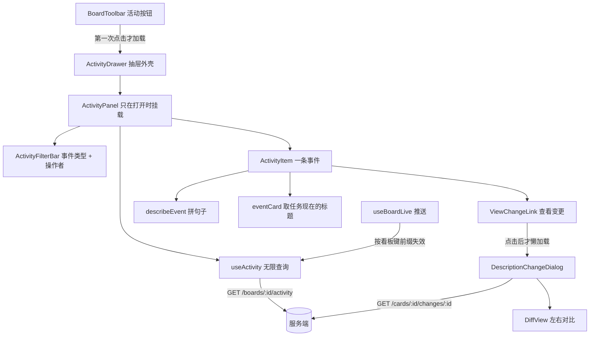

# 看板活动流（网页抽屉）

## 需求目标

在看板页用一个从右侧滑出的抽屉，按时间从新到旧展示「谁在什么时候做了什么」：移动、领取、评论、规则触发、改设置等。
可以按事件类型和操作者筛选；抽屉开着的时候，别人或 agent 的新操作会实时出现在最上面。
数据来自服务端的事件日志（见 `kanban.event.go.md`），网页只负责读取和展示，不新增任何写操作。

## 问题场景

| 编号 | 问题场景 | 不解决的后果 | 解决方案 | 状态 |
|------|----------|-------------|---------|------|
| 1 | agent 在后台移动、领取、评论，人回来时不知道发生了什么 | 只能一个个点开任务翻评论，或者对比看板猜 | 工具栏「活动」按钮打开抽屉，列出最近的事件；每条显示操作者、一句话、涉及的任务、相对时间（悬停显示完整时间） | 实施 |
| 2 | 事件很多，只想看某一类或某个人 | 在长列表里找，找不到 | 顶部筛选条：事件类型分成 6 组（移动、任务、领取、评论、规则触发、项目设置），可多选取并集；操作者单选（所有人、我、各 agent、各规则）。选项由服务端返回的操作者列表生成 | 实施 |
| 3 | 一次读全部事件会很慢 | 事件上限 10000 条，一次拉完要等很久 | 每页 30 条，点「加载更早的活动」用最旧一条的序号翻下一页；筛选在服务端数据库里做，所以每页都是满的 | 实施 |
| 4 | 事件里没有自然语言 | 网页显示一堆 `card.moved` | `describeEvent` 按事件类型和载荷在前端拼各语言的句子（五种语言各一套）；不认识的事件类型（服务端比网页新）显示成通用的一句话，不会让列表出错 | 实施 |
| 5 | 抽屉开着时看板有新动作 | 列表过期，用户以为没人动 | 缓存键 `['board', 看板编号, 'activity', 筛选条件]` 挂在看板键下面，`useBoardLive` 收到服务端推送时按看板键前缀失效，开着的抽屉自动重新读取；自己的拖动、评论也走同一个失效，所以自己的操作马上出现 | 实施 |
| 6 | 抽屉关着时也在后台刷新 | 白白多发请求 | 内容组件只在抽屉打开时才挂载，关着时没有观察者，失效不会触发重新读取；再次打开会立刻重新读取 | 实施 |
| 7 | 任务已经改名或被删除 | 链接点进去是空的，或显示旧标题 | 任务还在看板上时显示它现在的编号和标题并做成链接（点击后抽屉关闭，打开任务弹窗）；已被删除的只显示事件里记的编号和标题，不做链接 | 实施 |
| 8 | 人的称呼 | 「human」「人」不自然 | 人统一显示成「我」（英文 Me），规则触发显示成「自动化 · 规则名」，agent 显示它自己报的名字 | 实施 |
| 9 | 首屏体积 | 抽屉代码拖慢首屏 | 抽屉整体懒加载，第一次点「活动」才下载（约 4 kB gzip）；工具栏只多一个按钮 | 实施 |
| 10 | 连接中断 | 活动流请求失败 | 抽屉显示「连不上服务器」和重试按钮 | 实施 |
| 11 | 连续两条「修改了描述」看不出改了什么 | 只能凭记忆猜，或者去翻别的地方 | 载荷里带 `description_change_id` 的事件，在句子后面加带下划线的「查看变更」（句子和链接之间的标点跟着语言走）；点击才请求 `GET /cards/:id/changes/:id`，弹窗里左边旧版本、右边新版本并排对比。活动抽屉和任务弹窗里的「评论和活动」用同一个组件，句子完全一致 | 实施 |

## 界面结构

## 事件分组

| 分组 | 包含的事件类型 |
|------|---------------|
| 移动 | card.moved, card.reordered |
| 任务 | card.created, card.updated, card.tags_updated, card.deleted |
| 领取 | card.claimed, card.released |
| 评论 | comment.added, comment.deleted |
| 规则触发 | automation.fired |
| 项目设置 | board.created, board.updated, board.labels_updated, column.*, rule.* |

**修改事件的文字**：`card.updated` 按载荷里的 `fields` 写明改了哪些属性，例如“修改了优先级、截止时间”（时间类字段用更完整的叫法，其余复用任务详情里的属性名）；旧事件没有字段清单时退回成笼统的“修改了任务”。设置标签太琐碎：服务端把它记成独立的 `card.tags_updated` / `board.labels_updated`，网页读活动流和任务「评论和活动」时固定带 `exclude_types=card.tags_updated,board.labels_updated`（常量 `HIDDEN_EVENT_TYPES`）把它们挡掉；它们仍然会实时广播，所以别的窗口里的标签照样即时刷新。

后端新增事件类型时，`filters.test.ts` 会读取 `internal/core/kanban/event.go` 核对：每个类型必须恰好属于一个分组，否则测试失败，提醒给新类型安排分组和句子。

## 查看变更（描述对比）

- **入口**：`describeEvent` 把载荷里合法的 `description_change_id`（正整数）交给界面；`ActivityItem` 和 `CardTimeline` 在句子后面放 `ViewChangeLink`。任务已经删除时（变更记录随任务一起删了）、旧事件没有编号时、改的不是描述时都不显示链接。
- **按需加载**：对比弹窗和 diff 算法是单独的一块代码（约 3.4 kB gzip），第一次点「查看变更」才下载；点开之后才请求变更记录。变更记录只增不改，所以查询缓存 `['card-change', 任务编号, 变更编号]` 永不过期，同一条再次打开直接用缓存，也不挂在看板键下面，不跟着实时推送刷新。
- **弹窗**：标题「描述的变更」，副标题「操作者 · 时间」；读取中显示骨架，失败显示错误和「重试」，记录已不存在显示 `errors.ErrCardChangeNotFound`。弹窗最高不超过屏幕，内容多时只有对比区自己滚动，标题和关闭按钮不动。
- **对比区（`features/diff/DiffView`）**：布局仿 VS Code 的 git diff。左边「修改前」、右边「修改后」，两侧都有行号；删除和被改动的行在左边用红色底并带「−」，新增和改动后的行在右边用绿色底并带「+」；一边没有对应行时，另一边用斜线条纹填充；改动行里再把具体改了的词或字用更深的底色标出来（中文按字比较）；顶部的标题栏固定不动，右上角显示「+新增行数 −删除行数」；打开后自动把第一处改动滚到中间。前后内容完全一样时只显示一句说明。长行自动换行，不出横向滚动条。
- **行比较算法**：`lineDiff.ts` 用 Myers 算法比较行，把相邻的「删 + 增」配成「改」，再在改动行里做词级比较；超大文本有上限保护，不会卡死页面。

## 请求与状态

- 筛选条件（`ActivityFilters`）只在抽屉内存里，每次打开从「没有筛选」开始，不写本地存储。
- 事件类型分组按固定顺序排列后再生成缓存键，所以先点哪个后点哪个，得到的是同一份缓存。
- 筛选条件变化时用 `keepPreviousData`，新结果回来之前继续显示上一份，列表不会闪成空白，并稍微变淡提示正在刷新。
- 操作者选项取第一页返回的 `actors`，它不受筛选条件影响，所以选中某个人之后其他人的选项还在，可以直接换人。
- 翻页游标：`getNextPageParam` 在 `has_more` 为真时取当前最后一条（最旧）的序号，作为下一页的 `before`。

## v1 明确不做

| 项 | 说明 |
|----|------|
| 按时间范围筛选 | 事件按看板最多保留 10000 条，按类型和操作者足够用 |
| 按任务筛选 | 在任务弹窗里看单个任务的历史是另一个需求 |
| 新事件高亮和未读数 | 实时出现即可，不做提醒 |
| 活动流离线缓存 | 离线时只提示连不上 |
| 导出活动 | 看板导出里已经包含事件 |
| 描述以外字段的对比 | 服务端目前只为描述记录前后内容，标题、优先级等只在句子里写明改了哪些属性 |
| 统一（上下合并）视图 | 对比区只做左右两栏；手机宽度下两栏各自换行显示，不自动切成合并视图 |
| 变更记录的清理 | 记录随任务或看板一起删除，单个任务上的变更条数没有上限 |

## 验证计划

| 内容 | 怎么验证 |
|------|----------|
| 服务端查询 | `event_activity_test.go`（翻页、筛选、has_more 边界、参数校验，对每个分支改坏过）；`event.db_test.go` 在 SQLite 和 PostgreSQL 上各跑一遍 |
| 接口 | `kanbanapi/event_test.go` 的 `TestActivity`、`TestActivityInvalid` |
| 筛选条件 | `filters.test.ts`（含和后端事件类型的核对） |
| 句子 | `describeEvent.test.ts`（每个事件类型、释放的三种原因、规则动作的翻译、缺字段、非对象载荷） |
| 查看变更 | `ViewChangeLink.test.tsx`（带下划线的链接、点开前不请求、左旧右新和增删统计、再次打开用缓存、记录不存在时提示和重试、前后一样、旧事件和已删任务没有链接、中文界面）；`CardDialog.test.tsx` 里任务弹窗上叠对比弹窗、Esc 只关最上面一层；`DiffView.test.tsx` 和 `lineDiff.test.ts` 覆盖行比较和词级比较；每个关键分支都改坏过一次确认测试会失败 |
| 抽屉集成 | `ActivityDrawer.test.tsx`（打开、筛选请求参数、翻页、实时出现、关着不请求、任务链接、错误重试、空状态） |
| 语言 | `i18n/locales.test.ts` 核对五种语言的键和占位符一致 |
| 体积 | `npm run build` 的 `check-size.mjs` |
| 手工 | Playwright 截图：浅色、深色、390px；筛选；另开一个会话制造事件看实时出现；用独立端口的真实程序改两次描述，在活动抽屉和任务弹窗里点「查看变更」，浅色、深色、手机宽度各截图核对 |
