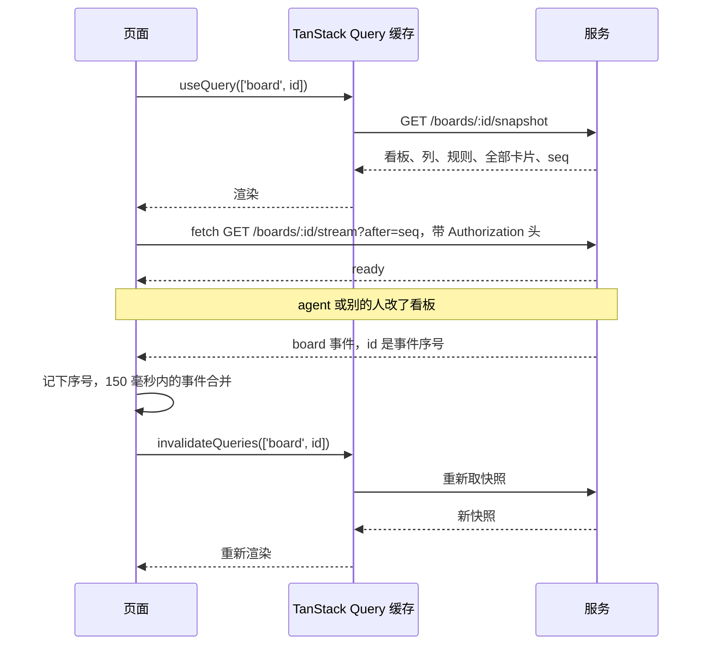
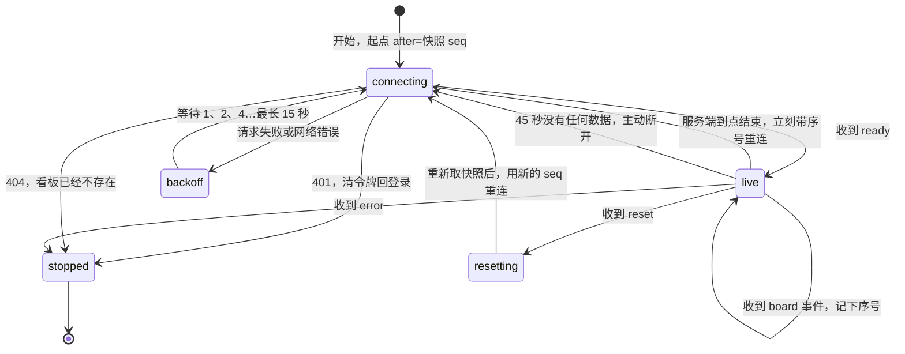
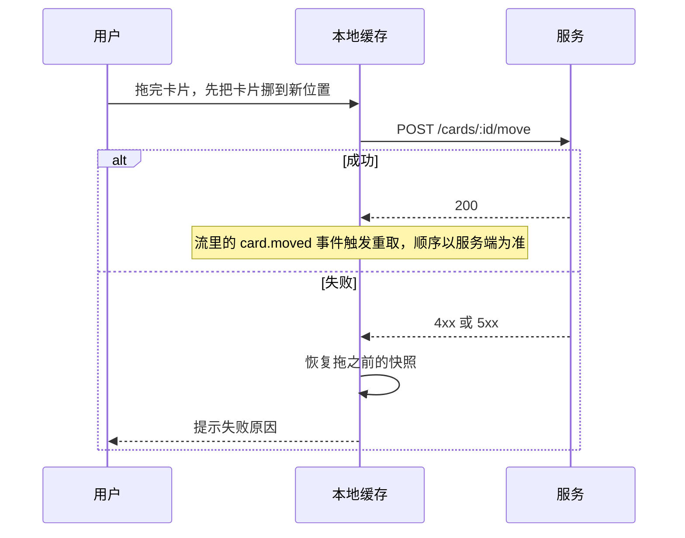

# 网页应用骨架（web/）

## 需求目标

人通过网页管理看板，agent 通过 MCP 或 REST 管理同一块看板。网页要做到：打开就能用、别人（包括 agent）改了马上看到、
五种语言、深浅两种主题、出错时给得出人话的提示。网页是纯静态资源，由 Go 服务同源提供（后面会嵌进二进制），
所以没有跨域，也没有单独部署的前端。

这一份文档只讲"骨架"：登录、接口调用、实时同步、多语言、主题、页面框架。看板、卡片、设置、令牌这些具体页面各有自己的设计文档
（`web.board.md`、`web.admin.md`）。

技术栈：Vite 8 + React 19 + TypeScript 7 + Tailwind CSS 4 + shadcn/ui（radix 版，lyra 风格，图标用 lucide）+ TanStack Query 5 +
React Router 7 + i18next + dnd-kit + vitest。包管理用 npm（本机只有 npm）。

| 编号 | 问题场景 | 不解决的后果 | 解决方案 | 状态 |
|------|----------|-------------|---------|------|
| 1 | 网页用什么凭证登录、放在哪 | 令牌被当成普通口令随便存，或者 agent 令牌登进来后到处报 403 | 登录用管理令牌（配置里的 `AdminToken`）。登录时先调 `GET /me`，只接受 `kind` 是 `human` 的令牌，agent 令牌直接提示"网页要用管理令牌"。令牌放 `localStorage`：页面同源、没有第三方脚本；剩下的风险是 XSS，所以服务端嵌入静态资源时会加严格的内容安全策略。任何接口返回 401 就清掉令牌回登录页 | 实施 |
| 2 | 实时流用 `EventSource` 就只能把令牌放进 URL | 令牌出现在访问日志和浏览器历史里 | 所有请求包括实时流都用 `Authorization` 请求头，实时流用 `fetch` 读响应流，自己解析 SSE | 实施 |
| 3 | 别人改了看板，网页要马上看到 | 看到的是旧数据，拖卡片时和别人互相覆盖 | 收到流里的 `board` 事件后重新取一次快照（150 毫秒内的多条事件合并成一次）。不在前端逐种事件去改本地数据：那样前端要重复实现一遍服务端的规则（自动化规则会连续改好几处），迟早和服务端对不上 | 实施 |
| 4 | 网络断了、笔记本睡眠、服务重启 | 页面悄悄停止更新，用户不知道 | 带着最后收到的事件序号用 `after` 重连，失败按 1、2、4…最长 15 秒退避；45 秒没有任何数据（服务端每 20 秒发一次心跳）就认为连接半开，主动断开重连；收到 `reset` 丢掉缓存重新取快照；收到 `error`（比如看板被删）停止重连并提示；页面顶部用一个小圆点显示"已连接/重连中" | 实施 |
| 5 | 拖卡片要立刻有反应，但服务端可能拒绝 | 要么拖完卡一下才动，要么显示成功但其实失败 | 乐观更新：拖完先改本地缓存，再调接口；失败恢复拖之前的快照并提示原因。成功时不额外提示，等流事件把缓存校准到服务端的真实顺序 | 实施 |
| 6 | 要支持简体、繁体、英、日、韩 | 漏翻译显示成键名，或者某种语言的占位符写错导致显示 `{{name}}` | 文案放 `src/i18n/locales/*.ts`，英文是基准，其余四种声明成同一个类型，缺键或多键编译就报错；测试再检查每个键的占位符在五种语言里一致；用浏览器语言自动选，用户手动选的存 `localStorage`；`<html lang>` 随语言更新，中日韩同一个汉字才会选对字形 | 实施 |
| 7 | 服务端的错误提示是中文兜底文案 | 日文用户看到中文报错 | 服务端每个错误有固定的 `reason`，网页按 `errors.<reason>` 取翻译，没有翻译才显示服务端的 `msg`；错误里的 `trace_id` 放在 toast 的描述里方便报告问题 | 实施 |
| 8 | 深色模式 | 夜里刺眼，或者刷新时先白一下再变黑 | 浅色、深色、跟随系统三选一，存 `localStorage`；`public/theme-init.js` 在 `<head>` 里同步执行，渲染前就给 `<html>` 加好 `dark` 类（外链脚本，不需要放开内容安全策略的内联脚本） | 实施 |
| 9 | 卡片描述和评论是别人写的文本（agent 写的评论常带 Markdown） | 原样显示难读；允许 HTML 就是 XSS | 用 `react-markdown` 渲染 Markdown，不解析原始 HTML；链接只放行 `http`、`https`、`mailto`，并加 `target=_blank` 和 `rel=noreferrer noopener`；其余文本都走 React 的转义 | 实施 |
| 10 | 切换看板或离开页面时请求还在飞 | 旧看板的数据回来覆盖新看板，或者在已卸载的页面里报错 | 查询把 TanStack Query 给的 `signal` 传给 `fetch`；实时流随页面卸载 `abort` | 实施 |
| 11 | 把"只有人能做的操作"在前端藏起来当作权限控制 | 绕过前端就能调用 | 权限一律在服务端（Core）判断；网页只用 `kind` 决定要不要显示入口，并且只接受人登录，不依赖前端隐藏 | 实施 |
| 12 | 鼠标之外的操作方式 | 键盘和读屏用户用不了看板 | 弹窗、菜单、下拉都用 Radix（自带焦点管理）；拖拽加上键盘传感器（空格拿起、方向键移动、空格放下）；按 `/` 聚焦搜索框 | 实施 |
| 13 | 开发时前端和后端不同端口 | 要开跨域，扩大攻击面 | 开发时 Vite 把 `/api`、`/mcp`、`/health`、`/install.md`、`/skills` 转发给 `SLATE_BACKEND`（默认 `http://127.0.0.1:7070`）；线上同源，不开跨域 | 实施 |

## 页面和路由

用 `BrowserRouter`（历史模式的路径），服务端要对所有非接口路径回退到 `index.html`（嵌入时实现）。

| 路径 | 页面 | 说明 |
|------|------|------|
| `/login` | LoginPage | 输入管理令牌；已登录访问会跳到 `/` |
| `/` | BoardListPage | 看板列表、新建看板 |
| `/b/:boardId` | BoardPage | 看板本体 |
| `/b/:boardId/settings` | SettingsPage | 看板设置，用 `?tab=general\|columns\|automation` 切换 |
| `/agents` | AgentsPage | agent 令牌和接入说明 |
| `*` | NotFoundPage | 没有这个页面 |

除 `/login` 外都要登录；没有令牌时跳到 `/login`，并记住原来想去的地址，登录后回去。

## 一次打开看板的流程

快照里的 `seq` 是"读数据之前的最新事件序号"，用它做 `after` 不会漏事件，期间发生的变化最多让页面多刷新一次。

## 实时流客户端

SSE 的解析规则（`lib/sse.ts`）：按行读取，行结束符是 `\n`、`\r\n` 或 `\r`；空行表示一条消息结束；`event:` 是事件名，缺省是 `message`；
多个 `data:` 行用换行连起来；`id:` 是事件序号；以冒号开头的是注释（心跳 `: ping`）直接忽略；一次读到的数据可能把一行从中间切断，所以要保留没有结束的半行。

## 乐观更新

## 多语言

- 五种语言代码和服务端一致：`zh-CN`、`zh-TW`、`en`、`ja`、`ko`（创建看板时把当前语言原样传给 `locale`，起步的列和规则就是这种语言）。
- 自动选择：先看 `localStorage` 里用户选过的，再看 `navigator.languages`，归并规则和服务端 `normalizeLocale` 一致
  （`zh-TW`、`zh-HK`、`zh-MO`、`zh-Hant*` 归繁体，其余 `zh*` 归简体，`ja*`、`ko*`，其余归英文）。
- 文案不用复数形式：显示数量时写成"标签：3"这样的结构，避免各语言复数规则不同；日期用 `Intl.DateTimeFormat`、相对时间用 `Intl.RelativeTimeFormat`，跟随当前语言。
- 活动流的文案由事件类型加载荷拼出来：`activity.<事件类型>` 一个键对应一种事件，占位符取自事件载荷。

## 目录规划

| 路径 | 内容 |
|------|------|
| `web/index.html`、`web/public/theme-init.js` | 入口页；渲染前设置深浅主题 |
| `web/vite.config.ts` | 路径别名 `@`、Tailwind 插件、开发代理 |
| `web/src/main.tsx` | 挂载：主题、多语言、查询缓存、路由、提示 |
| `web/src/index.css` | Tailwind 和设计变量（浅色、深色、字体、看板底纹） |
| `web/src/components/ui/` | shadcn 生成的基础组件，不手改（`sonner.tsx` 改成用自己的主题钩子，去掉 `next-themes`） |
| `web/src/lib/api/` | `client.ts` 请求封装与错误类型；`types.ts` 和后端 JSON 一一对应的类型；`endpoints.ts` 每个接口一个函数 |
| `web/src/lib/auth.tsx` | 令牌存取、登录、退出、当前身份 |
| `web/src/lib/sse.ts`、`web/src/lib/stream.ts` | SSE 解析；实时流的连接、重连、续传 |
| `web/src/lib/theme.tsx` | 主题 |
| `web/src/lib/format.ts` | 时间、相对时间格式化 |
| `web/src/lib/errors.ts` | 把 `ApiError` 翻译成人话 |
| `web/src/i18n/` | 初始化和五种语言的文案 |
| `web/src/features/` | 按功能分目录：`auth`、`boards`、`board`、`card`、`settings`、`agents`、`activity` |
| `web/src/app/` | 路由、整体框架（顶栏、语言、主题、用户菜单）、错误兜底 |

## 验证计划

| 内容 | 怎么验证 |
|------|----------|
| SSE 解析 | vitest：块边界切在行中间、`\r\n`、多行 data、注释、没有结尾空行、`id` 和 `retry` |
| 流客户端 | vitest：模拟 fetch，验证 ready、续传的 `after`、`reset`、`error`、401、退避、半开超时 |
| 接口封装 | vitest：令牌放头里、查询参数、错误体解析、401 清令牌、网络错误 |
| 多语言 | vitest：五种语言键一致（编译期 + 运行期）、占位符一致、语言归并规则 |
| 登录 | vitest + Testing Library：agent 令牌被拒绝、人令牌通过 |
| 页面真实渲染 | 起一个临时服务，用浏览器看每个页面的浅色、深色、窄屏、五种语言，并截图核对 |
| 构建 | `tsc -b`、`oxlint`、`vite build` 全部通过 |

## 限制

- 令牌放在 `localStorage`，页面里出现 XSS 就会泄露；所以不渲染原始 HTML，并在嵌入静态资源时加内容安全策略。
- 快照每次取全部卡片，个人和小团队（几千张卡片以内）够用；再大要改成按列分页，需要新增接口。
- 每个看板一条实时流，切换看板会断开旧的再连新的。
- `npm audit` 当前报告的 `picomatch` 问题只在构建工具链里（Vite 的依赖），不会进入浏览器里的代码，要等 Vite 上游升级。
