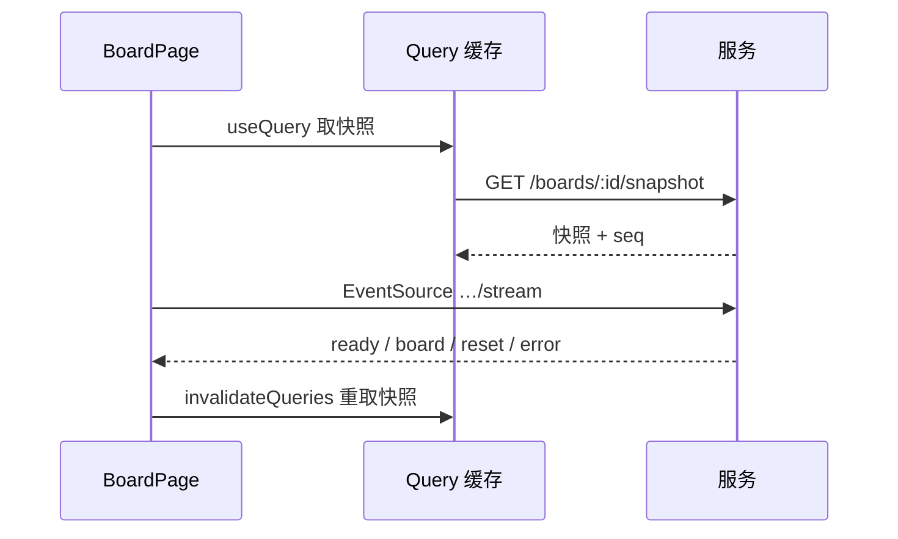

# 网页应用骨架（web/）

## 需求目标

人通过浏览器管理看板，agent 通过 MCP 或 REST 操作同一块数据。**默认免登录**：打开就能用；只有在配置里设置了访问口令时才会出现一个口令登录页（见 `security.passcode.go.md`），会话放在 HttpOnly cookie 里，网页自己不存任何令牌。
网页是纯静态资源，由 Go 服务同源提供（构建后嵌入二进制），无跨域。

本文件只讲**骨架**：路由与外框、接口调用、实时同步、多语言、主题、提示、Markdown、体积预算。
看板画布、卡片弹窗、设置、接入说明等有独立 scope（`web.board.md`、`web.settings.md`、`web.agents.md`）；视觉与动效的统一规则见 `web.design.md`。

技术栈：Vite 8、React 19、TypeScript 7、Tailwind CSS 4、**vendored shadcn/ui**（`radix-ui` 聚合包 + lucide）、TanStack Query 5、React Router 7、@dnd-kit（看板页）、Vitest + Testing Library + jsdom。包管理只用 **npm**。

| 编号 | 场景 | 做法 | 状态 |
|------|------|------|------|
| 1 | 身份与 REST | 前端不发任何认证头（启用口令后浏览器自动带会话 cookie）；服务端把所有 REST 写操作当作**人**（固定操作者名，见后端 identity scope） | 实施 |
| 2 | 实时更新 | 看板页用原生 **`EventSource`** 连 `GET /api/v1/boards/:id/stream`；事件 `ready` / `board` / `reset` / `error`；断线后浏览器带 **`Last-Event-ID`** 续传 | 实施 |
| 3 | 收到 `board` 后如何刷新 | 150 ms 内合并多次事件，再 `invalidateQueries` 重取快照；不在前端按事件类型改本地快照 | 实施 |
| 4 | 流异常 | `reset` 关连接、刷快照、重连；服务端 `error` 事件或连接关闭后查快照，404 视为看板已删；否则约 5 s 后手动 `epoch` 重连；顶栏圆点显示连接状态 | 实施 |
| 5 | 多语言 | 自研 `src/i18n`：`en` 打进主包，`zh-CN` / `zh-TW` / `ja` / `ko` 动态 chunk；`@/i18n/react` 的 `useTranslation`；存储键 `slate.lang` | 实施 |
| 6 | 主题 | `slate.theme`；`public/theme-init.js` 在首屏前给 `<html>` 加 `dark`；顶栏**循环按钮**（浅 → 深 → 跟随系统） | 实施 |
| 7 | 顶栏控件 | 语言、看板切换用原生 **`<select>`**（不用 Radix dropdown，减首屏体积） | 实施 |
| 8 | 提示 | 自研 `src/lib/toast.ts` + `src/components/ui/sonner.tsx`（仅导出名 `Toaster`，非 npm sonner） | 实施 |
| 9 | Markdown | 自研 `src/lib/markdown.tsx`（不接 react-markdown），和实时编辑器共用 `src/lib/md/` 的行内与块级解析（见 `web.editor.md`）；链接仅 `http`/`https`/`mailto` | 实施 |
| 10 | 样式合并 | `cn` 来自 npm 包 **`cn`**（`src/lib/utils.ts` 再导出）；**不会**像 `tailwind-merge` 那样去掉冲突类名——覆盖宽度等同断点前缀（如 `sm:max-w-4xl` 盖过 `sm:max-w-sm`） | 实施 |
| 11 | Tooltip | **`TooltipProvider` 不在 `App.tsx` 根部**；仅 **`BoardPage`** 内包裹需要提示的画布区域 | 实施 |
| 12 | 请求取消 | `fetch` 把 TanStack Query 的 `signal` 传给接口；切换看板关 `EventSource` | 实施 |
| 13 | 开发代理 | Vite 把 `/api`、`/mcp`、`/health`、`/install.md`、`/skills` 转到 `SLATE_BACKEND`（默认 `http://127.0.0.1:7070`） | 实施 |
| 14 | 访问口令 | `App.tsx` 里 `AuthGate` 包住 `AppRoutes`：启用口令且未通过时只显示按需加载的登录页；顶栏 `LogoutButton` 仅在启用口令且已登录时出现；任何接口 401 会重新读口令状态 | 实施 |

## 页面与路由

路由定义在 `web/src/app/AppRoutes.tsx`（`BrowserRouter` + 历史路径；生产环境由 Go 做 SPA 回退）。

| 路径 | 页面 | 加载方式 |
|------|------|----------|
| `/` | `BoardListPage` | 首屏同步 |
| `/b/:boardId` | `BoardPage` | `lazy` + `Suspense` |
| `/b/:boardId/settings` | `SettingsPage` | `lazy`；页内 Tabs（general / columns / automation），**无** URL `?tab=` |
| `/agents` | `AgentsPage` | `lazy` |
| `*` | `NotFoundPage` | 同步 |

所有页面都在 `AppShell` 外框内；**没有** `/login` 或 auth 路由。

## 免登录与 HTTP 客户端

- `web/src/lib/api/client.ts`：`request()` 只设 `Accept` / `Content-Type`，**无** `Authorization`。
- 错误体解析为 `ApiError`（`status`、`reason`、`traceId`）；`web/src/lib/errors.ts` 用 `t('errors.<reason>')` 展示文案。

## 实时流（`useBoardLive`）

- 连接：`new EventSource(\`${API_PREFIX}/boards/${boardId}/stream\`)`。
- `ready`：若 `latest` 大于缓存快照的 `seq`，补刷一次。
- `board`：合并刷新（见 `REFRESH_COALESCE_MS = 150`）。
- `reset`：关闭、刷快照、`epoch++` 新连接。
- `error`（`MessageEvent` 或 `EventSource.CLOSED`）：离线状态，快照 404 则 `onGone`，否则定时重连。
- 测试用 `web/src/test/fakeEventSource.ts`；`setup.ts` 里 `beforeEach` 安装假实现，避免 jsdom 无 `EventSource`。

## 多语言

- 文案：`web/src/i18n/locales/*.ts`（`en` 为类型基准）。
- 运行时：`default` 导出 `i18n`（`language`、`t`、`changeLanguage`、`getFixedT`）；`main.tsx` 在 `render` 前 `await loadLanguage(initialLanguage())`。
- 对外统一：`import { useTranslation } from '@/i18n/react'`。
- 语言归并：`web/src/i18n/languages.ts`，与后端 `normalizeLocale` 对齐。

## 顶栏与主题

| 文件 | 行为 |
|------|------|
| `LanguageMenu.tsx` | 原生 `<select>`，五种 `option` 带 `lang`；窄屏图标 + 透明 select 扩大点击区 |
| `ThemeMenu.tsx` | 单按钮循环；`theme.cycleLabel` 写 `aria-label` / `title` |
| `BoardSwitcher.tsx` | 原生 `<select>`，项为 `SLUG 名称`，首项「所有看板」；列表未加载时占位 |

## 应用根组件

`web/src/app/App.tsx`：`ErrorBoundary` → `ThemeProvider` → `QueryClientProvider` → `BrowserRouter` + `AppRoutes` + `Toaster`。**无** `TooltipProvider`。

## 体积预算

- 脚本：`web/scripts/check-size.mjs`（可选第 1 参数指定 dist 目录）。
- 规则：统计 `index.html` 里 **`<script src>` 与 `<link rel="modulepreload" href="…js">`** 的 gzip 之和为首屏 JS；整个 dist 的 gzip 总和。
- 上限（见 `v1.scope.md`）：首屏 JS **≤ 130 kB**，dist **≤ 325 kB**（实时渲染编辑器作为懒加载块约 12 kB，所以从 300 kB 放宽到 320 kB；标签库和活动文案又在 5 种语言里各加了一段文字，放宽到 325 kB；首屏预算不变）。
- 当前集成构建约：**首屏 118.5 kB**，**dist 243.9 kB**（2026-11 实测）。
- `npm run build` = `tsc -b` + `vite build` → `internal/web/spa/dist`（gitignore）+ 跑 `check-size.mjs`。

## 目录与文件（骨架相关）

### 入口与配置

| 路径 | 职责 |
|------|------|
| `web/index.html` | 挂 `#root`，引用 `theme-init.js` |
| `web/public/theme-init.js` | 首屏前读 `slate.theme` 设 `dark` |
| `web/vite.config.ts` | 别名 `@`、`outDir`、代理、vitest `setupFiles` |
| `web/package.json` | `dev` / `build` / `test` / `lint` / `typecheck` / `size` |
| `web/scripts/check-size.mjs` | 体积门禁 |

### `web/src/app/`

| 文件 | 职责 |
|------|------|
| `App.tsx` | 根 Provider、路由、Toaster |
| `AppRoutes.tsx` | 路由表与懒加载 |
| `AppShell.tsx` | 顶栏 + `Outlet` |
| `AppShell.test.tsx` | 外框行为测试 |
| `BoardSwitcher.tsx` | 看板 `<select>` |
| `LanguageMenu.tsx` | 语言 `<select>` |
| `ThemeMenu.tsx` | 主题循环按钮 |
| `ErrorBoundary.tsx` / `ErrorBoundary.test.tsx` | 渲染错误兜底 |
| `NotFoundPage.tsx` | 404 |
| `PageFallback.tsx` | 懒加载占位 |
| `Logo.tsx` | 标志 |

### `web/src/lib/`

| 文件 | 职责 |
|------|------|
| `api/client.ts` / `client.test.ts` | HTTP 封装 |
| `api/endpoints.ts` / `types.ts` | 接口函数与 JSON 类型 |
| `errors.ts` / `errors.test.ts` | 错误文案 |
| `format.ts` / `format.test.ts` | 时间格式化 |
| `route.ts` / `route.test.ts` | 路径参数解析 |
| `theme.tsx` / `theme.test.tsx` | `ThemeProvider` |
| `theme-context.ts` | 主题类型与 `THEME_KEY` |
| `toast.ts` / `toast-store.ts` / `toast.test.tsx` | 提示 API 与 UI store |
| `markdown.tsx` / `markdown.test.tsx` | 安全 Markdown |
| `queryClient.ts` / `queryKeys.ts` | Query 默认选项与键 |
| `useErrorToast.ts` | 统一错误 toast |
| `useDocumentTitle.ts` / `useDocumentTitle.test.tsx` | 文档标题 |
| `limits.ts` / `limits.test.ts` | 与后端一致的长度上限 |
| `utils.ts` | 导出 `cn` 包 |

### `web/src/i18n/`

| 文件 | 职责 |
|------|------|
| `index.ts` | `i18n` 默认导出、`loadLanguage` 等 |
| `react.ts` | `useTranslation`、`TFunction` |
| `runtime.ts` / `bundles.ts` / `lookup.ts` / `types.ts` | 运行时、按需语言包、查找、类型 |
| `languages.ts` / `languages.test.ts` | 语言代码与归并 |
| `useLanguage.ts` | `lang` + `setLang` 钩子 |
| `locales/*.ts` | 五语文案 |
| `locales.test.ts` | 键一致、占位符、与 Go 错误对齐 |

### `web/src/components/ui/`

vendored shadcn 组件（`button`、`dialog`、`tabs` 等）。**不要求**每个函数都写中文注释；业务改动的部分应注释。

### `web/src/test/`

| 文件 | 职责 |
|------|------|
| `setup.ts` | jsdom 补丁、预加载五语、假 EventSource、每用例恢复 `en` |
| `renderApp.tsx` | 测试用 Provider 树 |
| `fakeApi.ts` / `factories.ts` | 假 REST |
| `fakeEventSource.ts` | 假 SSE |

### 骨架相关 feature 测试（其它 feature 见各自 scope）

| 文件 | 覆盖 |
|------|------|
| `features/boards/BoardListPage.test.tsx` | 列表、新建项目对话框（名称、模板开关） |
| `features/boards/validation.test.ts` | 表单校验 |
| `features/board/useBoardLive.test.tsx` | EventSource 客户端 |

## 测试清单（用例名称以源码为准）

**`AppShell.test.tsx`**

- 有「跳到正文」链接，正文区域可以被它聚焦
- 切换语言：界面文字、`<html lang>`、i18n 当前语言一起变
- 语言下拉里五种语言都用自己的文字显示
- 切换到深色主题：`<html>` 带上 dark 类
- 看板切换：显示当前看板名，可以跳到别的看板或回到列表
- 不在看板页时，切换框选中「所有看板」
- 在 agent 页面时，agent 链接标为当前页
- 地址不存在时显示 404 并能回到列表

**`ErrorBoundary.test.tsx`**

- 子组件正常时原样渲染
- 子组件渲染出错：显示兜底界面，并把错误记到控制台

**`lib/api/client.test.ts`**：GET/POST、查询参数、错误体、网络错误、`AbortSignal` 等（见文件内 `it` 标题）。

**`lib/errors.test.ts`**：`describeError`、`isAbortError`、`isVersionConflict`。

**`lib/format.test.ts`**：`parseTime`、`formatRelative`、`formatDate` / `formatDateTime`、`isPast`、本地时间输入互转。

**`lib/route.test.ts`**：`parseId`。

**`lib/theme.test.tsx`**：`ThemeProvider` 与 `localStorage`、`matchMedia`。

**`lib/toast.test.tsx`**：显示、自动消失、悬停暂停、关闭、堆叠、同 id 更新、`role="alert"`。

**`lib/markdown.test.tsx`**：标题粗体、拒绝 `javascript:`、不渲染图片标签。

**`lib/limits.test.ts`**：输入上限与后端一致。

**`lib/useDocumentTitle.test.tsx`**：标题格式与卸载恢复。

**`i18n/languages.test.ts`**：`normalizeLanguage`、`pickLanguage`、`LANGUAGES`。

**`i18n/locales.test.ts`**：五语键与占位符、Go 错误翻译、`setLanguage` / `loadLanguage`、订阅重渲染。

**`features/boards/*`**：见 `BoardListPage.test.tsx`、`validation.test.ts`。

**`features/board/useBoardLive.test.tsx`**：ready、合并刷新、reset、error、重连、卸载等（见文件内 16 个 `it`）。

全仓库 vitest 约 **324** 条用例；以 `cd web && npm run test` 为准。

## 开发与构建

| 命令 | 作用 |
|------|------|
| `make web/dev` | Vite 5173，代理到 7070 |
| `make web/test` | `tsc -b` + `oxlint` + `vitest run` |
| `make web/build` | 前端构建 + 体积检查 |
| `make build` | 含 `web/build`，产出 `./slate`（`-tags embed_web`） |

仓库内亦可：`cd web && npm run dev|build|test|lint|typecheck|size`。

## 验证门禁

| 项 | 命令 |
|----|------|
| 类型 | `cd web && npx tsc -b` |
| 静态分析 | `cd web && npx oxlint` |
| 单测 | `cd web && npx vitest run` |
| 体积 | `cd web && npm run build`（或已有 dist 时 `node scripts/check-size.mjs`） |

## 限制

- 无登录≠无风险：默认本机监听 + Host 白名单 + 跨站写拦截（见 `identity.open.go.md`）。
- 快照一次取全板卡片，规模超大时要分页（需新接口）。
- 每块看板一条 `EventSource`，换看板会关旧连接。
- Radix 弹窗、部分懒加载页仍带来额外 chunk；首屏预算由 `check-size.mjs` 把关。