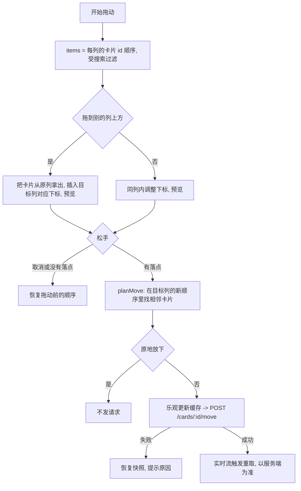
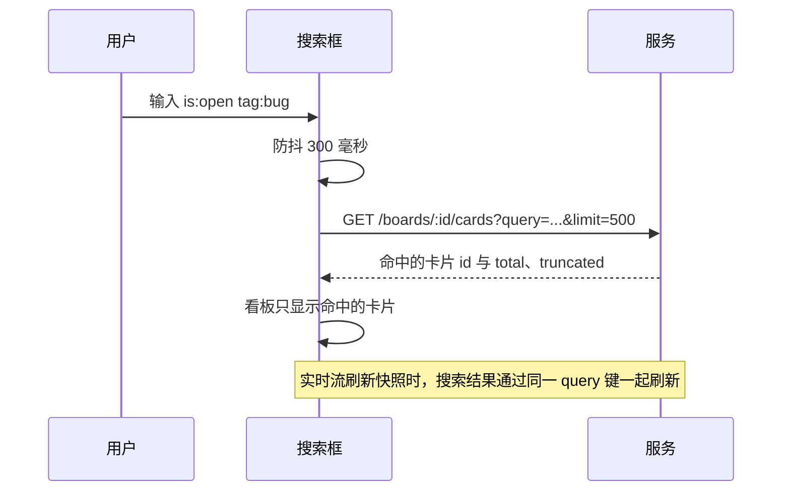

# 看板页面：看板列表、看板、卡片、搜索

## 需求目标

人在网页上看到整块看板，拖卡片、写卡片、留评论，别人（包括 agent）改了马上看到。
看板上要一眼看出三件事：哪些列是 agent 会去领卡的（"AI 列"）、哪些卡正被哪个 agent 处理、哪些卡被依赖卡住或必须由人来做。
这份文档讲页面行为和前端自己的算法；REST 契约见 `api.rest.go.md`；应用骨架（主题、Query、路由、多语言、错误提示）见 `web.app.md`（v1 网页免登录，无管理令牌与登录页流程）。

## 问题场景

| 编号 | 问题场景 | 不解决的后果 | 解决方案 | 状态 |
|------|----------|-------------|---------|------|
| 1 | 拖卡片要立刻动，还要能跨列、同列调序、拖进空列 | 拖完要等接口返回才动，手感差；空列没法放卡 | 用 dnd-kit 的多容器排序：每一列是一个可放置的容器，列里是可排序的卡片；拖动中实时预览落点；松手后按落点算出 `before_id` 或 `after_id` 再调用移动接口，并立刻乐观更新缓存 | 实施 |
| 2 | 拖到哪里算哪里，要算出服务端认的相对位置 | 位置算错，刷新后卡片跳到别处 | 抽成纯函数 `planMove`：只看目标列拖完之后的 id 顺序——后面有卡就用 `before_id`，否则前面有卡就用 `after_id`，空列只带 `column_id`；原地放下（列和相邻卡都没变）返回空，不发请求 | 实施 |
| 3 | 乐观更新的位置和服务端算的不一致 | 松手后卡片闪一下 | 乐观位置用和服务端同样的规则（相邻两张取中点，列头列尾各加减 1024）；接口成功后实时流会触发重取，以服务端为准；失败则恢复拖之前的快照并提示原因 | 实施 |
| 4 | 点一下卡片和拖一下卡片要分得开；键盘要能操作 | 手一抖就变成拖动，或者点不开；读屏用户卡在两个焦点之间 | 鼠标移动 6 像素才算拖动；触屏按住 200 毫秒；每张卡片磁贴只有一个 Tab 停靠点：单击或 **Enter** 打开 `?card=` 弹窗；**空格**拾起/放下拖拽，方向键移动，**Esc** 取消（`BoardCanvas` 里 KeyboardSensor 的 `start`/`end` 仅配 Space，`CardTile` 在 Enter 时打开弹窗且不嵌套链接） | 实施 |
| 5 | 卡片太多找不到 | 只能肉眼翻 | 工具栏的搜索框用和 agent 一样的筛选语法（服务端解析），300 毫秒防抖；有关键字时看板只显示命中的卡片，显示命中数/总数；语法错误在搜索框下面写出服务端指出的词；旁边有语法说明；按 `/` 聚焦搜索框 | 实施 |
| 5a | 搜索时还在拖会乱序 | 用户不知道为何拖不动 | 只要搜索非空（`visibleIds` 非 null），`BoardCanvas` 关闭拖拽，工具栏下方一行提示 `board.dragDisabledSearch`；清空搜索后恢复拖动 | 实施 |
| 6 | 一眼看出卡片的状态 | 要点开才知道谁在处理、被什么卡住 | 卡片上显示：编号（等宽字体）、标题、优先级色条、前 3 个标签（多的折成 +n）、截止日期（逾期且未完成标红）、"仅人工"锁图标、"等待依赖"图标、被 agent 领取时显示 agent 名加呼吸圆点；完成列里的卡片整体变淡；AI 列的列头有"AI"标记，列说明放在悬停提示里 | 实施 |
| 7 | 在卡片弹窗里改字段，别人同时也在改 | 静默覆盖别人的改动 | 每次修改都带上打开时读到的 `version`；服务端返回版本冲突时 toast 提示并重新读取最新内容，用户的输入保留在控件里 | 实施 |
| 8 | 卡片描述很长，修改要有保存和放弃 | 失焦就自动保存，写到一半的描述被存进去 | 标题、优先级、所在列、标签、截止、依赖、分支、链接等短字段改完立即保存；**标签**用 `TagEditor`（回车/逗号添加、× 删除、退格删最后一枚、大小写去重、上限内联提示）；描述用"编辑/保存/取消"，支持预览 Markdown；`Ctrl/Cmd + Enter` 保存评论和描述 | 实施 |
| 9 | agent 的评论和描述里常带 Markdown | 原样显示难读 | 描述和评论用 Markdown 渲染，不解析原始 HTML，链接只放行 http、https、mailto（做法见 `web.app.md` 第 9 条） | 实施 |
| 11 | 看板被别人删除时页面还开着 | 一直转圈或者报一堆错 | 实时流或快照 404 时走 `BoardGone`（看板已不存在） | 实施 |
| 12 | 看板很宽、手机很窄 | 横向看不全，误触 | 列容器横向滚动，窄屏每列接近整屏宽并按列吸附；卡片弹窗窄屏接近全宽，桌面用 `sm:max-w-4xl` 放宽（与 `DialogContent` 默认同断点前缀，避免 `cn` 合并 Tailwind 类时小屏类盖不掉基础 `max-w-sm`） | 实施 |
| 13 | 卡片弹窗要能分享给同事 | 复制链接只能到看板，找不到卡片 | 卡片弹窗的状态放在地址的 `?card=编号` 里，刷新、分享、浏览器返回都正常；卡片不存在时提示 | 实施 |
| 14 | 创建看板的参数多 | 新手面对空看板不知道怎么开始 | 创建对话框：名称（必填）、编号前缀（选填，不填服务端按名称生成）、说明、项目路径（选填）、模板三选一（研发流程、简单三列、空白）；语言取当前界面语言，起步的列和规则就是这种语言 | 实施 |
| 15 | 导出备份 | 只能截图或调 API | 工具栏「导出」下拉：`GET /api/v1/boards/:id/export?format=json` 与 `?format=md`，浏览器下载附件（`BoardToolbar` 链到同源 `API_PREFIX`） | 实施 |
| 16 | 首屏尽量少拉大组件 | 用不到的页面也加载 Tooltip 栈 | 根组件 `App.tsx` 不再包全局 `TooltipProvider`；**看板页**根节点包一层 `TooltipProvider`（列头 AI 说明等悬停提示）；卡片弹窗懒加载且内部不用 Tooltip | 实施 |
| 17 | 完成列常驻占位太宽 | 横向空间浪费，和 kanzo 一样希望侧边收起 | 每一列列头有收起按钮；收成 **48px** 窄边（宽约 250ms 过渡，`motion-reduce` 无动画）：展开图标、匹配卡片数、竖排列名；窄边为 `button`（`aria-expanded=false`，`board.expandColumn`），点整块或 Enter/空格展开；展开列头按钮 `board.collapseColumn`。无偏好时 **`is_done` 列默认收起**，其余展开。偏好键 `slate.col.<boardId>.<columnId>`，值 `1` 收起 / `0` 展开（`useCollapsedColumns`）。收起列仍注册 `useDroppable`（`type: column`），可拖进；搜索时窄边数字=当前可见卡数，不自动展开 | 实施 |

## v1 明确不做

| 项 | 说明 | 追踪 |
|----|------|------|
| 看板级活动流抽屉 | 只有卡片评论，没有按时间线展示移动/领取/规则等事件 | 产品待办「活动流：看板级事件时间线」（见 `docs/devlog/records.json`） |
| 列表视图（表格） | 除看板外的排序表格视图 | 未做，Slate 看板 **SLATE-38** |
| 磁贴新标签页打开 | 为单 Tab 停靠点去掉了磁贴内链接，中键/Cmd+点击不能新开卡片页 | 未做，Slate 看板 **SLATE-35** |

## 页面结构

```mermaid
flowchart TB
    subgraph 看板页 /b/:id
        T[工具栏: 看板名 编号 | 搜索 | 导出 JSON/MD | 设置 | LiveStatus 绿点]
        S[搜索激活时: 禁用拖拽提示条]
        subgraph 画布 可横向滚动
            C1[列: 名称 数量 AI标记 / 卡片 卡片 ... / 添加卡片]
            C2[列 ...]
        end
    end
    D[卡片弹窗 ?card=编号 懒加载]
    C1 --> D
```

一列的头部：列名、卡片数、`AI` 小标签（`agent_pickup` 为真）、完成标记（`is_done` 为真）；列底部是"添加卡片"：点开后是一个多行输入，`Enter` 添加、`Shift + Enter` 换行、`Esc` 取消；连续添加时输入框保持打开。

## 拖拽算法



纯函数的约定（`features/board/dnd.ts`，拖拽结束编排另见 `handleDragEnd.ts`）：

| 函数 | 输入 | 输出 |
|------|------|------|
| `buildItems` | 列、卡片、可见 id 集合（null 表示全部可见） | 每列一个 id 数组，按位置排序，位置相同按 id |
| `findColumnOf` | items、卡片 id | 所在列 id 或 null |
| `moveToColumn` | items、卡片 id、目标列、下标 | 拖动预览用的新 items |
| `finalizeDrop` | items、卡片 id、落在的目标 id、是否落在列上 | 松手预览用 items |
| `planMove` | 拖完之后的 items、拖之前的 items、被拖的卡片 | `{columnId, beforeId?, afterId?}`，没变化返回 null |
| `applyMoveToSnapshot` | 缓存里的快照、卡片 id、plan | 新快照：换列、位置、领取状态等 |
| `computePosition` | 前一张和后一张的位置，可缺省 | 和服务端 `positionBetween` 一致 |

## 实时连接

`useBoardLive` 用原生 `EventSource` 连接 `/api/v1/boards/:id/stream`（v1 免认证）。工具栏 `LiveStatus`：**已连接**为绿色圆点（`bg-emerald-500`），**连接中**琥珀色脉冲，**离线**灰色且可手动重试。事件合并刷新见 `web.app.md` 第 3–4 条；看板删除时快照 404 走 `BoardGone`。

## 卡片弹窗

- **开关**：URL `?card=卡片数字 id`；`CardDialog` 由 `BoardPage` 懒加载。
- **布局**：粘性顶栏显示卡片 `key`；内容区可滚动。`md` 及以上两栏（`CardDialogBody` 栅格）：**左栏**大号标题输入、描述（`DescriptionEditor`）、评论（`Comments`）；**右栏**属性（`CardProperties`）、领取横幅与「释放」、本列 agent 指令（`details` 折叠）、只读时间信息（`CardTimeMeta`：创建、更新、开始、完成，有值才显示，用 `formatDateTime`）、底部删除（二次确认）。窄屏 DOM 顺序：标题 → 属性 → 描述 → 评论。
- **宽度**：`DialogContent` 使用 `sm:max-w-4xl` 与 `max-h-[90dvh]`（须与组件库默认断点前缀一致才能覆盖默认 `max-w-sm`）。
- **属性区**：列（走 `useMoveCard` 与拖拽同一套规则）、优先级、**标签**（`TagEditor` + `tagList` 纯函数）、截止（本地 `datetime-local`）、仅人工、依赖（`DependencyPicker`）、分支、链接；PATCH 成功后 `useCardUpdate` 会把响应合并进详情缓存。
- **领取**：`claim_active` 且 `claimed_by` 非空时显示 agent 名与租约到期时间，人可点「释放」（`POST /cards/:id/release`）。
- **开始/完成时间**：只在 `CardTimeMeta` 只读展示，不在属性表单里编辑。
- **版本冲突**：见问题场景第 7 条；测试见 `CardDialog.test.tsx`。

## 搜索



语法说明在 `SearchHelp`；无结果、语法错误、结果被截断均有文案（`search.noResults`、`search.truncated` 等）。

## 多语言文案分组

| 分组 | 内容 |
|------|------|
| `boards` | 看板列表、创建看板对话框、模板名称 |
| `board` | 工具栏、列、卡片标记、添加卡片、空状态、搜索时禁用拖拽 |
| `search` | 搜索框、语法说明、结果统计 |
| `card` | 卡片弹窗、标签上限、版本冲突、评论、释放领取 |
| `stream` | 实时连接状态文案 |

## 目录规划

| 路径 | 内容 |
|------|------|
| `web/src/features/boards/` | `BoardListPage.tsx`、`CreateBoardDialog.tsx`、`useBoards.ts`、`validation.ts` |
| `web/src/features/board/` | `BoardPage.tsx`、`BoardToolbar.tsx`、`BoardCanvas.tsx`、`ColumnView.tsx`、`CardTile.tsx`、`AddCard.tsx`、`SearchBox.tsx`、`SearchHelp.tsx`、`LiveStatus.tsx`、`BoardGone.tsx`、`dnd.ts`、`handleDragEnd.ts`、`useBoard.ts`、`useBoardLive.ts`、`useMoveCard.ts`、`useBoardSearch.ts`、`useCreateCard.ts`、`useBoardKeyboard.ts`、`useCollapsedColumns.ts` |
| `web/src/features/card/` | `CardDialog.tsx`、`CardDialogBody.tsx`、`CardProperties.tsx`、`TagEditor.tsx`、`tagList.ts`、`CardTimeMeta.tsx`、`DescriptionEditor.tsx`、`Comments.tsx`、`DependencyPicker.tsx`、`useCardDetail.ts`、`useCardUpdate.ts`、`validateUrl.ts` |
| `web/src/lib/markdown.tsx` | 安全 Markdown 渲染（描述与评论共用） |

## 验证计划

| 内容 | 怎么验证 |
|------|----------|
| `dnd.ts` | `dnd.test.ts`：见文件内用例（`buildItems`、`planMove`、`computePosition`、`applyMoveToSnapshot` 等） |
| `handleDragEnd` | `handleDragEnd.test.ts`：`跨列移动时产生 columnId`、`没有落点时不发 plan`、`落在收起列的窄边上（列落点）时仍能跨列移入` |
| 列收起偏好 | `useCollapsedColumns.test.tsx`：默认、读写 localStorage、看板隔离、存储失败回退 |
| `useMoveCard` | `useMoveCard.test.tsx`：乐观更新、成功失效、失败回滚、取消在飞请求、无快照不崩溃 |
| `useBoardLive` | `useBoardLive.test.tsx`：连接 ready、事件合并刷新、board.* 刷新列表、reset 重连、404 看板不存在、卸载关闭等（**无**令牌/401 用例） |
| `LiveStatus` | `LiveStatus.test.tsx`：`已连接时圆点为绿色` |
| `BoardPage` 集成 | `BoardPage.test.tsx`：渲染列与卡片、非法 id、搜索防抖与语法错误、快捷键 `n`、新建卡片 POST、快照 404、完成列默认窄边/点击与键盘展开、收起按钮、刷新保留偏好 |
| 标签纯逻辑 | `tagList.test.ts`：去重、上限、截断、删除 |
| 卡片弹窗 | `CardDialog.test.tsx`：`?card= 打开后修改标题带 version`、`版本冲突时不丢输入框内容（仍可编辑）`、`标签可添加，重复标签不重复提交`、`标签达到上限时内联提示`、`显示开始时间、无完成时间，领取可释放`、`弹窗内同时有属性区、描述与评论` |
| Markdown | `markdown.test.tsx`：标题粗体、拒绝 `javascript:`、不渲染原始 HTML/图片标签 |
| 看板列表（相关） | `BoardListPage.test.tsx`、`boards/validation.test.ts`（创建看板校验） |
| 手工 | 浏览器拖卡片、搜索、开关弹窗、深浅主题、窄屏、五种语言 |

## 限制

- 一块看板的全部卡片都会渲染，没有虚拟滚动；几百张卡片内流畅，几千张会变慢（需要分页接口才能解决）。
- 拖拽预览不预测自动化规则的副作用（比如进入某列自动写开始时间），要等服务端结果回来才看到。
- 搜索结果最多取 500 张，超过时显示仅显示前 500 的提示。
- 服务端校验失败的具体原因可能是中文兜底，其他语言用通用提示加 `reason` 映射（见 `web.app.md` 第 7 条）。