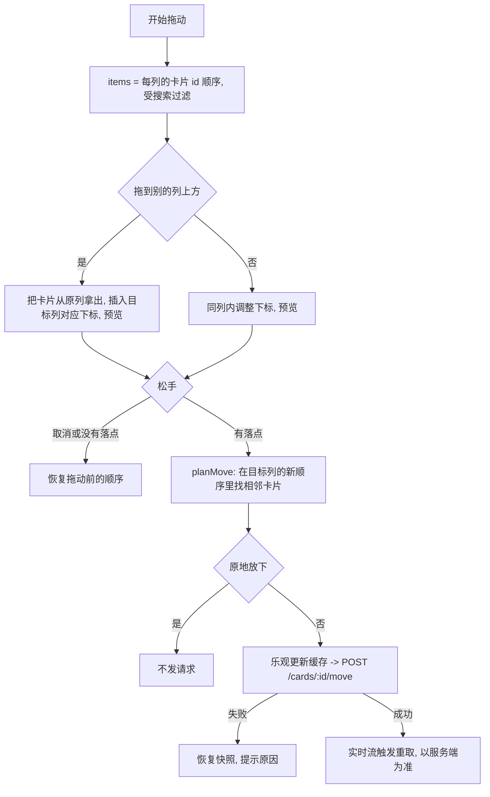
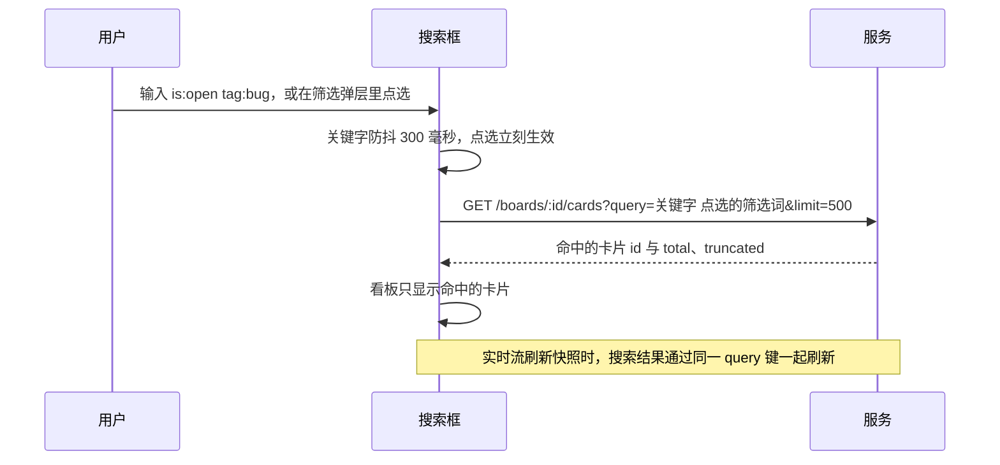

# 看板页面：看板列表、看板、卡片、搜索与筛选

## 需求目标

人在网页上看到整块看板，拖卡片、写卡片、留评论，别人（包括 agent）改了马上看到。
看板上要一眼看出两件事：哪些卡正被哪个 agent 处理、哪些卡被依赖卡住或必须由人来做。
这份文档讲页面行为和前端自己的算法；REST 契约见 `api.rest.go.md`；应用骨架（主题、Query、路由、多语言、错误提示）见 `web.app.md`（v1 网页免登录，无管理令牌与登录页流程）。

## 问题场景

| 编号 | 问题场景 | 不解决的后果 | 解决方案 | 状态 |
|------|----------|-------------|---------|------|
| 1 | 拖卡片要立刻动，还要能跨列、同列调序、拖进空列 | 拖完要等接口返回才动，手感差；空列没法放卡 | 用 dnd-kit 的多容器排序：每一列是一个可放置的容器，列里是可排序的卡片；拖动中实时预览落点；松手后按落点算出 `before_id` 或 `after_id` 再调用移动接口，并立刻乐观更新缓存 | 实施 |
| 2 | 拖到哪里算哪里，要算出服务端认的相对位置 | 位置算错，刷新后卡片跳到别处 | 抽成纯函数 `planMove`：只看目标列拖完之后的 id 顺序——后面有卡就用 `before_id`，否则前面有卡就用 `after_id`，空列只带 `column_id`；原地放下（列和相邻卡都没变）返回空，不发请求 | 实施 |
| 3 | 乐观更新的位置和服务端算的不一致 | 松手后卡片闪一下 | 乐观位置用和服务端同样的规则（相邻两张取中点，列头列尾各加减 1024）；接口成功后实时流会触发重取，以服务端为准；失败则恢复拖之前的快照并提示原因 | 实施 |
| 3a | 松手后浮起的卡片飞回旧位置，落地时旁边的卡片还在跳 | 看起来像 bug：乐观更新要晚一两帧才落地，这期间排列退回了拖之前，落下动画量到的就是旧位置 | 松手后继续用松手时的排列，直到乐观更新换了新的数据（`dnd.ts` 的 `pickShownItems`，`BoardCanvas` 的 `settling` 状态）；落下动画（`dropAnimation.ts`）终点按外层容器对齐（卡片放大倾斜后外框比真实卡片大，按外框对齐会偏几个像素），放大、倾斜、阴影同时收回，真实卡片用 `visibility` 藏到动画结束（用透明度会被 CSS 过渡淡入，像闪一下）；「减少动态效果」时不飞行 | 实施 |
| 4 | 点一下卡片和拖一下卡片要分得开；键盘要能操作 | 手一抖就变成拖动，或者点不开；读屏用户卡在两个焦点之间 | 鼠标移动 6 像素才算拖动；触屏按住 200 毫秒；每张卡片磁贴只有一个 Tab 停靠点：整张磁贴是一个指向 `?card=<id>` 的真实链接（`<a href>`），左键或 **Enter** 在当前页打开弹窗，中键或 Cmd/Ctrl+点击由浏览器在新标签页打开同一张卡片；**空格**拾起/放下拖拽，方向键移动，**Esc** 取消（`BoardCanvas` 里 KeyboardSensor 的 `start`/`end` 仅配 Space；磁贴设 `draggable={false}`，免得浏览器原生拖链接打断 dnd-kit；dnd-kit 默认的 `button` 角色换成 `link`，搜索时的 `aria-disabled` 去掉，因为链接仍然能点；拖拽中按 Enter 不打开卡片）。拖拽时跟手的那份是 `CardTileOverlay`，只是视觉副本，不是链接 | 实施 |
| 5 | 卡片太多找不到 | 只能肉眼翻 | 工具栏的搜索框用和 agent 一样的筛选语法（服务端解析），300 毫秒防抖；有关键字或筛选条件时看板只显示命中的卡片，搜索框下面显示「命中数 / 看板上的卡片总数」；语法错误在搜索框下面写出服务端指出的词；旁边有语法说明；按 `/` 聚焦搜索框 | 实施 |
| 5a | 搜索或筛选时还在拖会乱序 | 用户不知道为何拖不动 | 搜索框有字或选了筛选条件（`visibleIds` 非 null）时，`BoardCanvas` 关闭拖拽，工具栏下方一行提示 `board.dragDisabledSearch`；清空后恢复拖动 | 实施 |
| 5b | 不想记语法，想像 Trello 那样点一点就能过滤 | 只有搜索框时，按标签、状态、截止日期找卡片都得先记住 `tag:`、`is:`、`due:` 这些前缀 | 搜索框右边有「筛选」按钮（带已选个数的角标），点开是一个弹层，分组列出：**标签**（带每个标签的卡片数，有「没有标签」；选了 2 个以上标签时出现「任一 / 全部」开关）、**列**、**状态**（未完成、已完成、没人领取、已被领取、等待依赖、仅人工）、**优先级**（高、中、低、未设置）、**领取者**（只在有 agent 正在领取卡片时出现）、**截止**（单选：不限、已逾期、今天到期、7 天内到期、有、没有）。点一下立刻生效，不需要确认，弹层不会自己关。点选出来的条件由 `filters.ts` 的 `buildFilterTerms` 翻译成筛选词，和搜索框里的关键字用空格连起来，仍然交给服务端同一个解析器，所以网页、agent 和自动化规则的结果不会不一致。组合规则：同一组里选多个取值是「任一」（标签选了「全部」时拆成多个 `tag:`），不同组之间是「同时满足」；互相矛盾的状态（未完成/已完成、没人领取/已被领取）选一个就取消另一个；7 天内到期按浏览器本地日期算成 `due:>=today due:<=日期` | 实施 |
| 5c | 选了什么要看得见，也要能一键取消 | 过滤后看板变空，用户不知道是哪个条件造成的 | 工具栏下方一行小标签（`ActiveFilters`）：每个选中的取值一个，点叉取消，最右边是「清除全部」，什么都没选时不占位置；按 **Esc** 同时清空关键字和筛选（弹层打开时先关弹层）；筛选状态属于当前看板（`useBoardFilters`），换到另一块看板是什么都没选；标签或领取者名字里含双引号或竖线的，没法写进筛选语法，弹层里不列出，不会拼出和用户意图不同的条件；拼出的查询超过服务端的 500 个字符时不发请求，直接提示 `filter.tooLong` | 实施 |
| 6 | 一眼看出卡片的状态 | 要点开才知道谁在处理、被什么卡住 | 卡片上显示：编号（等宽字体）、标题、优先级色条、前 3 个标签（多的折成 +n）、截止日期（逾期且未完成标红）、"仅人工"锁图标、"等待依赖"图标、被 agent 领取时显示 agent 名加呼吸圆点；完成列里的卡片整体变淡；列头只有列名和卡片数，列说明显示成一行小字，悬停看全文 | 实施 |
| 7 | 在卡片弹窗里改字段，别人同时也在改 | 静默覆盖别人的改动 | 每次修改都带上打开时读到的 `version`；服务端返回版本冲突时 toast 提示并重新读取最新内容，用户的输入保留在控件里 | 实施 |
| 8 | 描述不想点保存按钮 | 多一步操作；Trello 式的流畅感被打断 | 标题、优先级、所在列、标签、截止、依赖、分支、链接等短字段改完立即保存；**标签**像 Trello：点开是 `LabelPicker`（搜索框、带颜色的勾选列表、铅笔进入 `LabelEditor` 改名/换色/删除、「新建标签」；在搜索框里直接回车仍可加一个没登记的无色标签），颜色和名字存在看板的标签库里（见 `kanban.board.go.md`「标签库」），卡片上只存名字；磁贴、列表视图、弹窗都用 `TagBadge` 按库里的颜色显示；描述编辑时是输入即渲染的实时编辑器（见 `web.editor.md`），**没有保存按钮**：焦点离开编辑区（点别处、Tab 走开）自动保存，没改动不发请求；`Esc` 放弃修改，`Ctrl/Cmd + Enter` 立即保存；焦点只是进了编辑器的帮助气泡不算离开 | 实施 |
| 9 | agent 的评论和描述里常带 Markdown | 原样显示难读 | 描述和评论用 Markdown 渲染，不解析原始 HTML，链接只放行 http、https、mailto（做法见 `web.app.md` 第 9 条） | 实施 |
| 11 | 看板被别人删除时页面还开着 | 一直转圈或者报一堆错 | 实时流或快照 404 时走 `BoardGone`（看板已不存在） | 实施 |
| 12 | 看板很宽、手机很窄 | 横向看不全，误触 | 列容器横向滚动，窄屏每列接近整屏宽并按列吸附；卡片弹窗窄屏接近全宽，桌面用 `sm:max-w-4xl` 放宽（与 `DialogContent` 默认同断点前缀，避免 `cn` 合并 Tailwind 类时小屏类盖不掉基础 `max-w-sm`） | 实施 |
| 16 | 卡片弹窗要像 Trello 那样左边内容、右边「评论和活动」 | 评论和卡片事件散在各处，看不出一张卡片的来龙去脉 | 桌面宽度（`md` 起）两栏：左栏标题、属性、描述、依赖与链接、列指令与时间信息；右栏是浅灰底的「评论和活动」，两栏各自滚动。手机宽度单栏，评论和活动排在最后。右栏顶部是评论编辑器（同一个实时编辑器的紧凑版）加「发送」，下面把评论和这张卡片的事件（建卡、修改、换列、认领、释放、自动化）按时间从新到旧排在一起；「显示详情」开关可收起事件，只看评论。事件来自 `GET /boards/:id/activity?card_id=`（只取上述类型，最多 100 条），缓存键挂在看板键下面，所以实时刷新会让它自动更新 | 实施 |
| 17 | 起步模板的列名、说明和默认规则名是创建时那种语言，换了界面语言还是原样 | 英文界面里看到「想法池」「待办」 | 网页显示时查 `web/src/lib/templateText.ts`：文字正好是某种语言的起步文案，就换成当前界面语言的说法（看板列头、卡片弹窗的列选择、筛选、列表视图、设置的列和规则页）；用户自己起的名字、改过的说明原样显示，只需要一种语言。编辑弹窗里仍是库里存的原文，保存时不会被悄悄改成别的语言。这张表和服务端 `board_template.go` 的 `templateTexts` 逐字一致，`board_template_web_test.go` 核对；历史事件（活动流、事件载荷里的列名）是当时的快照，不换 | 实施 |
| 13 | 卡片弹窗要能分享给同事 | 复制链接只能到看板，找不到卡片 | 卡片弹窗的状态放在地址的 `?card=编号` 里，刷新、分享、浏览器返回都正常；卡片不存在时提示 | 实施 |
| 14 | 新建项目的参数多 | 新手面对空项目不知道怎么开始 | 创建对话框叫「新建项目」：名称（必填）、编号前缀（选填，不填服务端按名称生成）、说明（选填）、一个**模板开关**（打开 = 研发流程，关闭 = 空白，开关旁显示当前模板名，不写模板描述）；**网页上不填也不展示项目路径**，由 agent 第一次接入时确认后写入（`set_project_path`）；语言取当前界面语言，起步的列和规则就是这种语言。网页只提供 `dev` 和 `empty` 两种，接口和 MCP 仍接受 `simple` | 实施 |
| 15 | 导出备份 | 只能截图或调 API | 项目设置的「导出」页签：`GET /api/v1/boards/:id/export?format=json` 与 `?format=md`，浏览器下载附件（`ExportSection` 链到同源 `API_PREFIX`；看板工具栏不再放导出入口） | 实施 |
| 16 | 首屏尽量少拉大组件 | 用不到的页面也加载 Tooltip 栈 | 根组件 `App.tsx` 不再包全局 `TooltipProvider`；**看板页**根节点包一层 `TooltipProvider`（列说明的悬停提示）；卡片弹窗懒加载且内部不用 Tooltip | 实施 |
| 17 | 完成列常驻占位太宽 | 横向空间浪费，和 kanzo 一样希望侧边收起 | 每一列列头有收起按钮；收成 **48px** 窄边（宽约 250ms 过渡，`motion-reduce` 无动画）：展开图标、匹配卡片数、竖排列名；窄边为 `button`（`aria-expanded=false`，`board.expandColumn`），点整块或 Enter/空格展开；展开列头按钮 `board.collapseColumn`。无偏好时 **`is_done` 列默认收起**，其余展开。偏好键 `slate.col.<boardId>.<columnId>`，值 `1` 收起 / `0` 展开（`useCollapsedColumns`）。收起列仍注册 `useDroppable`（`type: column`），可拖进；搜索时窄边数字=当前可见卡数，不自动展开 | 实施 |
| 18 | 想知道看板上发生过什么 | 只能一张张点开卡片翻评论 | 工具栏「活动」按钮（`BoardToolbar` 的 `onActivityOpen`）打开右侧抽屉，按时间列出谁做了什么，可按事件类型和操作者筛选，抽屉开着时实时出现新事件；抽屉代码在 `BoardPage` 里懒加载，第一次点击才下载。详见 `web.activity.md` | 实施 |

## v1 明确不做

| 项 | 说明 | 追踪 |
|----|------|------|
| 看板级活动流抽屉 | 只有卡片评论，没有按时间线展示移动/领取/规则等事件 | 产品待办「活动流：看板级事件时间线」（见 `docs/devlog/records.json`） |

列表视图见 `web.list.md`。

## 页面结构

```mermaid
flowchart TB
    subgraph 看板页 /b/:id
        T[工具栏: 看板名 编号 | 看板/列表 | 活动 | 设置 | 搜索 筛选 | LiveStatus 仅连接中或离线时出现]
        F[当前筛选一行小标签 ActiveFilters]
        S[搜索或筛选激活时: 禁用拖拽提示条]
        subgraph 画布 可横向滚动
            C1[列: 名称 数量 说明 / 卡片 卡片 ... / 添加卡片]
            C2[列 ...]
        end
    end
    D[卡片弹窗 ?card=编号 懒加载]
    C1 --> D
```

一列的头部：列名、卡片数、收起按钮，下面是一行列说明（悬停看全文）；列底部是"添加卡片"：点开后是一个多行输入，`Enter` 添加、`Shift + Enter` 换行、`Esc` 取消；连续添加时输入框保持打开；点开立刻聚焦（`autoFocus`），提交中输入框是只读而不是禁用，所以不会丢焦点。

## 拖拽算法



纯函数的约定（`features/board/dnd.ts`，拖拽结束编排另见 `handleDragEnd.ts`）：

| 函数 | 输入 | 输出 |
|------|------|------|
| `buildItems` | 列、卡片、可见 id 集合（null 表示全部可见） | 每列一个 id 数组，按位置排序，位置相同按 id |
| `findColumnOf` | items、卡片 id | 所在列 id 或 null |
| `moveToColumn` | items、卡片 id、目标列、下标 | 拖动预览用的新 items |
| `finalizeDrop` | items、卡片 id、落在的目标 id、是否落在列上 | 松手预览用 items |
| `planMove` | 拖完之后的 items、拖之前的 items、被拖的卡片 | `{columnId, beforeId?, afterId?}`，没变化返回 null |
| `applyMoveToSnapshot` | 缓存里的快照、卡片 id、plan | 新快照：换列、位置、领取状态等 |
| `computePosition` | 前一张和后一张的位置，可缺省 | 和服务端 `positionBetween` 一致 |

## 实时连接

`useBoardLive` 用原生 `EventSource` 连接 `/api/v1/boards/:id/stream`（v1 免认证）。工具栏 `LiveStatus`：**已连接时什么都不显示**，只在**连接中**（琥珀色脉冲）、**离线**（灰色，可手动重试）、看板被删时提示。事件合并刷新见 `web.app.md` 第 3–4 条；看板删除时快照 404 走 `BoardGone`。

## 卡片弹窗

- **开关**：URL `?card=卡片数字 id`；`CardDialog` 由 `BoardPage` 懒加载。
- **布局**（对齐 Trello 的卡片）：实心背景（不再是磨砂透明）。顶栏 `CardHeaderBar`：左边是所在列的药丸下拉（选了就移动卡片，走 `useMoveCard`），接着卡片编号，右边是删除图标（二次确认）。`md` 及以上两栏：**左栏**依次是领取横幅、大号标题、封面（描述里的第一张图片附件，见下）、一排紧凑的属性按钮 `CardMeta`（优先级、标签、截止、依赖、分支、链接、仅人工；点开是小弹层，改完关闭时保存）、描述（`DescriptionEditor`）、本列 agent 指令（`details` 折叠）、只读时间信息；**右栏**是浅灰底的「评论和活动」（`CardTimeline`），固定宽 21rem，两栏各自滚动。窄屏单栏，DOM 顺序：标题 → 属性 → 描述 → 时间信息 → 评论和活动。评论框没有焦点时不显示工具栏，只有一个输入区，点进去才出现，「发送」在有内容时才出现。**封面**：`lib/md/cover.ts` 的 `coverSrc` 取描述里第一张本服务图片附件（代码块里的不算），看板磁贴顶部和弹窗左栏顶部都显示它。详见问题场景第 16 条。
- **宽度**：`DialogContent` 使用 `sm:max-w-4xl` 与 `max-h-[90dvh]`（须与组件库默认断点前缀一致才能覆盖默认 `max-w-sm`）。
- **属性区**（`CardMeta.tsx`，都是小按钮 + 弹层）：列（顶栏下拉，走 `useMoveCard` 与拖拽同一套规则）、优先级、**标签**（`LabelPicker`，颜色表在 `lib/labelColors.ts`，标签库状态由 `LabelsProvider` 提供）、截止（本地 `datetime-local`，弹层里有清除）、依赖（`DependencyPicker`）、分支、链接、仅人工（开关）；PATCH 成功后 `useCardUpdate` 会把响应合并进详情缓存。
- **领取**：`claim_active` 且 `claimed_by` 非空时显示 agent 名与租约到期时间，人可点「释放」（`POST /cards/:id/release`）。
- **开始/完成时间**：只在 `CardTimeMeta` 只读展示，不在属性表单里编辑。
- **版本冲突**：见问题场景第 7 条；测试见 `CardDialog.test.tsx`。

## 搜索与筛选



语法说明在 `SearchHelp`；无结果、语法错误、结果被截断均有文案（`search.noResults`、`search.truncated` 等）。
点选的筛选词和关键字合成一条查询（`filters.ts` 的 `joinQuery`）后，由 `useBoardSearch` 一次发给服务端；条件刚变、新结果还没回来时先用上一次的结果（`keepPreviousData`），点一下筛选不会闪一下空白。
服务端的 `|` 多选一（`tag:bug|ui`、`col:待办|进行中`）就是为这个弹层加的：同一组里选多个取值时只需要一个词，不用在网页里再写一套过滤逻辑。

## 多语言文案分组

| 分组 | 内容 |
|------|------|
| `boards` | 看板列表、创建看板对话框、模板名称 |
| `board` | 工具栏、列、卡片标记、添加卡片、空状态、搜索时禁用拖拽 |
| `search` | 搜索框、语法说明、结果统计 |
| `filter` | 筛选按钮与弹层的分组名、取值名，当前筛选小标签，查询过长提示 |
| `card` | 卡片弹窗、标签上限、版本冲突、评论、释放领取 |
| `stream` | 实时连接状态文案 |

## 目录规划

| 路径 | 内容 |
|------|------|
| `web/src/features/boards/` | `BoardListPage.tsx`、`CreateBoardDialog.tsx`、`useBoards.ts`、`validation.ts` |
| `web/src/features/board/` | `BoardPage.tsx`、`BoardToolbar.tsx`、`BoardCanvas.tsx`、`ColumnView.tsx`、`CardTile.tsx`、`AddCard.tsx`、`SearchBox.tsx`、`SearchHelp.tsx`、`FilterPopover.tsx`、`ActiveFilters.tsx`、`filters.ts`、`filterChips.ts`、`useBoardFilters.ts`、`LiveStatus.tsx`、`BoardGone.tsx`、`dnd.ts`、`handleDragEnd.ts`、`useBoard.ts`、`useBoardLive.ts`、`useMoveCard.ts`、`useBoardSearch.ts`、`useCreateCard.ts`、`useBoardKeyboard.ts`、`useCollapsedColumns.ts` |
| `web/src/features/card/` | `CardDialog.tsx`、`CardDialogBody.tsx`、`CardHeaderBar.tsx`、`CardMeta.tsx`、`TagEditor.tsx`、`tagList.ts`、`CardTimeMeta.tsx`、`DescriptionEditor.tsx`、`CardTimeline.tsx`、`timeline.ts`、`useCardActivity.ts`、`DependencyPicker.tsx`、`useCardDetail.ts`、`useCardUpdate.ts`、`validateUrl.ts` |
| `web/src/features/editor/`、`web/src/lib/md/` | 实时渲染编辑器与共享的 Markdown 解析，见 `web.editor.md` |
| `web/src/lib/markdown.tsx` | 安全 Markdown 渲染（描述与评论共用） |

## 验证计划

| 内容 | 怎么验证 |
|------|----------|
| `dnd.ts` | `dnd.test.ts`：见文件内用例（`buildItems`、`planMove`、`computePosition`、`applyMoveToSnapshot` 等） |
| `handleDragEnd` | `handleDragEnd.test.ts`：`跨列移动时产生 columnId`、`没有落点时不发 plan`、`落在收起列的窄边上（列落点）时仍能跨列移入` |
| 列收起偏好 | `useCollapsedColumns.test.tsx`：默认、读写 localStorage、看板隔离、存储失败回退 |
| `useMoveCard` | `useMoveCard.test.tsx`：乐观更新、成功失效、失败回滚、取消在飞请求、无快照不崩溃 |
| `useBoardLive` | `useBoardLive.test.tsx`：连接 ready、事件合并刷新、board.* 刷新列表、reset 重连、404 看板不存在、卸载关闭等（**无**令牌/401 用例） |
| `LiveStatus` | `LiveStatus.test.tsx`：`已连接时什么都不显示`、`连接中显示提示文字`、`断线时显示提示并能点重试`、`项目已被删除时提示不存在，即使连接状态是 live` |
| 磁贴链接 | `CardTile.test.tsx`：`href` 沿用其他参数并替换 `card`、`draggable=false`、单 Tab 停靠点且无嵌套可聚焦元素、左键应用内打开并拦截整页跳转、Ctrl/Cmd+点击不拦截、回车打开、空格拾起后按回车不打开、搜索中仍能点开且不标 `aria-disabled` |
| `BoardPage` 集成 | `BoardPage.test.tsx`：渲染列与卡片、非法 id、搜索防抖与语法错误、快捷键 `n`、新建卡片 POST、快照 404、完成列默认窄边/点击与键盘展开、收起按钮、刷新保留偏好 |
| 列表视图 | `web.list.md`：`sortCards.test.ts`、`ListView.test.tsx`、`useBoardView.test.tsx`、`BoardView.test.tsx` |
| 筛选纯逻辑 | `filters.test.ts`：点选条件拼成筛选词（标签任一/全部、带空格加引号、没有标签、列用 id、状态、截止与跨月跨年的 7 天内）、含引号或竖线的取值被跳过、各组一起选、关键字合并、计数、切换与互斥状态、标签选项排序与领取者去重；`filterChips.test.ts`：小标签的文字、顺序和取消后的条件 |
| 筛选界面 | `FilterPopover.test.tsx`：点选后发给服务端的查询与当前筛选小标签、任一/全部开关、各组一起选、点叉取消与清除全部、关键字和点选合成一条查询、未完成与已完成互斥、查询过长不发请求；`useBoardFilters.test.tsx`：设置与清空、换到另一块看板是什么都没选 |
| 标签纯逻辑 | `tagList.test.ts`：去重、上限、截断、删除 |
| 卡片弹窗 | `CardDialog.test.tsx`：`?card= 打开后修改标题带 version`、`版本冲突时不丢输入框内容（仍可编辑）`、`标签可添加，重复标签不重复提交`、`标签达到上限时内联提示`、`显示开始时间、无完成时间，领取可释放`、`弹窗内同时有属性区、描述与评论和活动`、`「评论和活动」把评论和这张卡片的事件按时间排在一起，可收起详情`；`timeline.test.ts`：合并排序、收起详情、同时刻评论在事件前；`e2e/card.e2e.ts`：桌面两栏、手机上下排且不横向滚动 |
| Markdown | `markdown.test.tsx`：标题粗体、拒绝 `javascript:`、不渲染原始 HTML，外部图片不加载、本服务的图片附件才显示 |
| 看板列表（相关） | `BoardListPage.test.tsx`、`boards/validation.test.ts`（创建看板校验） |
| 手工 | 浏览器拖卡片、搜索、开关弹窗、深浅主题、窄屏、五种语言 |

## 限制

- 一块看板的全部卡片都会渲染，没有虚拟滚动；几百张卡片内流畅，几千张会变慢（需要分页接口才能解决）。
- 拖拽预览不预测自动化规则的副作用（比如进入某列自动写开始时间），要等服务端结果回来才看到。
- 搜索结果最多取 500 张，超过时显示仅显示前 500 的提示。
- 服务端校验失败的具体原因可能是中文兜底，其他语言用通用提示加 `reason` 映射（见 `web.app.md` 第 7 条）。