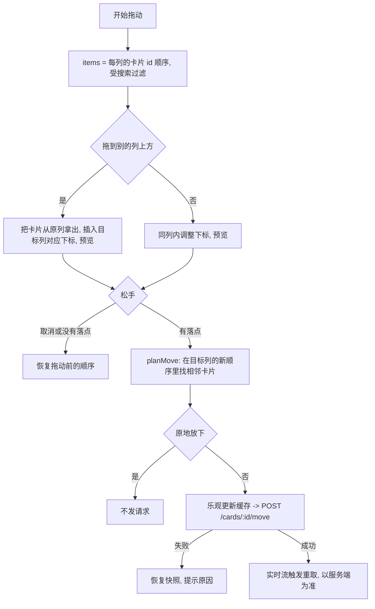
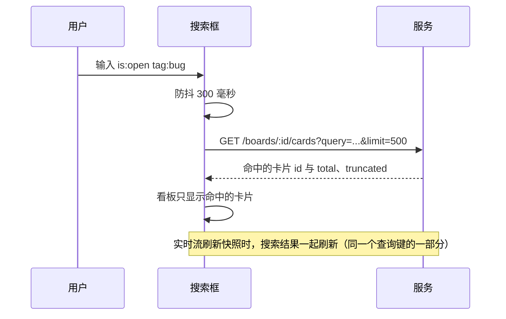

# 看板页面：看板列表、看板、卡片、搜索、活动流

## 需求目标

人在网页上看到整块看板，拖卡片、写卡片、留评论，别人（包括 agent）改了马上看到。
看板上要一眼看出三件事：哪些列是 agent 会去领卡的（"AI 列"）、哪些卡正被哪个 agent 处理、哪些卡被依赖卡住或必须由人来做。
这份文档讲页面行为和前端自己的算法；接口见 `api.rest.go.md`，登录、实时流、多语言等公共部分见 `web.app.md`。

## 问题场景

| 编号 | 问题场景 | 不解决的后果 | 解决方案 | 状态 |
|------|----------|-------------|---------|------|
| 1 | 拖卡片要立刻动，还要能跨列、同列调序、拖进空列 | 拖完要等接口返回才动，手感差；空列没法放卡 | 用 dnd-kit 的多容器排序：每一列是一个可放置的容器，列里是可排序的卡片；拖动中实时预览落点；松手后按落点算出 `before_id` 或 `after_id` 再调用移动接口，并立刻乐观更新缓存 | 实施 |
| 2 | 拖到哪里算哪里，要算出服务端认的相对位置 | 位置算错，刷新后卡片跳到别处 | 抽成纯函数 `planMove`：只看目标列拖完之后的 id 顺序——后面有卡就用 `before_id`，否则前面有卡就用 `after_id`，空列只带 `column_id`；原地放下（列和相邻卡都没变）返回空，不发请求 | 实施 |
| 3 | 乐观更新的位置和服务端算的不一致 | 松手后卡片闪一下 | 乐观位置用和服务端同样的规则（相邻两张取中点，列头列尾各加减 1024）；接口成功后实时流会触发重取，以服务端为准；失败则恢复拖之前的快照并提示原因 | 实施 |
| 4 | 点一下卡片和拖一下卡片要分得开 | 手一抖就变成拖动，或者点不开 | 鼠标要移动 6 像素才算拖动；触屏要按住 200 毫秒；键盘用空格拿起、方向键移动、空格放下，Esc 取消，并且读屏提示用当前语言 | 实施 |
| 5 | 卡片太多找不到 | 只能肉眼翻 | 工具栏的搜索框用和 agent 一样的筛选语法（服务端解析），300 毫秒防抖；有关键字时看板只显示命中的卡片，显示"命中 n / 共 m"；语法错误在搜索框下面写出服务端指出的词；旁边有语法说明；按 `/` 聚焦搜索框 | 实施 |
| 6 | 一眼看出卡片的状态 | 要点开才知道谁在处理、被什么卡住 | 卡片上显示：编号（等宽字体）、标题、优先级色条、前 3 个标签（多的折成 +n）、截止日期（逾期且未完成标红）、"仅人工"锁图标、"等待依赖"图标、被 agent 领取时显示 agent 名加呼吸圆点；完成列里的卡片整体变淡；AI 列的列头有"AI"标记，列说明放在悬停提示里 | 实施 |
| 7 | 在卡片弹窗里改字段，别人同时也在改 | 静默覆盖别人的改动 | 每次修改都带上打开时读到的 `version`；服务端返回版本冲突时，提示"这张卡刚被别人改过"，并重新读取最新内容，用户的输入不丢失（保留在输入框里，由用户决定是否再提交） | 实施 |
| 8 | 卡片描述很长，修改要有保存和放弃 | 失焦就自动保存，写到一半的描述被存进去 | 标题、优先级、所在列、标签、时间、依赖、分支、链接等短字段改完立即保存；描述用"编辑/保存/取消"，支持预览 Markdown；`Ctrl/Cmd + Enter` 保存评论和描述 | 实施 |
| 9 | agent 的评论和描述里常带 Markdown | 原样显示难读 | 描述和评论用 Markdown 渲染，不解析原始 HTML，链接只放行 http、https、mailto（做法见 `web.app.md` 第 9 条） | 实施 |
| 10 | 想知道谁在什么时候动了什么 | 出了问题没法追溯，也看不出 agent 在干什么 | 活动抽屉：按时间倒序列出事件，每条是"谁做了什么"加相对时间；新事件实时插到最前面；"加载更多"往更早翻。需要后端新增一个"最新事件"接口（见下文"活动流"） | 实施 |
| 11 | 看板被别人删除时页面还开着 | 一直转圈或者报一堆错 | 实时流收到 404 就提示"看板已不存在"并回到看板列表 | 实施 |
| 12 | 看板很宽、手机很窄 | 横向看不全，误触 | 列容器横向滚动，窄屏每列接近整屏宽并按列吸附；弹窗在窄屏占满宽度 | 实施 |
| 13 | 卡片弹窗要能分享给同事 | 复制链接只能到看板，找不到卡片 | 卡片弹窗的状态放在地址的 `?card=编号` 里，刷新、分享、浏览器返回都正常；卡片不存在时去掉参数并提示 | 实施 |
| 14 | 创建看板的参数多 | 新手面对空看板不知道怎么开始 | 创建对话框：名称（必填）、编号前缀（选填，不填服务端按名称生成）、说明、项目路径（选填）、模板三选一（研发流程、简单三列、空白）；语言取当前界面语言，起步的列和规则就是这种语言 | 实施 |

## 页面结构

```mermaid
flowchart TB
    subgraph 看板页 /b/:id
        T[工具栏: 看板名 编号 | 搜索框 | 活动 | 接入 agent | 设置 | 连接状态点]
        subgraph 画布 可横向滚动
            C1[列: 名称 数量 AI标记 / 卡片 卡片 ... / 添加卡片]
            C2[列 ...]
            C3[添加列 来自设置页的入口]
        end
    end
    D[卡片弹窗 ?card=编号]
    A[活动抽屉]
    T --> A
    C1 --> D
```

一列的头部：列名、卡片数、`AI` 小标签（`agent_pickup` 为真）、完成标记（`is_done` 为真）；列底部是"添加卡片"：点开后是一个多行输入，
`Enter` 添加、`Shift + Enter` 换行、`Esc` 取消；连续添加时输入框保持打开。

## 拖拽算法



纯函数的约定（`features/board/dnd.ts`）：

| 函数 | 输入 | 输出 |
|------|------|------|
| `buildItems(columns, cards, visibleIds)` | 列、卡片、可见的卡片 id 集合（null 表示全部可见） | 每列一个 id 数组，按位置排序，位置相同按 id |
| `planMove(items, original, cardId)` | 拖完之后的顺序、拖之前的顺序、被拖的卡片 | `{columnId, beforeId?, afterId?}`，没变化返回 null |
| `applyMoveToSnapshot(snapshot, cardId, plan)` | 缓存里的快照 | 新快照：卡片换列（列名、完成状态）、清掉领取、位置按中点规则计算 |
| `computePosition(prev, next)` | 前一张和后一张的位置，可缺省 | 和服务端 `positionBetween` 一致 |

## 卡片弹窗

- 头部：编号、所在列选择器（换列走移动接口，和拖拽共用同一套规则和乐观更新）。
- 领取横幅：被 agent 领取且租约有效时显示"agent 名 + 租约到期时间"，旁边有"收回"按钮（人才能点，服务端校验）。
- 字段：标题、优先级、标签、截止、开始、完成时间、仅人工开关、依赖（从本看板的其他卡片里选，已完成的灰显）、分支、链接。
- 列的 agent 指令：折叠显示"这一列 agent 怎么处理"，让人看得出是什么在驱动 agent。
- 描述：Markdown，编辑、预览、保存、取消。
- 评论：时间正序，作者带"人/agent/系统"标记；输入框 `Ctrl/Cmd + Enter` 发送；人可以删除评论。
- 底部：创建、更新时间和操作者；删除卡片（需要二次确认）。
- 版本冲突：见问题场景第 7 条。

## 搜索



语法说明弹窗列出 `tag:`、`col:`、`priority:`、`is:`、`has:`、`due:` 等常用写法，每条带一个可点击的示例，点一下填进搜索框。
说明文字是界面文案（五种语言），语法本身是服务端定义的，不翻译。

## 活动流

后端现有的 `GET /boards/:id/events?after=` 只能从某个序号往后读。事件序号是所有看板共用的，
所以"取这块看板最近 50 条"没法用序号推算，必须新增接口：

`GET /api/v1/boards/:id/activity?before=<序号>&limit=<条数>`

- `before` 为 0 或不填表示从最新开始；否则返回序号小于 `before` 的事件。
- 按序号倒序返回，`limit` 默认 50、最大 200；`has_more` 表示更早还有事件。
- 人和 agent 都能读（和现有事件接口一致）；看板不存在返回 404。

网页第一次打开抽屉取最新一页；之后实时流收到的事件直接插到最前面（用事件序号去重）；点"加载更多"带上最后一条的序号继续往前翻。
每条事件按类型拼成一句话：`activity.<事件类型>` 一个键对应一种事件，占位符取自事件载荷（字段见 `kanban.event.go.md`），
没有对应键的未知类型显示事件类型名，保证以后服务端加了新事件网页也不会空白。

## 多语言文案分组

| 分组 | 内容 |
|------|------|
| `boards` | 看板列表、创建看板对话框、模板名称 |
| `board` | 工具栏、列、卡片上的标记、添加卡片、空状态、拖拽的读屏提示 |
| `search` | 搜索框、语法说明、结果统计 |
| `card` | 卡片弹窗的所有标签、按钮、确认文字、版本冲突提示 |
| `activity` | 抽屉标题、每种事件的句子、加载更多、空状态 |

## 目录规划

| 路径 | 内容 |
|------|------|
| `web/src/features/boards/` | `BoardListPage.tsx`、`CreateBoardDialog.tsx` |
| `web/src/features/board/` | `BoardPage.tsx`、`Toolbar.tsx`、`Column.tsx`、`CardTile.tsx`、`AddCard.tsx`、`SearchBox.tsx`、`dnd.ts`、`useBoard.ts`（快照查询与派生数据）、`useBoardLive.ts`（实时流）、`useMoveCard.ts`（乐观移动） |
| `web/src/features/card/` | `CardDialog.tsx`、`CardFields.tsx`、`DescriptionEditor.tsx`、`Comments.tsx`、`DependencyPicker.tsx`、`Markdown.tsx` |
| `web/src/features/activity/` | `ActivitySheet.tsx`、`eventText.ts` |

## 验证计划

| 内容 | 怎么验证 |
|------|----------|
| `planMove`、`computePosition`、`buildItems`、`applyMoveToSnapshot` | vitest 单元测试 + 变异验证：跨列、同列上移下移、拖进空列、拖到列尾、原地放下、搜索过滤时的相邻卡片 |
| 实时流钩子 | vitest：事件合并刷新、reset 后重取并重连、401 清令牌、404 回列表、卸载时断开 |
| 卡片弹窗 | Testing Library：修改字段带 `version`、版本冲突提示、描述保存取消、评论发送、删除二次确认 |
| Markdown | 测试：`<script>`、`javascript:` 链接、原始 HTML 不会被渲染 |
| 活动事件文案 | 测试：每种服务端事件类型都有句子，占位符齐全；未知类型有兜底 |
| 整体 | 起临时服务，用浏览器真实拖拽卡片、搜索、开关弹窗，并检查浅色、深色、窄屏、五种语言的截图 |

## 限制

- 一块看板的全部卡片都会渲染，没有虚拟滚动；几百张卡片内流畅，几千张会变慢（需要分页接口才能解决）。
- 拖拽预览不预测自动化规则的副作用（比如进入某列自动写开始时间），要等服务端结果回来才看到。
- 搜索结果最多取 500 张，超过时显示"仅显示前 500 张"。
- 服务端校验失败的具体原因是中文（见 `web.app.md`），其他语言只有通用提示加这句中文原因。
