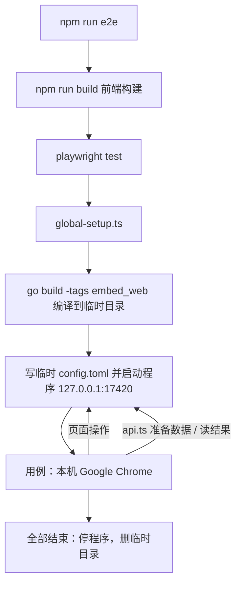

# 浏览器端到端冒烟测试（Playwright）

## 需求目标

前端原来只有 jsdom 里的单元和集成测试。拖动、实时同步、布局这些要真浏览器才能验证的东西，靠人在浏览器里点。
现在加一套用真实 Chrome 操作真实服务的冒烟用例，一条命令就能跑完：

```bash
make web/e2e          # 在仓库根目录
# 或者
cd web && npm run e2e
```

覆盖八块：新建项目、拖动卡片、搜索和筛选、规则触发、两个窗口的实时同步、五种语言切换，以及卡片弹窗（两栏布局、在评论框粘贴图片、占位提示排版）和导出。

## 问题场景

| 编号 | 问题场景 | 不解决的后果 | 解决方案 | 状态 |
|------|----------|-------------|---------|------|
| 1 | jsdom 里没有真实的鼠标和布局 | 拖动、窄边落点这类问题单元测试看不见，上线后才发现 | 用真实 Chrome 和真实鼠标事件拖动卡片 | 实施 |
| 2 | 测试要有一个能跑的服务 | 每次手动启动、清数据，容易碰到真实数据 | 每次运行前自动编译带前端的程序，在系统临时目录里用全新的数据库启动，跑完停掉并删除临时目录；不碰 `~/.slate-kanban`，也不占 7070 端口 | 实施 |
| 3 | 用例之间互相影响 | 一个用例失败带倒后面一串，或者靠运行顺序才通过 | 每个用例自己通过 REST 接口新建项目（卡片编号前缀随机），不读别人的数据 | 实施 |
| 4 | 测试服务的端口被占用 | 悄悄连到别的服务上，测错对象 | 启动前先检查端口，已经有服务就直接报错；端口可用环境变量 `E2E_PORT` 改，取值必须是 1024 到 65535 的整数，写错立刻报错 | 实施 |
| 5 | 用例失败后不知道发生了什么 | 只能重新跑、靠猜 | 失败时保存截图和 trace（放在 `web/e2e/.results`，已加入 gitignore） | 实施 |
| 6 | 前端改了但测试跑的是旧构建 | 测试通过，实际代码已经坏了 | `npm run e2e` 先 `npm run build`（含体积预算检查）再跑用例，程序里嵌入的永远是当前代码 | 实施 |

## 结构



## 运行要求和约定

| 项 | 说明 |
|----|------|
| 浏览器 | 本机已装的 Google Chrome（配置里 `channel: 'chrome'`），不用额外下载；没装就运行 `npx playwright install chrome` |
| 端口 | 默认 17420，监听 `127.0.0.1`；用 `E2E_PORT` 改 |
| 单跑一个文件 | 先 `npm run build`，再 `cd web && npx playwright test e2e/drag.e2e.ts` |
| 并发 | 单个 worker 串行，不自动重试；超时 30 秒，断言默认等 7 秒 |
| 语言 | 浏览器语言固定为 `en-US`，所以用例里的按钮文字是英文；语言切换那条用例直接引用 `src/i18n/locales`，翻译改了不用跟着改 |
| 文件后缀 | 用例叫 `*.e2e.ts`，避免被 vitest 当单元测试；`env.test.ts` 是给端口读取函数写的单元测试，由 vitest 运行 |
| 类型检查 | `tsconfig.e2e.json` 管 `e2e/` 和 `playwright.config.ts`，`npm run typecheck` 会一起检查 |
| 临时目录 | 全局准备在系统临时目录里建 `slate-e2e-XXXX`，里面有编译出的程序、配置、数据库和日志，结束时只删它自己建的这个目录 |

## 用例清单

| 文件 | 用例 | 验证什么 |
|------|------|----------|
| `project.e2e.ts` | 研发流程模板 | 点「New project」，填名称和卡片前缀，进到新项目能看到五列（默认收起的「完成」点开后可见），回到列表也有它 |
| | 空白模板 | 关掉模板开关，创建后是「No columns yet」 |
| | 名称为空 | 不能提交，对话框保持打开并提示「Enter a name.」 |
| `drag.e2e.ts` | 跨列拖动 | 当场换列；服务端的 `column_id` 变了；刷新后还在 |
| | 同列换序 | 把第三张拖到第一张上半部分，顺序变成 3、1、2；刷新后不变 |
| | 拖进收起的「完成」窄边 | 窄边计数从 0 变 1，服务端换列；刷新后展开，卡片在里面 |
| `search.e2e.ts` | 搜索框 | 关键字、`tag:bug` 语法、没有结果、清空；每一步卡片和「n / 3」随之变化 |
| | 筛选弹层 | 点选标签和优先级；条件显示在工具栏下面；一键清除后卡片全部回来 |
| `rules.e2e.ts` | 规则触发 | 卡片拖进「进行中」，磁贴上出现自动加的标签，服务端有记录；卡片里有「System」留的言 |
| | 停用的规则 | 卡片进了列，但没有标签 |
| `realtime.e2e.ts` | 两个窗口 | 窗口 A 里新建卡片，窗口 B 不刷新就能看到；用接口（代替 agent）建卡片、换列，两个窗口都跟着变 |
| `language.e2e.ts` | 五种语言 | 逐个切换：标题、按钮文字、`<html lang>` 都对；最后停在韩文，刷新后还是韩文；进到看板页，那里的文字也是韩文 |

## 写用例时要注意的地方

- 准备数据用 `api.ts`（直接调 REST），界面上要验证的那一步才走界面，别每个用例都从头点。
- 拖动用 `board.ts` 里的 `dragTo`：真实鼠标按下，先走出传感器要求的 6 像素，再分段移到目标，最后松手。同列换序要传 `offsetY`，落在目标的上半部分。
- dnd-kit 在松手后的约 50 毫秒里会吞掉点击（防止拖完误点）。真人点不了这么快，脚本可以，所以拖完以后先刷新页面或先等界面状态变化，再点。
- 断言服务端的结果用 `expect.poll`，因为界面上的乐观更新比请求先完成。
- 找「完成」窄边：它是一个名字以 `Expand` 开头、带列名和卡片数的按钮（`railOf`）。

## 这套测试发现并修掉的两个真实问题

| 问题 | 原因 | 修复和防回归 |
|------|------|-------------|
| 同一列里把卡片往上拖，卡片被丢到列尾或原地不动 | 卡片编号和列编号都是数据库自增的数字，常常相同（比如 3 号卡片和 3 号列）；dnd-kit 按编号登记落点，同号的两个互相顶掉，卡片的落点失效 | 列的落点编号改成 `column-<id>` 字符串（`dnd.ts` 的 `columnDropId`）；`ColumnView.test.tsx` 检查三个落点编号互不相同；`drag.e2e.ts` 的同列换序用例 |
| 卡片拖不进收起的「完成」窄边 | 默认的碰撞检测 `closestCorners` 比的是矩形四个角的距离，又窄又高的窄边永远比旁边的卡片远，选不中 | 新增 `collision.ts` 的 `boardCollision`：指针落在收起的窄边上就直接选它，其余情况仍用 `closestCorners`；键盘拖动没有指针，照旧；`collision.test.ts` 用真实坐标覆盖；`drag.e2e.ts` 的窄边用例 |

## v1 明确不做

| 项 | 说明 |
|----|------|
| 触摸屏拖动、键盘拖动 | 传感器的行为在单元测试里验证过，真机手势不在冒烟范围 |
| 离线和 Service Worker | 在 `src/pwa` 的单元测试里验证，浏览器里的安装和离线要人工试 |
| 口令登录、列表视图、活动抽屉、设置页 | 冒烟只覆盖最常用的六块，这些有各自的集成测试；以后哪块出了问题再补用例 |
| 多浏览器 | 只用 Chrome，Firefox 和 Safari 不在范围 |
| 接入 CI | 仓库还没有 CI；接入时记得先装 Chrome，再运行 `make web/e2e` |

## 验证计划

| 内容 | 怎么验证 |
|------|----------|
| 全部用例 | `npm run e2e`，24 条用例，一次约 1 分钟 |
| 用例能抓出问题 | 变异检查：把产品代码改坏一处，只跑相关用例，必须变红，然后立刻还原。共 15 处，全部被抓到：拖动落点编号撞车、窄边碰撞检测、拖动不提交、搜索忽略关键字或筛选条件、实时刷新失效、语言不保存或不改 `<html lang>`、新建项目忽略模板或不跳转或不校验名称、服务端规则的加标签、停用开关、进入列触发，以及服务端的标签过滤 |
| 端口读取 | `env.test.ts`：默认值、边界值、小数、科学计数法、空白、全角数字、超长输入；对 5 处改坏都能变红 |
| 类型和代码检查 | `tsc -b`、`oxlint` |
| 体积 | 测试代码不进前端产物；`npm run build` 的预算检查不变 |
