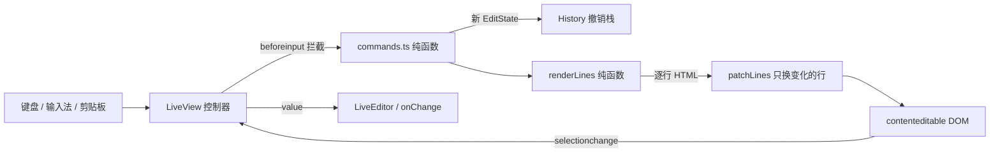

# 实时渲染 Markdown 编辑器

## 需求目标

卡片描述和评论的 Markdown 要「输入即渲染」：写 `**粗体**` 时，光标离开后星号收起、文字变粗，光标回到这段文字时记号又显示出来，手感对齐 Typora。同时支持常用快捷键（Ctrl/Cmd+B 加粗、Ctrl/Cmd+U 下划线等）。

说明：Typora 是闭源软件，没有源码可参考，这里只对齐它的**交互行为**；实现是自己写的。

## 问题场景

| 编号 | 问题场景 | 不解决的后果 | 解决方案 | 状态 |
|------|----------|-------------|---------|------|
| 1 | 写 Markdown 要来回切预览 | 排版效果看不到，写错了才发现 | 编辑区本身就渲染：标题变大、粗体变粗、列表有圆点；记号只在光标所在的那一段显示 | 实施 |
| 2 | 富文本编辑器（Tiptap、Lexical 等）体积大，且会把原文改写成它自己的格式 | 前端预算（首屏 130 kB、整包 320 kB）放不下；agent 写进去的 Markdown 原文被改样 | 不用富文本库。**Markdown 原文是唯一的数据**，编辑区只是原文的「带装饰的显示」；保存的就是原文，读回来一字不差 | 实施 |
| 3 | 光标位置、撤销、输入法、手机键盘在 contenteditable 里很容易出错 | 丢字、光标乱跳、中文输入候选框被打断 | 所有非输入法的输入都在 `beforeinput` 里拦截，改成对原文的纯函数命令，再整段重画；输入法组合期间不动 DOM，结束后再同步 | 实施 |
| 4 | 常用快捷键 | 只能点按钮 | Ctrl 与 Cmd 等价（Mac 和 Windows 手感一致）；工具栏的帮助气泡里有完整表 | 实施 |
| 5 | 手机、平板上用 | 工具栏挤出屏幕、按钮太小、键盘缩放页面 | 工具栏单行横向滚动，触屏上按钮 40px，触屏上正文 16px（避免 iOS 聚焦缩放） | 实施 |
| 6 | 想贴截图，只能先传到别处再贴链接 | 流程断掉；链接失效图就没了 | 复制图片后在编辑区粘贴：自动上传到当前看板，传完在光标处插入 ``，渲染时直接显示图片 | 实施 |

## 架构

- **状态**：`EditState { value, anchor, head }`，`value` 是 Markdown 原文，光标用原文下标表示。
- **一行一个 `div.md-line`**，它的 `textContent` 恒等于对应的原文行；记号（`**`、`#`、`- ` 等）是真实文本，放在 `md-mk` 里，光标不在这一段时加 `md-hide`（`display:none`）。所以任何时刻 `读 DOM 文本 == 原文`。
- 列表缩进、项目符号、任务框所在的开头区域是「隐藏区」，用 CSS `::before` 画出圆点、序号和复选框；光标不会停在隐藏区里（`normalize` 会挪出来）。
- `renderLines(value, selection|null)` 是纯函数，可以直接单测；`patchLines` 只替换前后缀之外变化的中间几行，所以长文档输入不卡。
- 选区拖动期间不重画，松手后再重画，避免拖选被打断。
- 复制、剪切写出的是 Markdown 原文；粘贴一律按纯文本；选中文字时粘贴网址会变成链接；拖放被禁用。

## 共享的 Markdown 方言（`web/src/lib/md/`）

| 文件 | 作用 |
|------|------|
| `inline.ts` | 行内：粗体 `**`、斜体 `*`、删除线 `~~`、下划线 `<u>…</u>`、行内代码、链接，输出带位置的片段 |
| `blocks.ts` | 块级：标题、引用、有序/无序/任务列表（可嵌套，子级缩进 `CHILD_INDENT=2`）、代码块、分隔线 |
| `doc.ts` | 把原文拆成行并标出每行的块类型 |
| `commands.ts` | 编辑命令（纯函数）：切换加粗等行内格式、切换标题/列表/引用/代码块、回车续写列表、退格、缩进、插入文本、粘贴 |
| `history.ts` | 撤销栈：连续输入合并成一步，格式命令各自一步 |

只读渲染器 `web/src/lib/markdown.tsx` 用同一套解析，所以「编辑时看到的」和「保存后看到的」一致（删除线、下划线、嵌套列表、任务勾选都支持；任务勾选在只读视图里点一下就会立即保存）。

## 粘贴图片

- `LiveView` 的 `paste` 处理：剪贴板里**有文字就按文字粘贴**（从表格复制会同时带一张截图，用户要的是文字）；**只有图片文件**才触发 `onPasteImages`。
- `LiveEditor` 收到 `boardId` 才处理粘贴图片（描述和评论都传）。图片按顺序上传（`uploadAttachment`），每传完一张在当时的光标处 `insert('')`；上传期间编辑区下方显示「正在上传图片…」，失败弹统一的错误提示（太大、类型不对等），已经成功的不受影响。
- 解析：`lib/md/inline.ts` 的 `image` 节点，只有地址匹配 `/api/v1/attachments/<32 位小写十六进制>` 才成立，其余（外部地址、`javascript:`、编号格式不对）都保持文字，所以不会泄露访问者 IP，也没有脚本风险。
- 编辑器里：光标不在这段图片语法上时只显示图片（``，没有文字，所以「每行文字等于原文」依旧成立）；光标碰到时原文和图片都显示。只读渲染器里图片外面包一个新标签页打开的链接。
- 编辑区旁边的按钮（评论的发送）在 `mousedown` 时 `preventDefault`，不让编辑区失焦：失焦会把图片旁的原文收起，按钮被顶得移位，这次点击就落到别处了（e2e 抓到过）。
- 服务端见 `api.rest.go.md` 的「图片附件」。

## 快捷键

Ctrl 和 Cmd 都当作 Mod 键。

| 快捷键 | 作用 |
|--------|------|
| Mod+B / Mod+I / Mod+U | 粗体 / 斜体 / 下划线 |
| Mod+Shift+X | 删除线 |
| Mod+E | 行内代码 |
| Mod+K | 链接 |
| Mod+Alt+1…6 / Mod+Alt+0 | 一到六级标题 / 正文 |
| Mod+Shift+7 / 8 / 9 | 有序 / 无序 / 任务列表 |
| Mod+Shift+. | 引用 |
| Mod+Alt+C | 代码块 |
| Tab / Shift+Tab | 列表里缩进 / 取消缩进（不在列表里时不拦截，保留键盘焦点切换） |
| Mod+Z / Mod+Shift+Z / Mod+Y | 撤销 / 重做 |
| Mod+Enter | 提交（描述立即保存、评论发送） |
| Esc | 取消（仅在有取消回调时） |

用 `e.code` 判断，所以输入法和不同键盘布局下也一致。

## 输入法与移动端

- 组合输入期间不拦截、不重画；`compositionend` 后标记「待同步」并稍后同步，同时任何读取状态的地方先同步一次，所以紧跟着输入下一个字也不丢字。
- 其他未知的输入类型先让浏览器处理，`input` 事件里发现 DOM 与状态不一致就以 DOM 为准重新读一次。
- 窄屏：工具栏 `overflow-x-auto` 且隐藏滚动条，按钮触屏下放大到 40px，正文 16px。

## 已知限制

- 引用块里的列表按行内文字显示（渲染器会显示成嵌套列表），属于有意的简化。
- 不支持表格和 HTML；图片只认本服务的附件（见下文「粘贴图片」），外部图片地址一律当文字。
- 单段超长文本（上万字符）按行重画，仍然够用；没有做虚拟化。

## 体积

编辑器是懒加载块（`LazyEditor`）：JS 约 11 kB gzip、CSS 约 1 kB，只在点开描述编辑或评论框时才下载。首屏 JS 预算不变（130 kB），整包预算从 300 kB 放宽到 320 kB。

## 文件

| 路径 | 内容 |
|------|------|
| `web/src/features/editor/render.ts` | `renderLines` 纯函数 |
| `web/src/features/editor/dom.ts` | DOM 与原文下标的互相映射、`patchLines` |
| `web/src/features/editor/keymap.ts` | 快捷键表 `keyAction`、工具栏命令 `COMMANDS` |
| `web/src/features/editor/LiveView.ts` | 控制器（事件、撤销、输入法、复制粘贴、任务框点击） |
| `web/src/features/editor/LiveEditor.tsx` | React 外壳：工具栏（`toolbarOnFocus` 时只在有焦点时显示，评论框用）、标题/帮助气泡 |
| `web/src/features/editor/LazyEditor.tsx` | 懒加载包装 |
| `web/src/features/editor/editor.css` | 样式 |
| `web/src/features/card/DescriptionEditor.tsx` | 描述：点击进入编辑，失焦自动保存，Esc 放弃 |
| `web/src/features/card/CardTimeline.tsx` | 评论：紧凑版编辑器 |

## 验证

| 内容 | 怎么验证 |
|------|----------|
| 命令与方言 | `lib/md/*.test.ts`（含随机输入的性质测试：任意命令后原文与光标合法） |
| 渲染 | `render.test.ts`：每行 `textContent` 等于原文行；随机文档不变量 |
| 控制器 | `LiveView.test.ts`、`LiveEditor.test.tsx`、`DescriptionEditor.test.tsx` |
| 真实浏览器 | `web/e2e/editor.e2e.ts`：输入即渲染并保存原文、快捷键与撤销重做、列表 Tab/退格、输入法（CDP `Input.imeSetComposition`）、任务框点击、手机 390 宽无横向溢出且按钮够大 |
| 变异测试 | 对 `commands.ts` 做过逐点变异，存活的变异补了用例或证明等价 |
